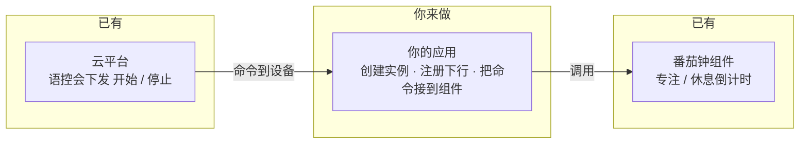

# 番茄时钟

> 来源：[灵机官方语雀 · 番茄时钟](https://xjiangiot.yuque.com/afahpl/qrhct7/acnxplbrn9lxfw3l)。原文内容更新时间：2026-10-28（UTC 日期）；整理日期：2026-10-29。
>
> 本文整理源页面的文字、表格、代码和可解析的流程图，保留官方示例口径；不代表本项目已采用或已验证。图示不在本地保存，未转录的图中文字、引脚位置和接线方向需回源核对。附件已有本地整理时链接到本地，其余保留源站链接，未下载、执行或展开。
>
> **项目适用性与原文差异：** 原文使用通用 QUMI 工程路径 `qumi/components/qm_pomodoro/`；本项目 SDK 组件位于 `qumios-dev/`，应用封装位于 `apps/main/lj_components/pomodoro/`，不能直接照抄路径。核对时 `CONFIG_QM_POMODORO_SUPPORT` 为 `0`，未在本任务中启用或验证该插件。

## 章节导航

- [一，插件介绍](#section-1)
- [插件功能](#section-2)
- [框图](#section-3)
- [二，使用方法（集成方法）](#section-4)
- [开始前：让组件真的编进工程](#section-5)
- [1，先让番茄钟走起来](#section-6)
- [2，把云端命令接到 start / stop](#section-7)
- [三，开启番茄钟后：禁闲聊，设备与云必须一起进、一起出](#section-8)
- [谁先进、谁先出，都用同一套命令](#section-9)
- [设备侧必须上报的时机](#section-10)
- [集成验收（专门防「一边退了」）](#section-11)
- [四，示例展示视频](#section-12)

<a id="section-1"></a>

## 一，插件介绍

<a id="section-2"></a>

### 插件功能

先介绍一下番茄时钟:

它由意大利人弗朗西斯科·西里洛在20世纪80年代末提出。他当时用了一个番茄形状的厨房定时器，所以叫“Pomodoro”（意大利语“番茄”）。

核心做法很简单：

1. **设定25分钟**，在这段时间里专注工作，不做无关的事。
2. 25分钟结束后，**休息5分钟**。
3. 每完成4个“番茄钟”，进行一次**较长的休息**，通常15—30分钟。
4. 然后继续循环。

〔图示见来源页面；未转录图中文字〕

**打开本插件，实际上打开的是智能体对设备上番茄钟的语控能力**，比如我对设备说 “打开番茄钟”，平台就会下发一条打开番茄钟的命令。

另外，QUMI库中已有现成的番茄钟组件，方便用户去开发本地的番茄时钟。

| 项目 | 内容 |
| --- | --- |
| 组件路径 | qumi/components/qm_pomodoro/ |

此组件完成了番茄钟的核心逻辑：专注 / 休息倒计时与阶段切换 。
**用户需要做的是将其集成到应用层中**。

<a id="section-3"></a>

### 框图



<a id="section-4"></a>

## 二，使用方法（集成方法）

目标：板上有一个番茄钟；说「打开番茄钟 / 关闭番茄钟」能 `start` / `stop`。

按顺序做：**先让钟走起来，再把云端命令接到** `qm_pomodoro_start/stop`**。**
下面步骤适用于任意已经能编译的 QUMI 工程，文件名、CMake 写法按你自己的工程改，不要照抄某一仓库的路径。

<a id="section-5"></a>

### 开始前：让组件真的编进工程

只改宏、不改编译列表时，很多工程**不会**自动编译 `qm_pomodoro.c`，链接阶段会报找不到 `qm_pomodoro_create`。三件事都要做：

**1）打开配置**

在工程的 `qm_config.h`里：

```c
#define CONFIG_QM_POMODORO_SUPPORT 1
```

如果工程走 Kconfig / menuconfig，则打开 `CONFIG_QM_POMODORO_SUPPORT`。该选项依赖 `QM_OS_TIMER_SUPPORT` 和 `QM_OS_MUTEX_SUPPORT`。

**2）把源文件和头文件编进项目**

把 `qm_pomodoro.c` 加进应用的源文件列表，把头文件目录加进 include。

---

<a id="section-6"></a>

#### **1，先让番茄钟走起来**

这一步不接云、不接语控。新建 `app_pomodoro.c`（或你习惯的名字），内容如下。在应用启动入口调用 `pomodoro_min_init()`——QUMI 工程里通常是 `qm_application_start()`，有的工程是 `app_main()` 之后的业务初始化函数。

```c
#include "qm_pomodoro.h"
#include "qm_log.h"

#define LOG_TAG "pomodoro"

static qm_pomodoro_t g_pomodoro;

static void on_pomodoro_event(qm_pomodoro_t t, const qm_pomodoro_event_data_t *e)
{
    (void)t;
    if (e == NULL) {
        return;
    }
    if (e->event == QM_POMODORO_EVENT_TICK) {
        QM_LOGI(LOG_TAG, "remain=%us", (unsigned)e->status.remaining_sec);
    }
}

void pomodoro_min_init(void)
{
    qm_pomodoro_config_t cfg = {0};

    cfg.focus_sec           = 25;   /* 演示用秒，正式产品改 1500 */
    cfg.short_break_sec     = 5;
    cfg.long_break_sec      = 10;
    cfg.long_break_interval = 2;
    cfg.event_cb            = on_pomodoro_event;

    g_pomodoro = qm_pomodoro_create(&cfg);
    if (g_pomodoro == NULL) {
        QM_LOGE(LOG_TAG, "create failed");
        return;
    }
    (void)qm_pomodoro_start(g_pomodoro);    /* 接语控后删掉这一行 */
}
```

启动入口里补一行（函数名以你工程为准）：

```c
void qm_application_start(void)
{
    /* … 原有初始化 … */
    pomodoro_min_init();
}
```

**验收：** 编译、烧录，串口按秒出现 `remain=24s`、`remain=23s` … 本地倒计时就通了。这一步还不能语控。

若链接报找不到 `qm_pomodoro_create`：回到「开始前」，确认 `.c` 已加入编译。若运行无日志：确认启动入口真的调用了 `pomodoro_min_init()`。

---

<a id="section-7"></a>

#### **2，把云端命令接到 start / stop**

语控前提：

- 设备已经配网，并能连上云（日志里能看到连云成功）。
- 产品在平台上已打开本番茄钟插件。
- 设备侧 IoT 已初始化，手里有 `iot_handle`（来自 `qm_iot_init()` 或你们工程保存的会话句柄）。

为了测语控，先删掉 `pomodoro_min_init()` 里最后那行 `qm_pomodoro_start()`，避免上电自己跑、和语音抢状态。

然后继续在我们刚刚创建的 `app_pomodoro.c` 里追加下行处理。说「打开番茄钟」时，回调里 `packet->data.pub.payload` 大致是：

```json
{"id":1,"method":"pomodoro","subMethod":"start"}
```

取出 `subMethod`，调用组件：

```c
#include "cJSON.h"
#include "qm_iot_api.h"
#include "qm_iot_mqtt.h"
#include <string.h>

static void handle_pomodoro_cloud_down(void *handle,
                                       const qm_iot_mqtt_recv_t *packet,
                                       void *userdata)
{
    cJSON *root;
    cJSON *sub;
    const char *subMethod;

    (void)handle;
    (void)userdata;
    if (packet == NULL || packet->type != QM_IOT_MQTTRECV_PUB ||
        packet->data.pub.payload == NULL) {
        return;
    }

    root = cJSON_ParseWithLength((const char *)packet->data.pub.payload,
                                 packet->data.pub.payload_len);
    if (root == NULL) {
        return;
    }

    sub = cJSON_GetObjectItem(root, "subMethod");
    subMethod = cJSON_IsString(sub) ? sub->valuestring : "";

    if (g_pomodoro != NULL && strcmp(subMethod, "start") == 0) {
        (void)qm_pomodoro_start(g_pomodoro);
    } else if (g_pomodoro != NULL && strcmp(subMethod, "stop") == 0) {
        (void)qm_pomodoro_stop(g_pomodoro);
    }

    cJSON_Delete(root);
}
```

在已有的 IoT 事件回调里，连云成功后再注册。事件名是 `QM_IOT_EVENT_CLOUD_CONN`。`iot_handle` 用你工程里保存的那个：

```c
case QM_IOT_EVENT_CLOUD_CONN:
    qm_iot_down_register(iot_handle, "pomodoro", handle_pomodoro_cloud_down, NULL);
    break;
```

第二个参数是 `"pomodoro"`，与平台下发的 `method` 一致。

**做完这一步，应该就可以：** 设备在线后说「打开番茄钟」，串口开始刷 `remain=`；说「关闭番茄钟」，倒计时停。如果不行，确定一下产品的智能体配置里有没有打开番茄时钟插件。
看起来已经能用了，但是，事情比这要复杂一点。。。

---

<a id="section-8"></a>

## 三，开启番茄钟后：禁闲聊，设备与云必须一起进、一起出

实际上插件打开后，**语控进入番茄时钟后，云端会记录打开番茄时钟这个状态，并且这个状态下不能闲聊，如果监测到别的对话，会返回固定的话**：`当前在番茄时钟，不允许聊天哦，请先说结束番茄闹钟`。只有**通过语控关闭番茄**或**本地发上报stop**离开这个状态，之后闲聊才能恢复正常。
因此导入了一个问题：如果设备只是本地退出了番茄时钟、云端没退，用户再说话会被平台当成还在番茄时钟状态，无法闲聊，继续播固定语音。反过来也一样：如果云端退了、设备没停，钟还在走。所以 **start / stop 必须双边对齐**。也就是说开发板本地进入和退出番茄时钟时，也应该向平台发送消息。

<a id="section-9"></a>

### 谁先进、谁先出，都用同一套命令

通道是 `device/up`（设备→平台）和 `device/down`（平台→设备）。报文形状与语控相同：

```json
{"method":"pomodoro","subMethod":"start","id":1301,"params":{"source":"cloud"}}
```

`subMethod`：`start` / `stop`。
`params.source`：云端发起 `"cloud"`，设备本地发起 `"local"`。
收到后回 `method` = 原 method + `Reply`（如 `pomodoroReply`），`subMethod`、`id` 原样带回，`code` 0 成功、1 失败。

| 动作 | 谁发起 | 通道 | 平台学习模式 | 设备时钟 |
| --- | --- | --- | --- | --- |
| 说「打开番茄钟」 | 平台 | down `start`（source=cloud） | 等设备 `pomodoroReply/start` 且 `code=0` 再进入 | `qm_pomodoro_start` |
| 按键 / 本地开钟 | 设备 | 本地 start **同时** up `start`（source=local） | 收到这条 up 后进入 | `qm_pomodoro_start` |
| 说「关闭番茄钟」 | 平台 | down `stop`（source=cloud） | 等 `pomodoroReply/stop` 且 `code=0` 再退出 | `qm_pomodoro_stop` |
| 按键 / 本地关钟 / 整轮结束 | 设备 | 本地 stop **同时** up `stop`（source=local） | 收到这条 up 后退出，不再拦闲聊 | `qm_pomodoro_stop` |
| 暂停 / 继续 | 任一侧 | pause / resume | **不变**，仍禁闲聊 | pause / resume |

本地 up 时 `params` 可写成 `{"source":"local"}`。平台若把这条再回环成 down，设备看到 `source=local` 只回 `code=0`，不要再执行一遍 start/stop。

<a id="section-10"></a>

### 设备侧必须上报的时机

本地调用 `qm_pomodoro_stop` 的每一处，都要再发一条 up，否则平台不知道已经退出：

1. 按键、旋钮、App 关钟
2. 语控在设备侧直接 stop（少见，一般等云 down）
3. 事件 `QM_POMODORO_EVENT_FINISHED`（目标个数跑完）
4. 产品如果把「关闭学习」做成单独按键：先 stop 钟，再 up `stop`

本地 `qm_pomodoro_start` 同理，必须 up `start`，否则板上在走钟、平台还能闲聊，两边状态反了。

示例（有 `iot_handle`、且已封装 up 时）：

```c
/* 本地开钟：先跑钟，再告诉平台进入学习模式 */
(void)qm_pomodoro_start(g_pomodoro);
(void)qm_iot_up_report_ex(iot_handle, "pomodoro", "start", 0,
                          "{\"source\":\"local\"}", 20);

/* 本地关钟 / FINISHED：先停钟，再告诉平台退出学习模式 */
(void)qm_pomodoro_stop(g_pomodoro);
(void)qm_iot_up_report_ex(iot_handle, "pomodoro", "stop", 0,
                          "{\"source\":\"local\"}", 20);
```

`event_cb` 里不要直接阻塞发 MQTT，把 stop+up 丢进自己的工作队列。

<a id="section-11"></a>

### 集成验收（专门防「一边退了」）

1. 语控打开 → 倒计时开始 → 再说闲话 → 听到固定语音，不能正常闲聊。
2. 说「退出学习模式」→ 钟停 → 再闲聊恢复正常。
3. **按键关钟**（不要说话）→ 平台也应退出学习模式：关钟后再对设备闲聊，**不能再**播固定语音。若还会播，就是本地 stop 了却没 up。
4. 按键开钟（不要说话）→ 再说闲话应被拦截。若还能闲聊，就是本地 start 了却没 up。
5. 暂停后再说话：仍应是固定语音；继续后也一样，直到 stop。

<a id="section-12"></a>

## 四，示例展示视频

原页视频：6FFBF9A7-A97C-4f2b-A833-3BD9E640C430(2).mp4。请从本文顶部的来源页面观看；本地未转录视频内容。

---

相关文档：[设备开发资料索引](../灵机设备开发资料索引.md) · [项目文档索引](../../README.md)。
