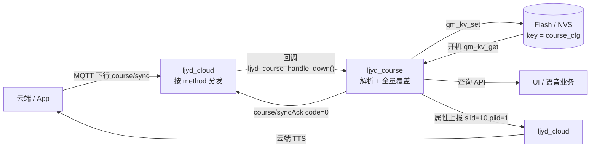
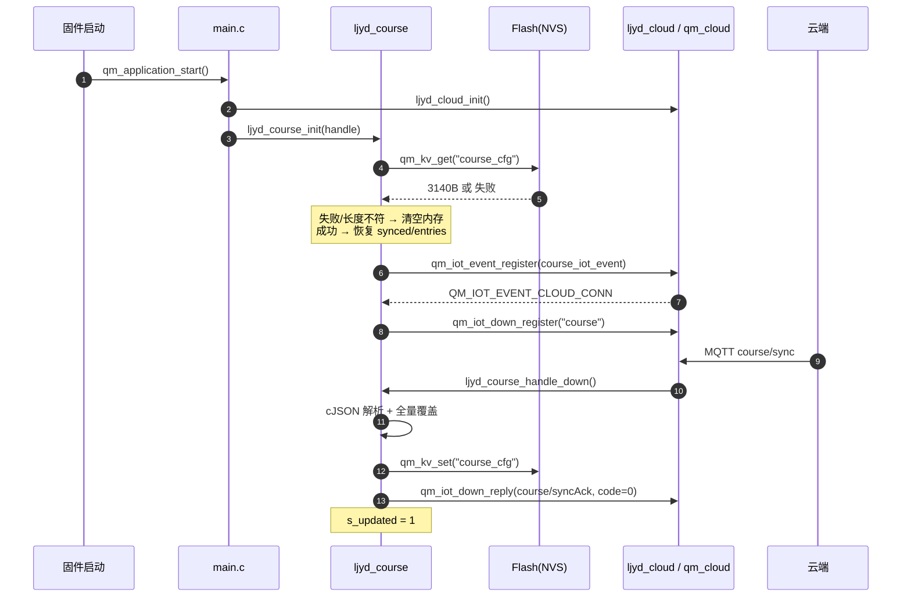

# 课程表

> 来源：[灵机官方语雀 · 课程表](https://xjiangiot.yuque.com/afahpl/qrhct7/cbemxr8hgmn241gt)。原文内容更新时间：2026-10-28（UTC 日期）；整理日期：2026-10-29。
>
> 本文整理源页面的文字、表格、代码和可解析的流程图，保留官方示例口径；不代表本项目已采用或已验证。图示不在本地保存，未转录的图中文字、引脚位置和接线方向需回源核对。附件已有本地整理时链接到本地，其余保留源站链接，未下载、执行或展开。
>
> **项目适用性与原文差异：** 本项目 SDK 存在 `apps/main/lj_components/course/`，以下初始化、云端同步与 API 说明来自源文档；本次未逐项验证实现、课表下发、晨间播报或实物行为。

## 章节导航

- [课程表（ljyd_course）开发使用说明](#section-1)
- [一、功能介绍](#section-2)
- [1.1 模块定位](#section-3)
- [1.2 模块框图](#section-4)
- [1.3 功能清单](#section-5)
- [1.4 数据模型与容量](#section-6)
- [二、使用说明](#section-7)
- [2.1 文件与编译接入](#section-8)
- [2.2 初始化：调用位置与顺序](#section-9)
- [2.3 云端协议](#section-10)
- [2.4 运行时流程图](#section-11)
- [2.5 查询 API 使用示例](#section-12)
- [2.6 恢复出厂 / 切换账号时清理](#section-13)
- [2.7 日志、调试与联调](#section-14)
- [2.8 常见问题（FAQ）](#section-15)

<a id="section-1"></a>

## 课程表（ljyd_course）开发使用说明

> 代码位置：`apps/main/lj_components/course/`
> 适用对象：需要做课表联调、UI 展示、晨间播报接入的开发者
> 依赖：`ljyd_cloud`（`qm_cloud`）、`qm_kv`、`qm_spec_api`、`cJSON`；**不依赖** `qm_course` 中间件

---

<a id="section-2"></a>

### 一、功能介绍

原页视频：课程表使用.MOV。请从本文顶部的来源页面观看；本地未转录视频内容。

课程表使用视频

<a id="section-3"></a>

#### 1.1 模块定位

课程表模块把“课表”做成一个**被动接收的本地数据库 + 查询接口**：

- 课表数据由**云端 / App 下发**（MQTT 下行 `course/sync`），端侧从不主动请求；
- 收到后**全量覆盖**内存中的课表并立即写入 Flash（NVS，key = `course_cfg`）；
- 对外只暴露查询类 API，供 UI / 语音业务读取；
- 恢复出厂时可一键清空。

<a id="section-4"></a>

#### 1.2 模块框图

```plain
┌───────────────┐        MQTT 下行: method=course, subMethod=sync        ┌─────────────────────────────┐
│  云端 / App   │ ─────────────────────────────────────────────────────▶ │  ljyd_cloud（qm_cloud 封装） │
│               │ ◀───────────────────────────────────────────────────── │  下行按 method 分发          │
└───────────────┘        MQTT 上行: subMethod=syncAck (code=0)           └──────────────┬──────────────┘
                                                                                         │ 回调
                                                                                         │ ljyd_course_handle_down()
                                                                                         ▼
                                                        ┌────────────────────────────────────────────────┐
                                                        │            ljyd_course（本模块）                │
                                                        │                                                │
                                                        │  ┌──────────────────────────────────────────┐  │
                                                        │  │ 1. cJSON_ParseWithLength 解析报文         │  │
                                                        │  │ 2. 校验 method / subMethod                │  │
                                                        │  │ 3. 提取 params[0].extensions.courses[]    │  │
                                                        │  │ 4. 逐条校验 weekday/period/subject        │  │
                                                        │  └───────────────┬──────────────────────────┘  │
                                                        │                  │ 全量覆盖 s_store             │
                                                        │  ┌───────────────▼──────────────────────────┐  │
                                                        │  │ qm_kv_set("course_cfg", 3140B)           │──┼──▶ Flash (NVS)
                                                        │  └───────────────┬──────────────────────────┘  │
                                                        │                  │ 开机 qm_kv_get 恢复          │
                                                        │  ┌───────────────▼──────────────────────────┐  │
                                                        │  │ 查询 API（纯内存，无锁、无 IO）            │  │
                                                        │  │  · ljyd_course_get_day_entries()          │  │
                                                        │  │  · ljyd_course_entry_count()              │  │
                                                        │  │  · ljyd_course_is_synced()                │  │
                                                        │  │  · ljyd_course_get_today_weekday()        │  │
                                                        │  │  · ljyd_course_take_update_flag()         │  │
                                                        │  └───────────────┬──────────────────────────┘  │
                                                        │                  │                             │
                                                        │  ┌───────────────▼──────────────────────────┐  │
                                                        │  │ ljyd_course_broadcast_today()            │  │
                                                        │  │ 属性上报 siid=10 / piid=1 = 今日周几       │  │
                                                        │  └───────────────┬──────────────────────────┘  │
                                                        └──────────────────┼─────────────────────────────┘
                                                                           │ qm_iot_property_report()
                                                                           ▼
                                                                   云端 TTS 播报当天课程
```

同一结构用 Mermaid 表示（GitHub / 支持 Mermaid 的 Gitee 页面可直接渲染）：



<a id="section-5"></a>

#### 1.3 功能清单

| # | 功能 | 实现入口 | 说明 |
| --- | --- | --- | --- |
| 1 | 开机恢复课表 | `ljyd_course_init()` → `ljyd_course_load()` | 从 `qm_kv` 读取 `course_cfg`，长度或 key 不匹配则清空 |
| 2 | 连云注册下行 | `qm_iot_event_register()` + `QM_IOT_EVENT_CLOUD_CONN` → `qm_iot_down_register("course")` | `ljyd_cloud` 的事件回调是单槽且被 `agent_app` 占用，本模块用多监听接口追加，互不影响；重连会重新挂订阅 |
| 3 | 全量同步 | `course/sync` | 解析 `params[0].extensions.courses[]`，**全量覆盖**，不做增量合并 |
| 4 | 同步应答 | `course/syncAck` | `qm_iot_down_reply()`，`code = 0`，无 payload |
| 5 | 本地查询 | `ljyd_course_get_day_entries()` 等 | 纯内存读取，按节次升序返回 |
| 6 | 更新通知 | `ljyd_course_take_update_flag()` | 同步成功后置位，读取即清除，供 UI 轮询 |
| 7 | 晨间播报 | `ljyd_course_broadcast_today()` | 上报 `siid=10 / piid=1`（数字 = 今日周几），由云端 TTS 播报 |
| 8 | 清空课表 | `ljyd_course_clear_configs()` | 清内存 + `qm_kv_del("course_cfg")`，可重复调用 |

<a id="section-6"></a>

#### 1.4 数据模型与容量

```c
typedef struct {
    uint8_t weekday;      /* 1~7，1 = 周一 */
    uint8_t period;       /* 节次，查询结果按此升序 */
    char    subject[32];  /* 科目名，UTF-8，超长截断 */
    char    textbook[64]; /* 教材名，可为空串 */
} ljyd_course_entry_t;    /* sizeof = 98 B */

typedef struct {                  /* Flash 中 course_cfg 的二进制布局 */
    uint8_t             synced;   /* 1 = 已同步 */
    uint16_t            entry_count;
    ljyd_course_entry_t entries[32];
} ljyd_course_store_t;            /* sizeof = 3140 B */
```

| 约束 | 值 | 说明 |
| --- | --- | --- |
| 条目上限 | `LJYD_COURSE_MAX_ENTRIES = 32` | 超出部分**静默丢弃**；与云端协议、Flash 格式绑定，改动前需评估旧固件兼容 |
| 科目名 | 31 字节 + `'\0'` | 按字节 `snprintf` 截断，云端应保证不超长（否则可能截断出半个 UTF-8 字符） |
| 教材名 | 63 字节 + `'\0'` | 可缺省（空串） |
| Flash 占用 | 3140 B / 单 key | key 固定 `course_cfg`，OTA 后可直接读旧固件写入的数据 |

---

<a id="section-7"></a>

### 二、使用说明

<a id="section-8"></a>

#### 2.1 文件与编译接入

| 文件 | 作用 |
| --- | --- |
| `ljyd_course.c` | 数据模型、Flash 持久化、`course/sync` 下行、`course/syncAck` 应答、查询 API、晨间播报 |
| `ljyd_course.h` | 对外 API 与常量（长度上限、KV key、method、TTS siid/piid） |
|  |  |
|  |  |

`apps/main/CMakeLists.txt` 中已包含（仅新增文件时才需要改动）：

```cmake
# SRCS 列表
"./lj_components/course/ljyd_course.c",

# INCLUDE_DIRS 列表
"./lj_components/course",
```

> 新增 `.c` 文件时需同时加入 `SRCS`，并确认依赖组件（`cJSON`、`qm_kv`、`qm_spec_api`）已在 `REQUIRES` 中。

<a id="section-9"></a>

#### 2.2 初始化：调用位置与顺序

```c
#include "ljyd_course.h"          /* main.c 第 14 行 */

void qm_application_start(void)
{
    ...
    if (ljyd_cloud_init() != QM_EOK) {          /* 必须先有云会话 */
        QM_LOGE("main", "ljyd_cloud_init failed");
        return;
    }
    if (iot_control_init(ljyd_cloud_get_handle()) != QM_EOK) { ... }
    if (ljyd_course_init(ljyd_cloud_get_handle()) != QM_EOK) {   /* 本模块 */
        QM_LOGE("main", "ljyd_course_init failed");
    }
    if (ljyd_provision_init() != QM_EOK) { ... }
    ...
}
```

关键点：

1. **必须在** `ljyd_cloud_init()` **之后**：需要 `ljyd_cloud_get_handle()` 返回有效 IoT 句柄；
2. 返回 `-QM_EINVAL` 表示句柄为 `NULL`；下行注册失败不致命（连云事件会重试），
   因此这里只打日志、不 `return`；
3. 重复调用安全：`s_loaded` / `s_event_registered` 阻止重复加载与重复注册；
4. 不要放在 `ljyd_cloud_init()` 之前，否则首次开机拿不到句柄，需等下一次连云事件才可能恢复。

<a id="section-10"></a>

#### 2.3 云端协议

##### 下行：`course/sync`

```json
{
  "id": 16873,
  "method": "course",
  "subMethod": "sync",
  "params": [
    {
      "extensions": {
        "courses": [
          { "weekday": 1, "period": 1, "subject": "语文", "textbook": "人教版必修一" },
          { "weekday": 1, "period": 2, "subject": "数学", "textbook": "" },
          { "weekday": 3, "period": 5, "subject": "物理", "textbook": "沪科版" }
        ]
      }
    }
  ]
}
```

| 字段 | 类型 | 必填 | 说明 |
| --- | --- | --- | --- |
| `id` | number | 建议 | 报文 id，原样回填到 `syncAck` |
| `method` | string | 是 | 固定 `"course"`，否则忽略 |
| `subMethod` | string | 是 | 固定 `"sync"`，否则忽略 |
| `params[0].extensions.courses[]` | array | 是 | 课程数组，**全量**覆盖本地课表 |
| `courses[].weekday` | number | 是 | 1~7，1 = 周一 |
| `courses[].period` | number | 是 | 节次，查询时按此升序 |
| `courses[].subject` | string | 是 | 科目名，≤ 31 字节 |
| `courses[].textbook` | string | 否 | 教材名，≤ 63 字节 |

解析规则（`ljyd_course_parse_courses()`）：

- 缺 `weekday` / `period` / `subject` 或类型不符的条目**跳过**，其余条目照常生效；
- 超过 32 条的部分丢弃；
- `params` 不是非空数组、或无 `extensions.courses` 时按 0 条处理 → 本地课表被清空、
  `synced = 1`，并照常回 `syncAck`。云端要“清空课表”直接下发空数组即可；
- 解析缓冲区用 `qm_malloc`（约 3.1 KB）从堆分配，避免占用云任务栈。

##### 上行：`course/syncAck`

```c
qm_iot_down_req_t reply = {
    .method    = "course",
    .submethod = "syncAck",
    .msg_id    = <收到的 id>,
};
qm_iot_down_reply(handle, &reply, 0, NULL, 0);   /* code = 0，无 data */
```

- 只有**解析并落盘成功**才回 ack（`ljyd_course_apply_sync()` 返回 `QM_EOK`）；
- 落盘失败（`qm_kv_set` 出错）时不回 ack，云端可据此重试；
- method / subMethod 不符的报文既不处理也不回 ack。

<a id="section-11"></a>

#### 2.4 运行时流程图

##### 2.4.1 开机 → 连云 → 同步



##### 2.4.2 下行处理流程

```plain
收到 pub 报文
      │
      ▼
packet 类型/ payload 有效？ ──否──▶ 打 ERROR，返回（不回 ack）
      │是
      ▼
cJSON_ParseWithLength 成功？ ─否─▶ 打 ERROR，返回（不回 ack）
      │是
      ▼
method == "course" 且 subMethod == "sync"？ ──否──▶ 静默忽略，返回
      │是
      ▼
取 id（number，可缺省 → 0）
      │
      ▼
params[0].extensions.courses[] 存在且为数组？ ─否─▶ 按 0 条处理（清空课表）
      │是
      ▼
逐条遍历：weekday/period 是 number 且 subject 是 string？ ──否──▶ 跳过该条
      │是
      ▼
写入临时数组（上限 32）→ qm_malloc 缓冲区
      │
      ▼
apply_sync：清 s_store → 拷贝 → 逐条补 '\0' → synced=1 → qm_kv_set
      │
      ├─ 落盘失败 ──▶ 打 ERROR，**不回 ack**
      │
      ▼ 成功
回 course/syncAck（code=0, msg_id=id）→ s_updated = 1 → cJSON_Delete
```

##### 2.4.3 晨间播报判定流程

```plain
业务调用 ljyd_course_broadcast_today()
      │
      ▼
synced == 1 ？ ──否──▶ WARN "NOT synced, skip broadcast"
      │是
      ▼
云句柄有效 ？ ──否──▶ WARN "cloud not ready"
      │是
      ▼
本地年份 ≥ 2024 ？（ljyd_course_local_time_valid） ──否──▶ WARN "local time not synced"
      │是
      ▼
qm_localtime() 得到 tm_wday → 1~7（0 映射为 7）
      │
      ▼
属性上报：siid=10 / piid=1 / number=weekday（prop->did = qm_iot_did_get）
      │
      ▼
云端收到属性 → 触发 TTS 播报当天课程
```

<a id="section-12"></a>

#### 2.5 查询 API 使用示例

```c
#include "ljyd_course.h"

/* 1) 是否已同步过：0 时 UI 应显示“请先同步课表” */
if (!ljyd_course_is_synced()) {
    show_placeholder("课表未同步");
    return;
}

/* 2) 今日周几（1~7）。注意：未对时（1970）时返回的周几不可信 */
int today = 0;
if (ljyd_course_get_today_weekday(&today) == QM_EOK) {
    ljyd_course_entry_t buf[LJYD_COURSE_MAX_ENTRIES];
    int n = ljyd_course_get_day_entries(today, buf, LJYD_COURSE_MAX_ENTRIES);
    for (int i = 0; i < n; i++) {
        /* buf[i] 已按 period 升序 */
        printf("%u %s %s\n", buf[i].period, buf[i].subject, buf[i].textbook);
    }
}

/* 3) 全周条目数 */
uint16_t total = ljyd_course_entry_count();

/* 4) UI 轮询：读取并清除“课表已更新”标志 */
if (ljyd_course_take_update_flag()) {
    ui_timetable_invalidate();
}
```

| API | 返回 | 说明 |
| --- | --- | --- |
| `ljyd_course_init(void *iot_handle)` | `QM_EOK` / `-QM_EINVAL` | 开机调用一次；可重复调用 |
| `ljyd_course_is_synced(void)` | 1 / 0 | 是否收到过一次云端同步（含“清空”同步） |
| `ljyd_course_entry_count(void)` | 条目数 | 全部周几的总数 |
| `ljyd_course_get_day_entries(weekday, out, max)` | 写入条数 / `-QM_EINVAL` | 只返回指定周几，插入排序保证 `period` 升序 |
| `ljyd_course_get_today_weekday(&wd)` | `QM_EOK` / `-QM_EINIT` / `-QM_EINVAL` | `-QM_EINIT` = `qm_localtime()` 不可用 |
| `ljyd_course_take_update_flag(void)` | 1 / 0 | 读取即清除，适合 UI 轮询 |
| `ljyd_course_broadcast_today(void)` | void | 条件不满足时静默跳过，仅打日志 |
| `ljyd_course_clear_configs(void)` | void | 清内存 + 删除 `course_cfg`，未初始化时也可调用 |

> 查询 API 只读全局 `s_store`，无锁、无 Flash IO；但 `ljyd_course_init()` /
> 下行回调 / 播报路径会用到 `qm_kv`、`cJSON`、`printf`，**这些不要在中断上下文调用**。

<a id="section-13"></a>

#### 2.6 恢复出厂 / 切换账号时清理

⚠️ 现状核对（2026-10 代码）：`apps/main/cloud/ljyd_provision.c` 的
`ljyd_provision_clear_and_reboot()` 只清理了 `cloud/bind`、`cloud/env`、`wifi_cfg`，
**没有**删除 `course_cfg`。也就是说：配网复位 / 云端 RESET / GPIO 复位后，
课表仍会保留并继续上报。

需要“恢复出厂一并清空课表”时，在 `ljyd_provision.c` 中加入：

```c
#include "ljyd_course.h"

void ljyd_provision_clear_and_reboot(void)
{
    uint8_t bound = 0;

    ljyd_course_clear_configs();                 /* 清内存 + 删除 course_cfg */
    (void)qm_kv_set(PROVISION_KV_BIND, &bound, (int)sizeof(bound), 1);
    (void)qm_kv_del(PROVISION_KV_ENV);
    (void)qm_kv_del("wifi_cfg");
    qm_msleep(50);
    qm_reboot();
}
```

复位入口有两条，都会汇聚到该函数，因此只需改这一处：

```plain
云端 RESET  ──▶ ljyd_cloud.c: ljyd_provision_clear_and_reboot()
GPIO 长按复位 ──▶ bsp_io.c   : ljyd_provision_clear_and_reboot()
```

<a id="section-14"></a>

#### 2.7 日志、调试与联调

日志 TAG 固定为 `course`，抓串口时按它过滤：

```plain
I (12345) course: no valid flash data, key=course_cfg
I (12345) course: loaded: key=course_cfg synced=1 entries=12
I (12345) course: iot event listener registered
I (12345) course: down_register ret=0 (method=course)
I (12345) course: ******course_handle_down*******
I (12345) course: down recv: payload_len=312 payload={"id":16873,...}
I (12345) course: entry[0]: weekday=1 period=1 subject=语文 textbook=人教版必修一
I (12345) course: apply_sync: input=12 accepted=12
I (12345) course: saved: key=course_cfg synced=1 entries=12
I (12345) course: ack sent: method=courseReply subMethod=syncAck id=16873 code=0 ret=0
I (12345) course: sync applied: synced=1 entries=12
```

自测步骤：

1. 烧录后看开机日志是否出现 `loaded:` 或 `no valid flash data`；
2. 等 `down_register ret=0`，说明 `course` 下行已注册；
3. 用云端 / 脚本下发一条 `course/sync`，确认日志出现 `entry[...]`、`saved:`、`ack sent:`；
4. 断电重启，确认 `loaded: ... entries=N` 与下发条数一致（Flash 生效）；
5. 让上位机发空数组 `"courses": []`，确认 `entries=0` 且 `synced=1`（清空语义）；
6. 发一条缺 `subject` 的条目，确认该条被跳过、其余条目正常落盘。

<a id="section-15"></a>

#### 2.8 常见问题（FAQ）

| 现象 | 原因 / 处理 |
| --- | --- |
| `is_synced()` 一直是 0 | 从未收到合法 `course/sync`；检查 `down_register ret`、method/subMethod 拼写、`params[0].extensions.courses` 层级 |
| 下发后没收到 ack | 报文被忽略（method/subMethod 不符、JSON 非法）或 `qm_kv_set` 失败；看 `apply failed` / `save failed` 日志 |
| 课表“莫名其妙被清空” | 云端下发了空数组或缺失 `courses` 字段，模块按全量覆盖语义清空。云端下发前请确认 payload 完整 |
| 重启后课表回到上一版 | 下发成功但 `saved:` 日志报错（NVS 空间不足 / 分区异常）；检查分区表与 NVS 占用 |
| 周几不对 | 未对时（1970 年）。播报已拦截；UI 展示请先接入 SNTP 或使用云端下发的日期 |
| 重连后收不到课表 | 本模块在 `QM_IOT_EVENT_CLOUD_CONN` 里重新 `qm_iot_down_register`；若自行改动事件注册逻辑，注意不要覆盖 `ljyd_cloud` 的单槽回调 |
| 条目数少于云端 | 超过 32 条被截断；或其中有条目缺 `weekday/period/subject` 被跳过 |
| 中文科目被截断成乱码 | `subject` 按字节截断（31 B ≈ 10 个汉字）；云端应限制长度，必要时缩短科目名 |
| 能否主动拉取课表 | 不能，端侧是纯被动接收端（设计如此，避免与云端同步策略冲突） |

---

相关文档：[设备开发资料索引](../灵机设备开发资料索引.md) · [项目文档索引](../../README.md)。
