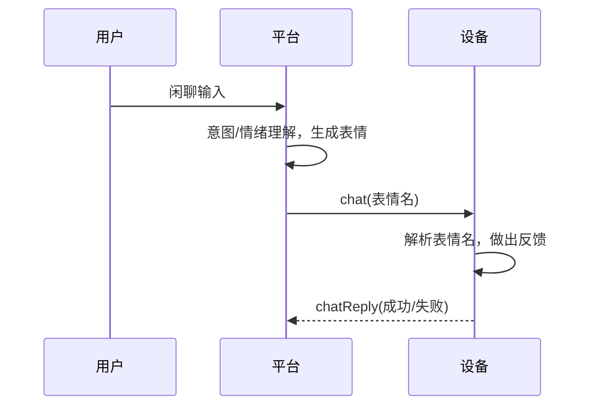

# 闲聊表情

> 来源：[灵机官方语雀 · 闲聊表情](https://xjiangiot.yuque.com/afahpl/qrhct7/eatgfcc2hyttdgw9)。原文内容更新时间：2026-10-26（UTC 日期）；整理日期：2026-10-29。
>
> 本文整理源页面的文字、表格、代码和可解析的流程图，保留官方示例口径；不代表本项目已采用或已验证。图示不在本地保存，未转录的图中文字、引脚位置和接线方向需回源核对。附件已有本地整理时链接到本地，其余保留源站链接，未下载、执行或展开。

## 闲聊表情能力说明

闲聊对话中，云平台选定表情下发到设备，设备据此做出反馈并回执。

### 1. 概述

闲聊表情是设备在闲聊对话中展示情绪的能力。平台先理解用户的意图和情绪，据此选定一个表情，通过指令下发；设备收到后据此做出反馈（如显示 emoji、执行动作），并回执确认。

该能力用于闲聊陪伴类设备，在语音对话之外补充表情反馈。表情共 21 种（见第 4 节），覆盖正向、中性、负向三类情绪。

两端分工：

- 云平台：选定表情、下发指令。
- 设备：接收指令、做出反馈、回执。

### 2. 工作流程

1. 用户与设备闲聊。
2. 平台对用户输入做意图和情绪理解，据此选定一个表情。
3. 平台把表情名（如 `happy`）连同 `chat` 指令下发到设备。
4. 设备收到后，把表情名转成标准表情编号，通知业务层。
5. 设备业务层根据表情做出反馈（如显示 emoji、执行动作）。
6. 设备自动回 `chatReply`，告知成功或失败。



### 3. 协议

> 本节供平台开发参考，产品 / 设备开发可跳过。

#### 3.1 平台下发

```json
{ "method": "chat", "id": 1101, "params": { "emotions": "happy" } }
```

| 字段 | 含义 |
| --- | --- |
| `method` | 固定 `chat` |
| `id` | 平台编号，回执时原样带回 |
| `params.emotions` | 表情名，见第 4 节 |

#### 3.2 设备回执

```json
{ "method": "chatReply", "id": 1101, "code": 0 }
```

| 字段 | 含义 |
| --- | --- |
| `id` | 与下发一致 |
| `code` | `0` 成功，`1` 失败（无表情名） |

表情名不识别时，设备按未知表情处理，仍回 `0`。

### 4. 表情映射表

21 个表情名，平台与设备共用：

| # | 表情名 | emoji | 含义 | 情绪 |
| --- | --- | --- | --- | --- |
| 1 | happy | 😊 | 开心 | 正向 |
| 2 | laughing | 😆 | 大笑 | 正向 |
| 3 | funny | 😂 | 笑哭 | 正向 |
| 4 | loving | 😍 | 花痴 / 爱慕 | 正向 |
| 5 | kissy | 😘 | 飞吻 | 正向 |
| 6 | cool | 😎 | 酷 | 正向 |
| 7 | confident | 😏 | 得意 / 坏笑 | 正向 |
| 8 | relaxed | 😌 | 放松 / 释然 | 正向 |
| 9 | delicious | 😋 | 美味 | 正向 |
| 10 | winking | 😉 | 眨眼 / 使眼色 | 正向 |
| 11 | silly | 🤪 | 搞怪 / 犯傻 | 正向 |
| 12 | thinking | 🤔 | 思考 | 中性 / 认知 |
| 13 | neutral | 😑 | 平淡 / 面无表情 | 中性 / 认知 |
| 14 | surprised | 😯 | 惊讶 | 中性 / 认知 |
| 15 | shocked | 😱 | 震惊 | 中性 / 认知 |
| 16 | confused | 😕 | 困惑 / 茫然 | 中性 / 认知 |
| 17 | sad | 😞 | 难过 | 负向 |
| 18 | crying | 😢 | 哭泣 | 负向 |
| 19 | angry | 😠 | 生气 | 负向 |
| 20 | embarrassed | 😳 | 尴尬 / 脸红 | 负向 |
| 21 | sleepy | 😴 | 困倦 | 负向 |

情绪分组：正向 11 个、中性 / 认知 5 个、负向 5 个。

### 5. 设备侧实现

设备固件内置闲聊表情模块；启用后，以下事项由模块自动完成，业务层无需处理：

- 接收 `chat` 指令。
- 表情名转标准编号（`qm_agent_expression_t`）。
- 通过 `QM_AGENT_EVENT_EXPRESSION` 事件通知业务层。
- 自动回 `chatReply`。

业务层只需两项：启用模块、根据表情做反馈。

```c
/* 启用模块 */
qm_agent_config_init_defaults(&config);
qm_agent_config_add_module(&config, "chat", NULL);
s_qm_agent = qm_agent_create(&config);

/* 事件回调里根据表情做反馈 */
case QM_AGENT_EVENT_EXPRESSION:
    /* notice->data.expression.emotion 为表情编号 */
    break;
```

表情名与编号的转换由 `qm_agent_expression_name` / `qm_agent_expression_from_key` 统一处理，业务层不要重复建表情名表。

### 6. 平台侧配置

在智能体配置中，选中闲聊表情插件并配置表情即可。

---

相关文档：[设备开发资料索引](../灵机设备开发资料索引.md) · [项目文档索引](../../README.md)。
