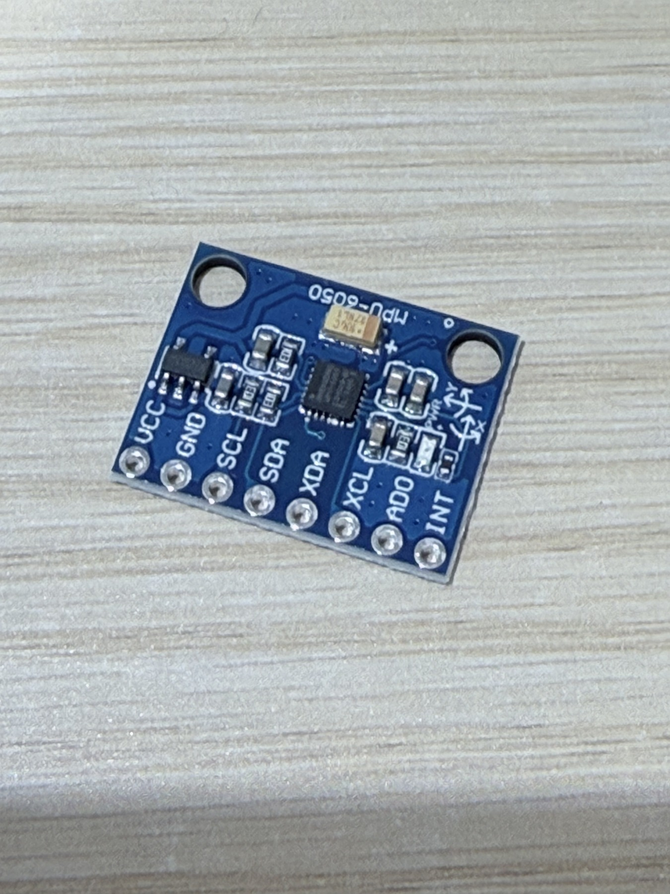
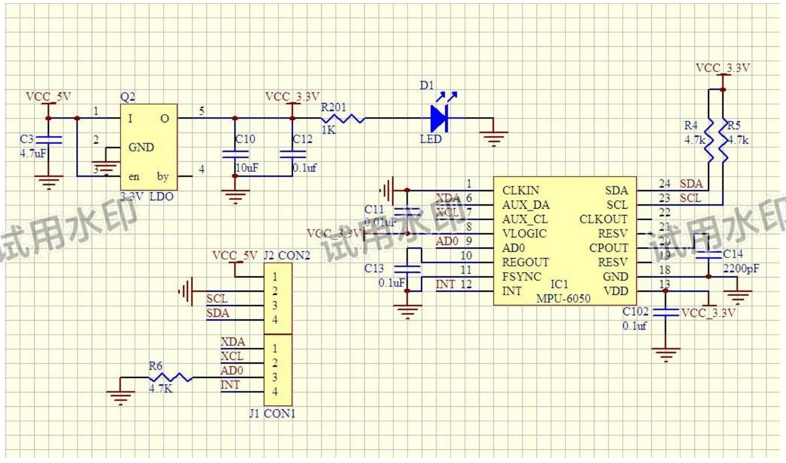

# MPU6050 模块 V1 原理图

> 在线来源与配件对应：[赛道配件清单与实物图](../赛道配件清单与实物图.md)；原件核对／补图日期：2026-10-29。

> 来源：`MPU6050-V1-SCH.pdf`。本说明包含模块接口、供电和外围电路，完整电路区域见下图；实际模块连线待按实物核对。实际模块版本待确认，未进行接线与电气验证。

## 模块实物与原理图

照片可见 `MPU-6050` 丝印，不能据照片确认芯片 ID 或实际兼容版本。

原 PDF 第 1 页图形区域。

原图水印及清晰度按来源保留；下面的接口表用于检索，连线关系应结合图形核对。

## 电路组成
图中包含 MPU-6050、3.3 V LDO、电源指示灯、I²C 上拉及外围去耦电路。原图输入网名为 `VCC_5V`，LDO 输出网名为 `VCC_3.3V`；这些是该模块原理图标注，不代表 MPU-6050 裸芯片可直接接 5 V。

## 外部接口

| 连接器 | 引脚编号 | 原图标识 |
| --- | --- | --- |
| J2 / CON2 | 1 | VCC_5V |
| J2 / CON2 | 2 | GND |
| J2 / CON2 | 3 | SCL |
| J2 / CON2 | 4 | SDA |
| J1 / CON1 | 1 | XDA |
| J1 / CON1 | 2 | XCL |
| J1 / CON1 | 3 | AD0 |
| J1 / CON1 | 4 | INT |

## 主要元件与连接

| 标识 | 标注或连接 |
| --- | --- |
| IC1 | MPU-6050 |
| Q2 | 3.3 V LDO，具体器件型号未标明 |
| R4、R5 | 4.7 kΩ；SDA、SCL 上拉至 VCC_3.3V |
| R6 | 4.7 kΩ；AD0 下拉至地 |
| R201、D1 | 1 kΩ 与 LED，电源指示支路 |
| C3 | 4.7 μF，LDO 输入端 |
| C10、C12 | 10 μF、0.1 μF，LDO 输出端 |
| C11 | 0.01 μF，CPOUT 支路 |
| C13 | 0.1 μF，REGOUT 支路 |
| C14 | 2200 pF，图示预留引脚支路 |
| C102 | 0.1 μF，VDD 去耦 |
| VLOGIC | 图中接 VCC_3.3V |

元件值和连线来自图像人工辨认；正式接线前应对照原图及实物确认。芯片电气规格另见[产品规格书](PS-MPU-6000A-EN.md)，寄存器定义见[寄存器手册](RM-MPU-6000A-EN.md)。

## 项目接入状态

开发板手册列出 MPU6050 使用 GPIO8（SDA）与 GPIO9（SCL），并提示 GPIO8 与摄像头 DATA0 复用；最终供电、引脚分配、I²C 地址及运行步骤待确认，参见[开发板手册](../开发板/灵机XJWB03标准开发板使用文档.md)。

返回：[文档索引](../../README.md)。
