# MPU-6000 / MPU-6050 产品规格书

> 在线来源与配件对应：[赛道配件清单与实物图](../赛道配件清单与实物图.md)；原件核对／补图日期：2026-10-29。

用于查询芯片功能、电气参数、接口时序、应用电路和封装要求。参数表空白表示资料未给出该项数值。正文保留英文技术术语和章节编号，可通过阅读导航定位。

> 来源：InvenSense，`PS-MPU-6000A-EN.pdf`，Revision 3.2，2011-11-16。未进行芯片、驱动或实物验证；实际模块版本与项目配置待确认。

相关资料：[寄存器手册](RM-MPU-6000A-EN.md) · [模块原理图](MPU6050-V1-SCH.md) · [版本兼容说明](关于MPU6050模块新版本兼容问题的解决方案2.md)。

## 阅读导航

| 主题 | 入口 |
| --- | --- |
| 芯片功能与型号差异 | [3 Product Overview](#section-3) |
| 电气参数与绝对最大额定值 | [6 Electrical Characteristics](#section-6) |
| 芯片引脚与信号定义 | [7.1 Pin Out and Signal Description](#section-7-1) |
| 典型应用电路与外围器件 | [7.2 Typical Operating Circuit](#section-7-2) |
| 上电顺序 | [7.4 Recommended Power-on Procedure](#section-7-4) |
| 运动检测与中断 | [8 Programmable Interrupts](#section-8) |
| I²C 与 SPI 通信 | [9 Digital Interface](#section-9) |
| MPU-6050 接口电平 | [10 Serial Interface Considerations (MPU-6050)](#section-10) |
| 轴向、封装与 PCB 设计 | [11 Assembly](#section-11) |

### 章节目录

- [1 Revision History](#section-1)
- [2 Purpose and Scope](#section-2)
- [3 Product Overview](#section-3)
- [4 Applications](#section-4)
- [5 Features](#section-5)
- [6 Electrical Characteristics](#section-6)
- [7 Applications Information](#section-7)
- [8 Programmable Interrupts](#section-8)
- [9 Digital Interface](#section-9)
- [10 Serial Interface Considerations (MPU-6050)](#section-10)
- [11 Assembly](#section-11)
- [12 Reliability](#section-12)
- [13 Environmental Compliance](#section-13)

## 1 Revision History

|Revision Date|Revision|Description|
|---|---|---|
|11/24/2010|1.0|Initial Release|
|05/19/2011|2.0| For Rev C parts. Clarified wording in sections (3.2, 5.1, 5.2, 6.1-6.4, 6.6, 6.9, 7, 7.1-7.6, 7.11, 7.12, 7.14, 8, 8.2-8.4, 10.3, 10.4, 11, 12.2)|
|07/28/2011|2.1|Edited supply current numbers for different modes (section 6.4)|
|08/05/2011|2.2|Unit of measure for accelerometer sensitivity changed from LSB/m_g _ to LSB/_g _|
|10/12/2011|2.3|Updated accelerometer self test specifications in Table 6.2. Updated package dimensions (section 11.2). Updated PCB design guidelines (section 11.3)|
|10/18/2011|3.0|For Rev D parts. Updated accelerometer specifications in Table 6.2. Updated accelerometer specification note (sections 8.2, 8.3, & 8.4). Updated qualification test plan (section 12.2).|
|10/24/2011|3.1|Edits for clarity Changed operating voltage range to 2.375V-3.46V Added accelerometer Intelligence Function increment value of 1m_g_/LSB (Section 6.2) Updated absolute maximum rating for acceleration (any axis, unpowered) from 0.3ms to 0.2ms (Section 6.9) Modified absolute maximum rating for Latch-up to Level A and ±100mA (Section 6.9, 12.2)|
|11/16/2011|3.2|**Updated self-test response specifications for Revision D parts dated with** **date code 1147 (YYWW) or later.**  Edits for clarity Added Gyro self-test (sections 5.1, 6.1, 7.6, 7.12) Added Min/Max limits to Accel self-test response (section 6.2) Updated Accelerometer low power mode operating currents (Section 6.3) Added gyro self test to block diagram (section 7.5) Updated packaging labels and descriptions (sections 11.8 & 11.9)|

## 2 Purpose and Scope

This product specification provides advanced information regarding the electrical specification and design related information for the MPU-6000™ and MPU-6050™ Motion Processing Unit™, collectively called the MPU-60X0™ or MPU™.

Electrical characteristics are based upon design analysis and simulation results only. Specifications are subject to change without notice. Final specifications will be updated based upon characterization of production silicon. For references to register map and descriptions of individual registers, please refer to the MPU-6000/MPU-6050 Register Map and Register Descriptions document.

**The self-test response specifications provided in this document pertain to Revision D parts with date** **codes of 1147 (YYWW) or later.** Please see Section 11.6 for package marking description details.

## 3 Product Overview

### 3.1 MPU-60X0 Overview

The MPU-60X0 Motion Processing Unit is the world’s first motion processing solution with integrated 9-Axis sensor fusion using its field-proven and proprietary MotionFusion™ engine for handset and tablet applications, game controllers, motion pointer remote controls, and other consumer devices. The MPU-60X0 has an embedded 3-axis MEMS gyroscope, a 3-axis MEMS accelerometer, and a Digital Motion Processor™ (DMP™) hardware accelerator engine with an auxiliary I²C port that interfaces to 3 rd party digital sensors such as magnetometers. When connected to a 3-axis magnetometer, the MPU-60X0 delivers a complete 9-axis MotionFusion output to its primary I²C or SPI port (SPI is available on MPU-6000 only). The MPU-60X0 combines acceleration and rotational motion plus heading information into a single data stream for the application. This MotionProcessing™ technology integration provides a smaller footprint and has inherent cost advantages compared to discrete gyroscope plus accelerometer solutions. The MPU-60X0 is also designed to interface with multiple non-inertial digital sensors, such as pressure sensors, on its auxiliary I²C port. The MPU-60X0 is a 2 nd generation motion processor and is footprint compatible with the MPU30X0 family.

The MPU-60X0 features three 16-bit analog-to-digital converters (ADCs) for digitizing the gyroscope outputs and three 16-bit ADCs for digitizing the accelerometer outputs. For precision tracking of both fast and slow motions, the parts feature a user-programmable gyroscope full-scale range of ±250, ±500, ±1000, and ±2000°/sec (dps) and a user-programmable accelerometer full-scale range of ±2 _g_, ±4 _g_, ±8 _g_, and ±16 _g_ .

An on-chip 1024 Byte FIFO buffer helps lower system power consumption by allowing the system processor to read the sensor data in bursts and then enter a low-power mode as the MPU collects more data. With all the necessary on-chip processing and sensor components required to support many motion-based use cases, the MPU-60X0 uniquely supports a variety of advanced motion-based applications entirely on-chip. The MPU-60X0 thus enables low-power MotionProcessing in portable applications with reduced processing requirements for the system processor. By providing an integrated MotionFusion output, the DMP in the MPU-60X0 offloads the intensive MotionProcessing computation requirements from the system processor, minimizing the need for frequent polling of the motion sensor output.

Communication with all registers of the device is performed using either I²C at 400kHz or SPI at 1MHz (MPU-6000 only). For applications requiring faster communications, the sensor and interrupt registers may be read using SPI at 20MHz (MPU-6000 only). Additional features include an embedded temperature sensor and an on-chip oscillator with ±1% variation over the operating temperature range.

By leveraging its patented and volume-proven Nasiri-Fabrication platform, which integrates MEMS wafers with companion CMOS electronics through wafer-level bonding, InvenSense has driven the MPU-60X0 package size down to a revolutionary footprint of 4x4x0.9mm (QFN), while providing the highest performance, lowest noise, and the lowest cost semiconductor packaging required for handheld consumer electronic devices. The part features a robust 10,000 _g_ shock tolerance, and has programmable low-pass filters for the gyroscopes, accelerometers, and the on-chip temperature sensor.

For power supply flexibility, the MPU-60X0 operates from VDD power supply voltage range of 2.375V-3.46V. Additionally, the MPU-6050 provides a VLOGIC reference pin (in addition to its analog supply pin: VDD), which sets the logic levels of its I²C interface. The VLOGIC voltage may be 1.8V±5% or VDD.

The MPU-6000 and MPU-6050 are identical, except that the MPU-6050 supports the I²C serial interface only, and has a separate VLOGIC reference pin. The MPU-6000 supports both I²C and SPI interfaces and has a single supply pin, VDD, which is both the device’s logic reference supply and the analog supply for the part. The table below outlines these differences:

**Primary Differences between MPU-6000 and MPU-6050**

|Part / Item|MPU-6000|MPU-6050|
|---|---|---|
|**VDD**|2.375V-3.46V|2.375V-3.46V|
|**VLOGIC**|n/a |1.71V to VDD |
|**Serial Interfaces Supported**|I2C, SPI|I2C|
|**Pin 8**|/CS|VLOGIC|
|**Pin 9**|AD0/SDO|AD0|
|**Pin 23**|SCL/SCLK|SCL|
|**Pin 24**|SDA/SDI|SDA|

## 4 Applications

- _BlurFree_ ™ technology (for Video/Still Image Stabilization)

- _AirSign_ ™ technology (for Security/Authentication)

- _TouchAnywhere_ ™ technology (for “no touch” UI Application Control/Navigation)

- _MotionCommand_ ™ technology (for Gesture Short-cuts)

- Motion-enabled game and application framework

- InstantGesture™ iG™ gesture recognition

- Location based services, points of interest, and dead reckoning

- Handset and portable gaming

- Motion-based game controllers

- 3D remote controls for Internet connected DTVs and set top boxes, 3D mice

- Wearable sensors for health, fitness and sports

- Toys

## 5 Features

### 5.1 Gyroscope Features

The triple-axis MEMS gyroscope in the MPU-60X0 includes a wide range of features:

- Digital-output X-, Y-, and Z-Axis angular rate sensors (gyroscopes) with a user-programmable fullscale range of ±250, ±500, ±1000, and ±2000°/sec

- External sync signal connected to the FSYNC pin supports image, video and GPS synchronization

- Integrated 16-bit ADCs enable simultaneous sampling of gyros

- Enhanced bias and sensitivity temperature stability reduces the need for user calibration

- Improved low-frequency noise performance

- Digitally-programmable low-pass filter

- Gyroscope operating current: 3.6mA

- Standby current: 5µA

- Factory calibrated sensitivity scale factor

- User self-test

### 5.2 Accelerometer Features

The triple-axis MEMS accelerometer in MPU-60X0 includes a wide range of features:

- Digital-output triple-axis accelerometer with a programmable full scale range of ±2 _g_, ±4 _g_, ±8 _g_ and ±16 _g_

- Integrated 16-bit ADCs enable simultaneous sampling of accelerometers while requiring no external multiplexer

- Accelerometer normal operating current: 500µA

- Low power accelerometer mode current: 10µA at 1.25Hz, 20µA at 5Hz, 60µA at 20Hz, 110µA at 40Hz

- Orientation detection and signaling

- Tap detection

- User-programmable interrupts

- Free-fall interrupt

- High-G interrupt

- Zero Motion/Motion interrupt

- User self-test

### 5.3 Additional Features

The MPU-60X0 includes the following additional features:

- 9-Axis MotionFusion by the on-chip Digital Motion Processor (DMP)

- Auxiliary master I²C bus for reading data from external sensors (e.g., magnetometer)

- 3.9mA operating current when all 6 motion sensing axes and the DMP are enabled

- VDD supply voltage range of 2.375V-3.46V

- Flexible VLOGIC reference voltage supports multiple I²C interface voltages (MPU-6050 only)

- Smallest and thinnest QFN package for portable devices: 4x4x0.9mm

- Minimal cross-axis sensitivity between the accelerometer and gyroscope axes

- 1024 byte FIFO buffer reduces power consumption by allowing host processor to read the data in bursts and then go into a low-power mode as the MPU collects more data

- Digital-output temperature sensor

- User-programmable digital filters for gyroscope, accelerometer, and temp sensor

- 10,000 _g_ shock tolerant

- 400kHz Fast Mode I²C for communicating with all registers

- 1MHz SPI serial interface for communicating with all registers (MPU-6000 only)

- 20MHz SPI serial interface for reading sensor and interrupt registers (MPU-6000 only)

- MEMS structure hermetically sealed and bonded at wafer level

- RoHS and Green compliant

### 5.4 MotionProcessing

- Internal Digital Motion Processing™ (DMP™) engine supports 3D MotionProcessing and gesture recognition algorithms

- The MPU-60X0 collects gyroscope and accelerometer data while synchronizing data sampling at a user defined rate. The total dataset obtained by the MPU-60X0 includes 3-Axis gyroscope data, 3Axis accelerometer data, and temperature data. The MPU’s calculated output to the system processor can also include heading data from a digital 3-axis third party magnetometer.

- The FIFO buffers the complete data set, reducing timing requirements on the system processor by allowing the processor burst read the FIFO data. After burst reading the FIFO data, the system processor can save power by entering a low-power sleep mode while the MPU collects more data.

- Programmable interrupt supports features such as gesture recognition, panning, zooming, scrolling, zero-motion detection, tap detection, and shake detection

- Digitally-programmable low-pass filters

- Low-power pedometer functionality allows the host processor to sleep while the DMP maintains the step count.

### 5.5 Clocking

- On-chip timing generator ±1% frequency variation over full temperature range

- Optional external clock inputs of 32.768kHz or 19.2MHz

## 6 Electrical Characteristics

### 6.1 Gyroscope Specifications

VDD = 2.375–3.46 V, VLOGIC (MPU-6050 only) = 1.8 V ± 5% or VDD, TA = 25°C.

|PARAMETER|CONDITIONS|MIN|TYP|MAX|UNITS|
|---|---|---|---|---|---|
|Full-Scale Range|FS_SEL=0||±250||°/s|
|Full-Scale Range|FS_SEL=1||±500||°/s|
|Full-Scale Range|FS_SEL=2||±1000||°/s|
|Full-Scale Range|FS_SEL=3||±2000||°/s|
|Gyroscope ADC Word Length|||16||bits|
|Sensitivity Scale Factor|FS_SEL=0||131||LSB/(°/s)|
|Sensitivity Scale Factor|FS_SEL=1||65.5||LSB/(°/s)|
|Sensitivity Scale Factor|FS_SEL=2||32.8||LSB/(°/s)|
|Sensitivity Scale Factor|FS_SEL=3||16.4||LSB/(°/s)|
|Sensitivity Scale Factor Tolerance|25°C|-3||+3|%|
|Sensitivity Scale Factor Variation Over Temperature|||±2||%|
|Nonlinearity|Best fit straight line; 25°C||0.2||%|
|Cross-Axis Sensitivity|||±2||%|
|Initial ZRO Tolerance|25°C||±20||°/s|
|ZRO Variation Over Temperature|-40°C to +85°C||±20||°/s|
|Power-Supply Sensitivity (1–10 Hz)|Sine wave, 100 mVpp; VDD=2.5 V||0.2||°/s|
|Power-Supply Sensitivity (10–250 Hz)|Sine wave, 100 mVpp; VDD=2.5 V||0.2||°/s|
|Power-Supply Sensitivity (250 Hz–100 kHz)|Sine wave, 100 mVpp; VDD=2.5 V||4||°/s|
|Linear Acceleration Sensitivity|Static||0.1||°/s/g|
|Self-Test Response, X-Axis||10||105|°/s|
|Self-Test Response, Y-Axis (note 1)||-105||-10|°/s|
|Self-Test Response, Z-Axis||10||105|°/s|
|Total RMS Noise|FS_SEL=0, DLPFCFG=2 (100 Hz)||0.05||°/s-rms|
|Low-frequency RMS noise|FS_SEL=0, bandwidth 1–10 Hz||0.033||°/s-rms|
|Rate Noise Spectral Density|FS_SEL=0, at 10 Hz||0.005||°/s/√Hz|
|Gyroscope Mechanical Frequency, X-Axis||30|33|36|kHz|
|Gyroscope Mechanical Frequency, Y-Axis||27|30|33|kHz|
|Gyroscope Mechanical Frequency, Z-Axis||24|27|30|kHz|
|Low Pass Filter Response|Programmable range|5||256|Hz|
|Output Data Rate|Programmable|4||8,000|Hz|
|ZRO Settling|DLPFCFG=0; to ±1°/s of final||30||ms|

1. The Y-Axis self-test has an opposite polarity from the X- and Z-Axes. However, the magnitude of the self-test limit is the same for all 3 axes.

### 6.2 Accelerometer Specifications

VDD = 2.375–3.46 V, VLOGIC (MPU-6050 only) = 1.8 V ± 5% or VDD, TA = 25°C.

|PARAMETER|CONDITIONS|MIN|TYP|MAX|UNITS|
|---|---|---|---|---|---|
|Full-Scale Range|AFS_SEL=0||±2||g|
|Full-Scale Range|AFS_SEL=1||±4||g|
|Full-Scale Range|AFS_SEL=2||±8||g|
|Full-Scale Range|AFS_SEL=3||±16||g|
|ADC Word Length|Output in two’s complement format||16||bits|
|Sensitivity Scale Factor|AFS_SEL=0||16,384||LSB/g|
|Sensitivity Scale Factor|AFS_SEL=1||8,192||LSB/g|
|Sensitivity Scale Factor|AFS_SEL=2||4,096||LSB/g|
|Sensitivity Scale Factor|AFS_SEL=3||2,048||LSB/g|
|Initial Calibration Tolerance|||±3||%|
|Sensitivity Change vs. Temperature|AFS_SEL=0, -40°C to +85°C||±0.02||%/°C|
|Nonlinearity|Best fit straight line||0.5||%|
|Cross-Axis Sensitivity|||±2||%|
|Zero-G Initial Calibration Tolerance (note 1)|X and Y axes||±50||mg|
|Zero-G Initial Calibration Tolerance (note 1)|Z axis||±80||mg|
|Zero-G Level Change vs. Temperature|X and Y axes, 0°C to +70°C||±35||mg|
|Zero-G Level Change vs. Temperature|Z axis, 0°C to +70°C||±60||mg|
|Self Test Response||300||950|mg|
|Noise Power Spectral Density|At 10 Hz, AFS_SEL=0, ODR=1 kHz||400||μg/√Hz|
|Low Pass Filter Response|Programmable range|5||260|Hz|
|Output Data Rate|Programmable range|4||1,000|Hz|
|Intelligence Function Increment|||1||mg/LSB|

1. Typical zero-g initial calibration tolerance value after MSL3 preconditioning.

### 6.3 Electrical and Other Common Specifications

VDD = 2.375–3.46 V, VLOGIC (MPU-6050 only) = 1.8 V ± 5% or VDD, TA = 25°C.

|PARAMETER|CONDITIONS|MIN|TYP|MAX|UNITS|
|---|---|---|---|---|---|
|Temperature Sensor Range|||-40 to +85||°C|
|Temperature Sensor Sensitivity|Untrimmed||340||LSB/°C|
|Temperature Offset|35°C||-521||LSB|
|Temperature Sensor Linearity|Best fit straight line (-40°C to +85°C)||±1||°C|
|VDD Operating Voltage||2.375||3.46|V|
|Normal Operating Current|Gyroscope + Accelerometer + DMP||3.9||mA|
|Normal Operating Current|Gyroscope + Accelerometer; DMP disabled||3.8||mA|
|Normal Operating Current|Gyroscope + DMP; Accelerometer disabled||3.7||mA|
|Normal Operating Current|Gyroscope only; DMP & Accelerometer disabled||3.6||mA|
|Normal Operating Current|Accelerometer only; DMP & Gyroscope disabled||500||μA|
|Accelerometer Low Power Mode Current|1 Hz update rate||10||μA|
|Accelerometer Low Power Mode Current|5 Hz update rate||20||μA|
|Accelerometer Low Power Mode Current|20 Hz update rate||70||μA|
|Accelerometer Low Power Mode Current|40 Hz update rate||140||μA|
|Full-Chip Idle Mode Supply Current|||5||μA|
|VDD Power Supply Ramp Rate|Monotonic ramp, 10% to 90% of final value|||100|ms|
|VLOGIC Voltage Range|MPU-6050 only; VLOGIC ≤ VDD at all times|1.71||VDD|V|
|VLOGIC Power Supply Ramp Rate|MPU-6050 only; monotonic ramp, 10% to 90% of final value|||3|ms|
|VLOGIC Normal Operating Current|MPU-6050 only||100||μA|
|Start-Up Time for Register Read/Write|||20|100|ms|
|Specified Temperature Range|Performance parameters are not applicable beyond specified range|-40||+85|°C|

### 6.4 Serial Interface and Digital I/O Specifications

VDD = 2.375–3.46 V, VLOGIC (MPU-6050 only) = 1.8 V ± 5% or VDD, TA = 25°C.

|PARAMETER|CONDITIONS|MIN|TYP|MAX|UNITS|
|---|---|---|---|---|---|
|SPI Operating Frequency, All Registers Read/Write|MPU-6000 only, low speed characterization||100 ± 10%||kHz|
|SPI Operating Frequency, All Registers Read/Write|MPU-6000 only, high speed characterization||1 ± 10%||MHz|
|SPI Operating Frequency, Sensor and Interrupt Registers Read Only|MPU-6000 only||20 ± 10%||MHz|
|I²C Operating Frequency|All registers, Fast-mode|||400|kHz|
|I²C Operating Frequency|All registers, Standard-mode|||100|kHz|
|I²C Address|AD0=0||1101000||binary|
|I²C Address|AD0=1||1101001||binary|
|Digital Inputs: VIH, High Level Input Voltage|MPU-6000|0.7 × VDD|||V|
|Digital Inputs: VIH, High Level Input Voltage|MPU-6050|0.7 × VLOGIC|||V|
|Digital Inputs: VIL, Low Level Input Voltage|MPU-6000|||0.3 × VDD|V|
|Digital Inputs: VIL, Low Level Input Voltage|MPU-6050|||0.3 × VLOGIC|V|
|Digital Inputs: CI, Input Capacitance|||< 5||pF|
|Digital Outputs (SDO, INT): VOH|RLOAD=1 MΩ; MPU-6000|0.9 × VDD|||V|
|Digital Outputs (SDO, INT): VOH|RLOAD=1 MΩ; MPU-6050|0.9 × VLOGIC|||V|
|Digital Outputs (SDO, INT): VOL1|RLOAD=1 MΩ; MPU-6000|||0.1 × VDD|V|
|Digital Outputs (SDO, INT): VOL1|RLOAD=1 MΩ; MPU-6050|||0.1 × VLOGIC|V|
|Digital Outputs: VOL.INT1, INT Low-Level Output Voltage|OPEN=1, 0.3 mA sink current|||0.1|V|
|Digital Outputs (SDO, INT): Output Leakage Current|OPEN=1||100||nA|
|Digital Outputs: tINT, INT Pulse Width|LATCH_INT_EN=0||50||μs|
|Digital Output (CLKOUT): VOH|RLOAD=1 MΩ|0.9 × VDD|||V|
|Digital Output (CLKOUT): VOL1|RLOAD=1 MΩ|||0.1 × VDD|V|

Digital input pins: SDI/SDA, AD0, SCLK/SCL, FSYNC, /CS, CLKIN. VOH is the high-level output voltage; VOL1 is the low-level output voltage.

### 6.5 Primary and Auxiliary I²C I/O Specifications

Typical Operating Circuit of Section 7.2. VDD = 2.375–3.46 V, VLOGIC (MPU-6050 only) = 1.8 V ± 5% or VDD, TA = 25°C.

**Primary I²C I/O (SCL, SDA)**

|PARAMETER|CONDITIONS|TYPICAL|UNITS|
|---|---|---|---|
|VIL, Low-Level Input Voltage|MPU-6000|-0.5 to 0.3 × VDD|V|
|VIH, High-Level Input Voltage|MPU-6000|0.7 × VDD to VDD + 0.5|V|
|Vhys, Hysteresis|MPU-6000|0.1 × VDD|V|
|VIL, Low-Level Input Voltage|MPU-6050|-0.5 to 0.3 × VLOGIC|V|
|VIH, High-Level Input Voltage|MPU-6050|0.7 × VLOGIC to VLOGIC + 0.5|V|
|Vhys, Hysteresis|MPU-6050|0.1 × VLOGIC|V|
|VOL1, Low-Level Output Voltage|3 mA sink current|0 to 0.4|V|
|IOL, Low-Level Output Current|VOL=0.4 V|3|mA|
|IOL, Low-Level Output Current|VOL=0.6 V|5|mA|
|Output Leakage Current||100|nA|
|tof, Output Fall Time from VIHmax to VILmax|Cb bus capacitance in pF|20 + 0.1 × Cb to 250|ns|
|CI, Capacitance for Each I/O Pin||< 10|pF|

**Auxiliary I²C I/O (AUX_CL, AUX_DA), MPU-6050: AUX_VDDIO=0**

|PARAMETER|CONDITIONS|TYPICAL|UNITS|
|---|---|---|---|
|VIL, Low-Level Input Voltage||-0.5 to 0.3 × VLOGIC|V|
|VIH, High-Level Input Voltage||0.7 × VLOGIC to VLOGIC + 0.5|V|
|Vhys, Hysteresis||0.1 × VLOGIC|V|
|VOL1, Low-Level Output Voltage|VLOGIC > 2 V; 1 mA sink current|0 to 0.4|V|
|VOL3, Low-Level Output Voltage|VLOGIC < 2 V; 1 mA sink current|0 to 0.2 × VLOGIC|V|
|IOL, Low-Level Output Current|VOL=0.4 V|1|mA|
|IOL, Low-Level Output Current|VOL=0.6 V|1|mA|
|Output Leakage Current||100|nA|
|tof, Output Fall Time from VIHmax to VILmax|Cb bus capacitance in pF|20 + 0.1 × Cb to 250|ns|
|CI, Capacitance for Each I/O Pin||< 10|pF|

**Auxiliary I²C I/O (AUX_CL, AUX_DA), MPU-6050: AUX_VDDIO=1; MPU-6000**

|PARAMETER|CONDITIONS|TYPICAL|UNITS|
|---|---|---|---|
|VIL, Low-Level Input Voltage||-0.5 to 0.3 × VDD|V|
|VIH, High-Level Input Voltage||0.7 × VDD to VDD + 0.5|V|
|Vhys, Hysteresis||0.1 × VDD|V|
|VOL1, Low-Level Output Voltage|1 mA sink current|0 to 0.4|V|
|IOL, Low-Level Output Current|VOL=0.4 V|1|mA|
|IOL, Low-Level Output Current|VOL=0.6 V|1|mA|
|Output Leakage Current||100|nA|
|tof, Output Fall Time from VIHmax to VILmax|Cb bus capacitance in pF|20 + 0.1 × Cb to 250|ns|
|CI, Capacitance for Each I/O Pin||< 10|pF|

### 6.6 Clock and Sample Rate Specifications

Typical Operating Circuit of Section 7.2. VDD = 2.375–3.46 V, VLOGIC (MPU-6050 only) = 1.8 V ± 5% or VDD, TA = 25°C.

**Internal Clock Source: CLK_SEL=0,1,2,3**

|PARAMETER|CONDITIONS|MIN|TYP|MAX|UNITS|
|---|---|---|---|---|---|
|Gyroscope Sample Rate, Fast|DLPFCFG=0, SAMPLERATEDIV=0||8||kHz|
|Gyroscope Sample Rate, Slow|DLPFCFG=1,2,3,4,5,6; SAMPLERATEDIV=0||1||kHz|
|Accelerometer Sample Rate|||1||kHz|
|Reference Clock Output|CLKOUTEN=1||1.024||MHz|
|Clock Frequency Initial Tolerance|CLK_SEL=0, 25°C|-5||+5|%|
|Clock Frequency Initial Tolerance|CLK_SEL=1,2,3; 25°C|-1||+1|%|
|Frequency Variation over Temperature|CLK_SEL=0||-15 to +10||%|
|Frequency Variation over Temperature|CLK_SEL=1,2,3||±1||%|
|PLL Settling Time|CLK_SEL=1,2,3||1|10|ms|

**External 32.768 kHz Clock: CLK_SEL=4**

|PARAMETER|CONDITIONS|MIN|TYP|MAX|UNITS|
|---|---|---|---|---|---|
|External Clock Frequency|||32.768||kHz|
|External Clock Allowable Jitter|Cycle-to-cycle rms||1 to 2||μs|
|Gyroscope Sample Rate, Fast|DLPFCFG=0, SAMPLERATEDIV=0||8.192||kHz|
|Gyroscope Sample Rate, Slow|DLPFCFG=1,2,3,4,5,6; SAMPLERATEDIV=0||1.024||kHz|
|Accelerometer Sample Rate|||1.024||kHz|
|Reference Clock Output|CLKOUTEN=1||1.0486||MHz|
|PLL Settling Time|||1|10|ms|

**External 19.2 MHz Clock: CLK_SEL=5**

|PARAMETER|CONDITIONS|MIN|TYP|MAX|UNITS|
|---|---|---|---|---|---|
|External Clock Frequency|||19.2||MHz|
|Gyroscope Sample Rate|Full programmable range|3.9||8000|Hz|
|Gyroscope Sample Rate, Fast Mode|DLPFCFG=0, SAMPLERATEDIV=0||8||kHz|
|Gyroscope Sample Rate, Slow Mode|DLPFCFG=1,2,3,4,5,6; SAMPLERATEDIV=0||1||kHz|
|Accelerometer Sample Rate|||1||kHz|
|Reference Clock Output|CLKOUTEN=1||1.024||MHz|
|PLL Settling Time|||1|10|ms|

### 6.7 I²C Timing Characterization

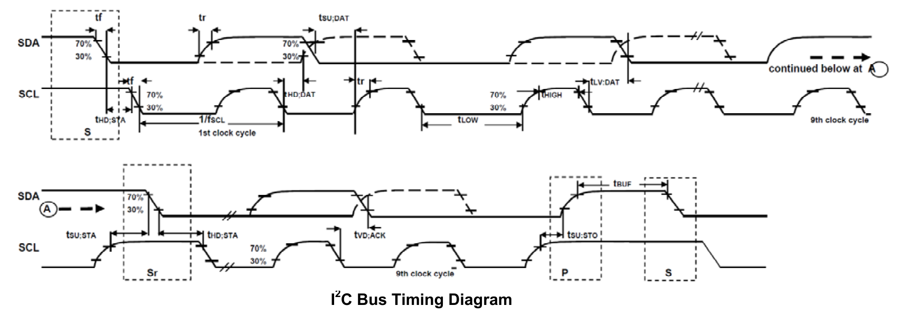

原 PDF 第 18 页图形区域。

Typical Operating Circuit of Section 7.2, VDD = 2.375V-3.46V, VLOGIC (MPU-6050 only) = 1.8V±5% or VDD, TA = 25°C

| Parameter | Conditions | Min | Typical | Max | Units |
| --- | --- | --- | --- | --- | --- |
| fSCL, SCL Clock Frequency | I²C Fast-mode | | | 400 | kHz |
| tHD.STA, (Repeated) START Condition Hold Time | I²C Fast-mode | 0.6 | | | μs |
| tLOW, SCL Low Period | I²C Fast-mode | 1.3 | | | μs |
| tHIGH, SCL High Period | I²C Fast-mode | 0.6 | | | μs |
| tSU.STA, Repeated START Condition Setup Time | I²C Fast-mode | 0.6 | | | μs |
| tHD.DAT, SDA Data Hold Time | I²C Fast-mode | 0 | | | μs |
| tSU.DAT, SDA Data Setup Time | I²C Fast-mode | 100 | | | ns |
| tr, SDA and SCL Rise Time | Cb = 10–400 pF | 20 + 0.1 × Cb | | 300 | ns |
| tf, SDA and SCL Fall Time | Cb = 10–400 pF | 20 + 0.1 × Cb | | 300 | ns |
| tSU.STO, STOP Condition Setup Time | I²C Fast-mode | 0.6 | | | μs |
| tBUF, Bus Free Time Between STOP and START Condition | I²C Fast-mode | 1.3 | | | μs |
| Cb, Capacitive Load for Each Bus Line | I²C Fast-mode | | < 400 | | pF |
| tVD.DAT, Data Valid Time | I²C Fast-mode | | | 0.9 | μs |
| tVD.ACK, Data Valid Acknowledge Time | I²C Fast-mode | | | 0.9 | μs |

Timing characteristics apply to both primary and auxiliary I²C buses.

### 6.8 SPI Timing Characterization (MPU-6000 only)

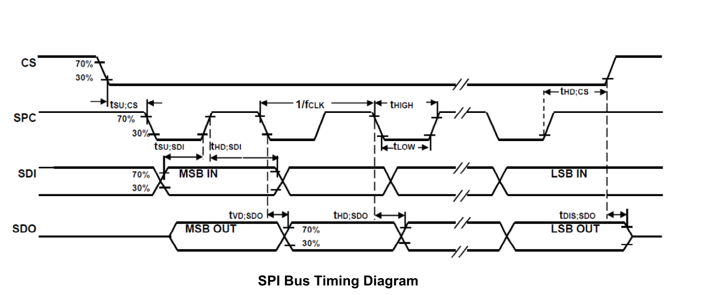

原 PDF 第 19 页图形区域。

Typical Operating Circuit of Section 7.2, VDD = 2.375V-3.46V, VLOGIC (MPU-6050 only) = 1.8V±5% or VDD,TA = -40°C to +85°C, unless otherwise noted.

| Parameter | Conditions | Min | Typical | Max | Units |
| --- | --- | --- | --- | --- | --- |
| fSCLK, SCLK Clock Frequency | | | | 1 | MHz |
| tLOW, SCLK Low Period | | 400 | | | ns |
| tHIGH, SCLK High Period | | 400 | | | ns |
| tSU.CS, CS Setup Time | | 8 | | | ns |
| tHD.CS, CS Hold Time | | 500 | | | ns |
| tSU.SDI, SDI Setup Time | | 11 | | | ns |
| tHD.SDI, SDI Hold Time | | 7 | | | ns |
| tVD.SDO, SDO Valid Time | Cload = 20 pF | | | 100 | ns |
| tHD.SDO, SDO Hold Time | Cload = 20 pF | 4 | | | ns |
| tDIS.SDO, SDO Output Disable Time | | | | 10 | ns |

### 6.9 Absolute Maximum Ratings

Stress above those listed as “Absolute Maximum Ratings” may cause permanent damage to the device. These are stress ratings only and functional operation of the device at these conditions is not implied. Exposure to the absolute maximum ratings conditions for extended periods may affect device reliability.

|Parameter|Rating|
|---|---|
|Supply Voltage, VDD|-0.5V to +6V|
|VLOGIC Input Voltage Level (MPU-6050)|-0.5V to VDD + 0.5V|
|REGOUT|-0.5V to 2V|
|Input Voltage Level (CLKIN, AUX_DA, AD0, FSYNC, INT, SCL, SDA)|-0.5V to VDD + 0.5V|
|CPOUT (2.5V ≤ VDD ≤ 3.6V )|-0.5V to 30V|
|Acceleration (Any Axis, unpowered)|10,000g for 0.2ms|
|Operating Temperature Range|-40°C to +105°C|
|Storage Temperature Range|-40°C to +125°C|
|Electrostatic Discharge (ESD) Protection|2kV (HBM); 200V (MM)|
|Latch-up|JEDEC Class II (2),125°C Level A, ±100mA|

## 7 Applications Information

### 7.1 Pin Out and Signal Description

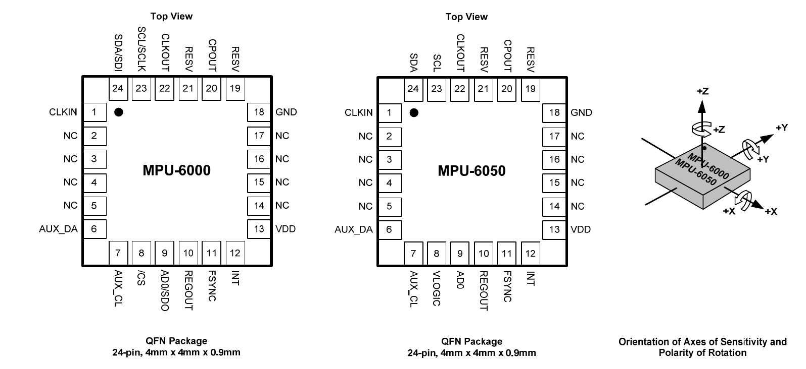

原 PDF 第 21 页图形区域。

|Pin Number|MPU- 6000|MPU- 6050|Pin Name|Pin Description|
|---|---|---|---|---|
|1|Y|Y|CLKIN|Optional external reference clock input. Connect to GND if unused.|
|6|Y|Y|AUX_DA|I²C master serial data, for connecting to external sensors|
|7|Y|Y|AUX_CL|I²C Master serial clock, for connecting to external sensors|
|8|Y||/CS|SPI chip select (0=SPI mode)|
|8||Y|VLOGIC|Digital I/O supply voltage|
|9|Y||AD0 / SDO|I²C Slave Address LSB (AD0); SPI serial data output (SDO)|
|9||Y|AD0|I²C Slave Address LSB (AD0)|
|10|Y|Y|REGOUT|Regulator filter capacitor connection|
|11|Y|Y|FSYNC|Frame synchronization digital input. Connect to GND if unused.|
|12|Y|Y|INT|Interrupt digital output (totem pole or open-drain)|
|13|Y|Y|VDD|Power supply voltage and Digital I/O supply voltage|
|18|Y|Y|GND|Power supply ground|
|19, 21|Y|Y|RESV|Reserved. Do not connect.|
|20|Y|Y|CPOUT|Charge pump capacitor connection|
|22|Y|Y|CLKOUT|System clock output|
|23|Y||SCL / SCLK|I²C serial clock (SCL); SPI serial clock (SCLK)|
|23||Y|SCL|I²C serial clock (SCL)|
|24|Y||SDA / SDI|I²C serial data (SDA); SPI serial data input (SDI)|
|24||Y|SDA|I²C serial data (SDA)|
|2, 3, 4, 5, 14, 15, 16, 17|Y|Y|NC|Not internally connected. May be used for PCB trace routing.|

### 7.2 Typical Operating Circuit

图形位置关系见原资料截图；参数表仍以本文文字为准。

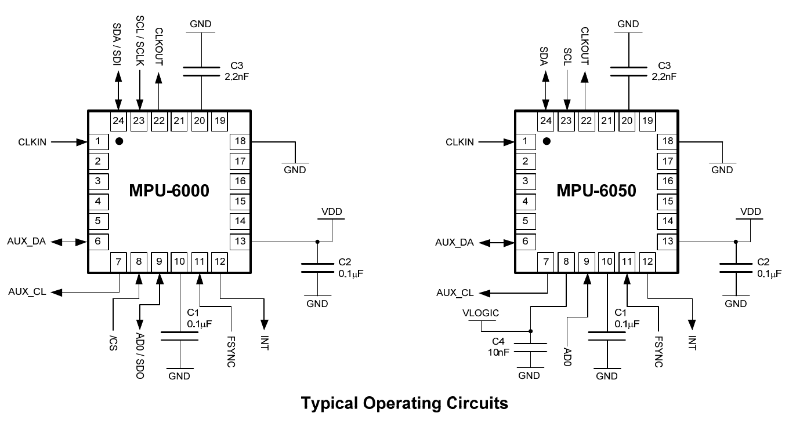

原 PDF 第 22 页图形区域。

### 7.3 Bill of Materials for External Components

Component labels refer to the [typical operating circuit](#section-7-2).

|Component|Label|Specification|Quantity|
|---|---|---|---|
|Regulator Filter Capacitor (Pin 10)|C1|Ceramic, X7R, 0.1µF ±10%, 2V|1|
|VDD Bypass Capacitor (Pin 13)|C2|Ceramic, X7R, 0.1µF ±10%, 4V|1|
|Charge Pump Capacitor (Pin 20)|C3|Ceramic, X7R, 2.2nF ±10%, 50V|1|
|VLOGIC Bypass Capacitor (Pin 8)|C4*|Ceramic, X7R, 10nF ±10%, 4V|1|

- MPU-6050 Only.

### 7.4 Recommended Power-on Procedure

图形位置关系见原资料截图；参数表仍以本文文字为准。

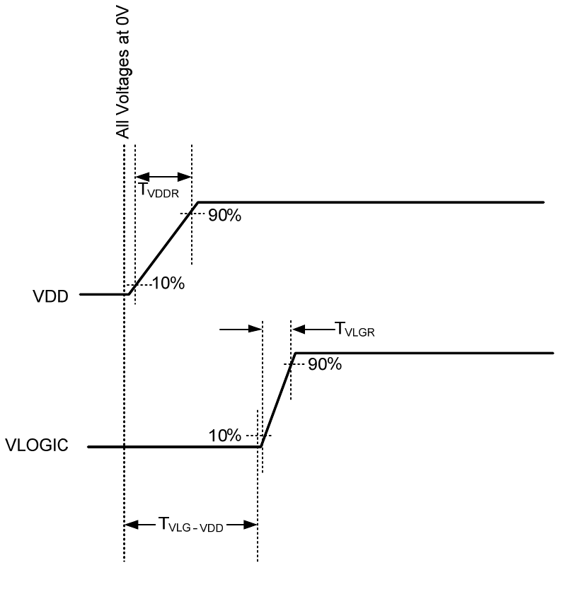

原 PDF 第 23 页图形区域。原图另列上电约束：`VLOGIC ≤ VDD`；VDD 从最终值的 10% 升至 90% 的时间不超过 100 ms，VLOGIC 相同定义的上升时间不超过 3 ms；VLOGIC 的起升不得早于 VDD，二者应单调上升。这些为芯片级要求，模块电源方案仍待核对。

### 7.5 Block Diagram

图形位置关系见原资料截图；参数表仍以本文文字为准。

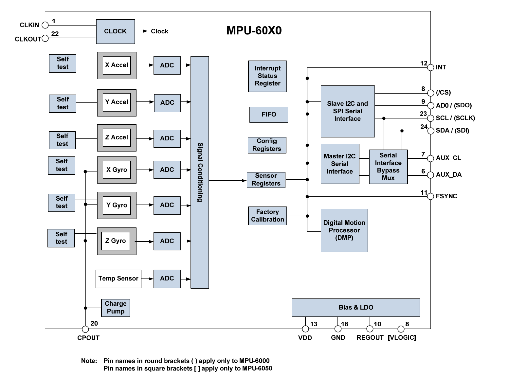

原 PDF 第 24 页图形区域。

### 7.6 Overview

The MPU-60X0 is comprised of the following key blocks and functions:

- Three-axis MEMS rate gyroscope sensor with 16-bit ADCs and signal conditioning

- Three-axis MEMS accelerometer sensor with 16-bit ADCs and signal conditioning

- Digital Motion Processor (DMP) engine

- Primary I²C and SPI (MPU-6000 only) serial communications interfaces

- Auxiliary I²C serial interface for 3 rd party magnetometer & other sensors

- Clocking

- Sensor Data Registers

- FIFO

- Interrupts

- Digital-Output Temperature Sensor

- Gyroscope & Accelerometer Self-test

- Bias and LDO

- Charge Pump

### 7.7 Three-Axis MEMS Gyroscope with 16-bit ADCs and Signal Conditioning

The MPU-60X0 consists of three independent vibratory MEMS rate gyroscopes, which detect rotation about the X-, Y-, and Z- Axes. When the gyros are rotated about any of the sense axes, the Coriolis Effect causes a vibration that is detected by a capacitive pickoff. The resulting signal is amplified, demodulated, and filtered to produce a voltage that is proportional to the angular rate. This voltage is digitized using individual on-chip 16-bit Analog-to-Digital Converters (ADCs) to sample each axis. The full-scale range of the gyro sensors may be digitally programmed to ±250, ±500, ±1000, or ±2000 degrees per second (dps). The ADC sample rate is programmable from 8,000 samples per second, down to 3.9 samples per second, and user-selectable low-pass filters enable a wide range of cut-off frequencies.

### 7.8 Three-Axis MEMS Accelerometer with 16-bit ADCs and Signal Conditioning

The MPU-60X0’s 3-Axis accelerometer uses separate proof masses for each axis. Acceleration along a particular axis induces displacement on the corresponding proof mass, and capacitive sensors detect the displacement differentially. The MPU-60X0’s architecture reduces the accelerometers’ susceptibility to fabrication variations as well as to thermal drift. When the device is placed on a flat surface, it will measure 0 _g_ on the X- and Y-axes and +1 _g_ on the Z-axis. The accelerometers’ scale factor is calibrated at the factory and is nominally independent of supply voltage. Each sensor has a dedicated sigma-delta ADC for providing digital outputs. The full scale range of the digital output can be adjusted to ±2 _g_, ±4 _g_, ±8 _g_, or ±16 _g_ .

### 7.9 Digital Motion Processor

The embedded Digital Motion Processor (DMP) is located within the MPU-60X0 and offloads computation of motion processing algorithms from the host processor. The DMP acquires data from accelerometers, gyroscopes, and additional 3 rd party sensors such as magnetometers, and processes the data. The resulting data can be read from the DMP’s registers, or can be buffered in a FIFO. The DMP has access to one of the MPU’s external pins, which can be used for generating interrupts.

The purpose of the DMP is to offload both timing requirements and processing power from the host processor. Typically, motion processing algorithms should be run at a high rate, often around 200Hz, in order to provide accurate results with low latency. This is required even if the application updates at a much lower rate; for example, a low power user interface may update as slowly as 5Hz, but the motion processing should still run at 200Hz. The DMP can be used as a tool in order to minimize power, simplify timing, simplify the software architecture, and save valuable MIPS on the host processor for use in the application.

### 7.10 Primary I²C and SPI Serial Communications Interfaces

The MPU-60X0 communicates to a system processor using either a SPI (MPU-6000 only) or an I²C serial interface. The MPU-60X0 always acts as a slave when communicating to the system processor. The LSB of the of the I²C slave address is set by pin 9 (AD0).

The logic levels for communications between the MPU-60X0 and its master are as follows:

- MPU-6000: The logic level for communications with the master is set by the voltage on VDD

- MPU-6050: The logic level for communications with the master is set by the voltage on VLOGIC

For further information regarding the logic levels of the MPU-6050, please refer to Section 10.

### 7.11 Auxiliary I²C Serial Interface

The MPU-60X0 has an auxiliary I²C bus for communicating to an off-chip 3-Axis digital output magnetometer or other sensors. This bus has two operating modes:

- I 2 C Master Mode: The MPU-60X0 acts as a master to any external sensors connected to the auxiliary I 2 C bus

- Pass-Through Mode: The MPU-60X0 directly connects the primary and auxiliary I 2 C buses together, allowing the system processor to directly communicate with any external sensors.

**Auxiliary I** **2** **C Bus Modes of Operation:**

- I 2 C Master Mode: Allows the MPU-60X0 to directly access the data registers of external digital sensors, such as a magnetometer. In this mode, the MPU-60X0 directly obtains data from auxiliary sensors, allowing the on-chip DMP to generate sensor fusion data without intervention from the system applications processor.

For example, In I²C Master mode, the MPU-60X0 can be configured to perform burst reads, returning the following data from a magnetometer:

- X magnetometer data (2 bytes)

- Y magnetometer data (2 bytes)

- Z magnetometer data (2 bytes)

The I²C Master can be configured to read up to 24 bytes from up to 4 auxiliary sensors. A fifth sensor can be configured to work single byte read/write mode.

- Pass-Through Mode: Allows an external system processor to act as master and directly communicate to the external sensors connected to the auxiliary I²C bus pins (AUX_DA and AUX_CL). In this mode, the auxiliary I²C bus control logic (3 rd party sensor interface block) of the MPU-60X0 is disabled, and the auxiliary I²C pins AUX_DA and AUX_CL (Pins 6 and 7) are connected to the main I²C bus (Pins 23 and 24) through analog switches.

Pass-Through Mode is useful for configuring the external sensors, or for keeping the MPU-60X0 in a low-power mode when only the external sensors are used.

In Pass-Through Mode the system processor can still access MPU-60X0 data through the I²C interface.

**Auxiliary I** **2** **C Bus IO Logic Levels**

- MPU-6000: The logic level of the auxiliary I 2 C bus is VDD

- MPU-6050: The logic level of the auxiliary I 2 C bus can be programmed to be either VDD or VLOGIC

For further information regarding the MPU-6050’s logic levels, please refer to Section 10.2.

### 7.12 Self-Test

Self-test allows for the testing of the mechanical and electrical portions of the sensors. The self-test for each measurement axis can be activated by controlling the bits of the Gyro and Accel control registers.

When self-test is activated, the electronics cause the sensors to be actuated and produce an output signal. The output signal is used to observe the self-test response.

The self-test response is defined as follows:

Self-test response = Sensor output with self-test enabled – Sensor output without self-test enabled

The self-test response for each accelerometer axis is defined in the accelerometer specification table (Section 6.2). Similarly, for the gyro axes, self test allows the proof masses to be moved equivalent to a predefined Coriolis force, resulting in a change in sensor output. The self-test response for each gyroscope axis is defined in the gyroscope specification table (Section 6.1).

For further information regarding the Gyro & Accel control registers, please refer to the MPU-6050 Register Map and Register Descriptions document.

### 7.13 MPU-60X0 Solution for 9-axis Sensor Fusion Using I²C Interface

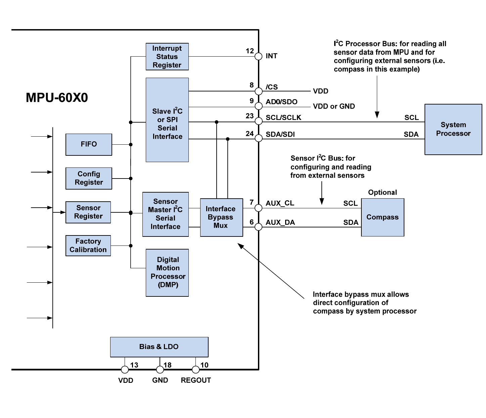

原 PDF 第 28 页图形区域。

The system processor is an I²C master to the MPU-60X0. In addition, the MPU-60X0 is an I²C master to the optional external compass sensor. The MPU-60X0 has limited capabilities as an I²C Master, and depends on the system processor to manage the initial configuration of any auxiliary sensors. The MPU-60X0 has an interface bypass multiplexer, which connects the system processor I²C bus pins 23 and 24 (SDA and SCL) directly to the auxiliary sensor I²C bus pins 6 and 7 (AUX_DA and AUX_CL).

Once the auxiliary sensors have been configured by the system processor, the interface bypass multiplexer should be disabled so that the MPU-60X0 auxiliary I²C master can take control of the sensor I²C bus and gather data from the auxiliary sensors.

For further information regarding I²C master control, please refer to Section 10.

### 7.14 MPU-6000 Using SPI Interface

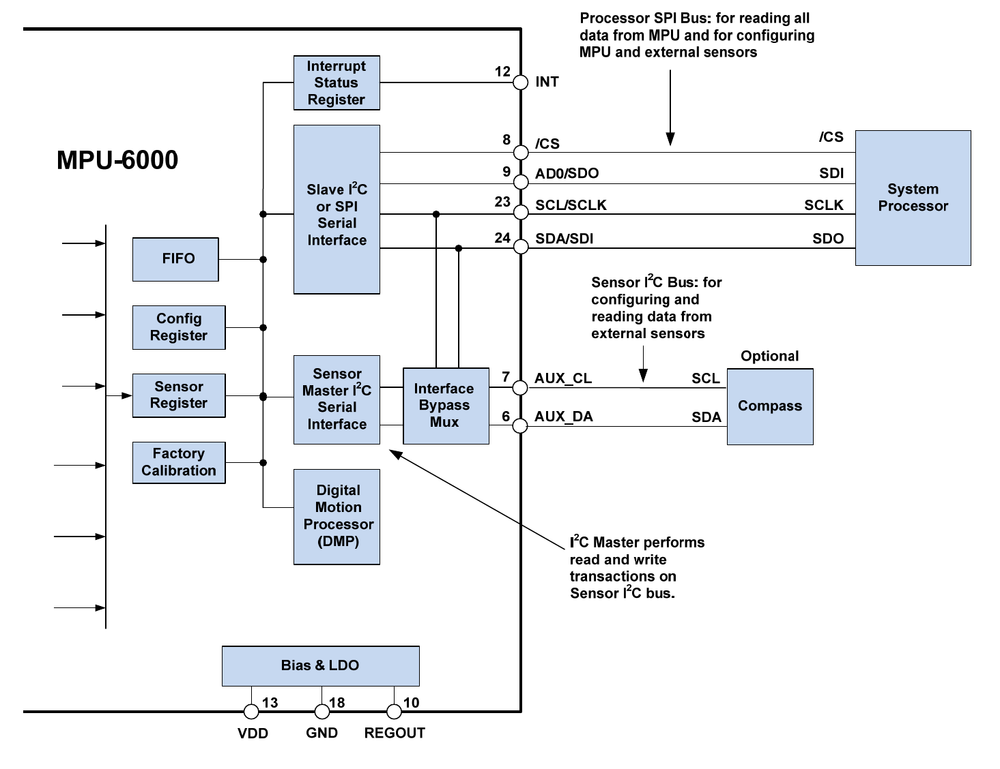

原 PDF 第 29 页图形区域。

The system processor is an SPI master to the MPU-6000. Pins 8, 9, 23, and 24 are used to support the /CS, SDO, SCLK, and SDI signals for SPI communications. Because these SPI pins are shared with the I²C slave pins (9, 23 and 24), the system processor cannot access the auxiliary I²C bus through the interface bypass multiplexer, which connects the processor I²C interface pins to the sensor I²C interface pins.

Since the MPU-6000 has limited capabilities as an I²C Master, and depends on the system processor to manage the initial configuration of any auxiliary sensors, another method must be used for programming the sensors on the auxiliary sensor I²C bus pins 6 and 7 (AUX_DA and AUX_CL).

When using SPI communications between the MPU-6000 and the system processor, configuration of devices on the auxiliary I²C sensor bus can be achieved by using I²C Slaves 0-4 to perform read and write transactions on any device and register on the auxiliary I²C bus. The I²C Slave 4 interface can be used to perform only single byte read and write transactions.

Once the external sensors have been configured, the MPU-6000 can perform single or multi-byte reads using the sensor I²C bus. The read results from the Slave 0-3 controllers can be written to the FIFO buffer as well as to the external sensor registers.

For further information regarding the control of the MPU-60X0’s auxiliary I²C interface, please refer to the

MPU-60X0 Register Map and Register Descriptions document.

### 7.15 Internal Clock Generation

The MPU-60X0 has a flexible clocking scheme, allowing a variety of internal or external clock sources to be used for the internal synchronous circuitry. This synchronous circuitry includes the signal conditioning and ADCs, the DMP, and various control circuits and registers. An on-chip PLL provides flexibility in the allowable inputs for generating this clock.

Allowable internal sources for generating the internal clock are:

- An internal relaxation oscillator

- Any of the X, Y, or Z gyros (MEMS oscillators with a variation of ±1% over temperature)

Allowable external clocking sources are:

- 32.768kHz square wave

- 19.2MHz square wave

Selection of the source for generating the internal synchronous clock depends on the availability of external sources and the requirements for power consumption and clock accuracy. These requirements will most likely vary by mode of operation. For example, in one mode, where the biggest concern is power consumption, the user may wish to operate the Digital Motion Processor of the MPU-60X0 to process accelerometer data, while keeping the gyros off. In this case, the internal relaxation oscillator is a good clock choice. However, in another mode, where the gyros are active, selecting the gyros as the clock source provides for a more accurate clock source.

Clock accuracy is important, since timing errors directly affect the distance and angle calculations performed by the Digital Motion Processor (and by extension, by any processor).

There are also start-up conditions to consider. When the MPU-60X0 first starts up, the device uses its internal clock until programmed to operate from another source. This allows the user, for example, to wait for the MEMS oscillators to stabilize before they are selected as the clock source.

### 7.16 Sensor Data Registers

The sensor data registers contain the latest gyro, accelerometer, auxiliary sensor, and temperature measurement data. They are read-only registers, and are accessed via the serial interface. Data from these registers may be read anytime. However, the interrupt function may be used to determine when new data is available.

For a table of interrupt sources please refer to Section 8.

### 7.17 FIFO

The MPU-60X0 contains a 1024-byte FIFO register that is accessible via the Serial Interface. The FIFO configuration register determines which data is written into the FIFO. Possible choices include gyro data, accelerometer data, temperature readings, auxiliary sensor readings, and FSYNC input. A FIFO counter keeps track of how many bytes of valid data are contained in the FIFO. The FIFO register supports burst reads. The interrupt function may be used to determine when new data is available.

For further information regarding the FIFO, please refer to the MPU-60X0 Register Map and Register Descriptions document.

### 7.18 Interrupts

Interrupt functionality is configured via the Interrupt Configuration register. Items that are configurable include the INT pin configuration, the interrupt latching and clearing method, and triggers for the interrupt. Items that can trigger an interrupt are (1) Clock generator locked to new reference oscillator (used when switching clock sources); (2) new data is available to be read (from the FIFO and Data registers); (3) accelerometer event interrupts; and (4) the MPU-60X0 did not receive an acknowledge from an auxiliary sensor on the secondary I²C bus. The interrupt status can be read from the Interrupt Status register.

For further information regarding interrupts, please refer to the MPU-60X0 Register Map and Register Descriptions document.

For information regarding the MPU-60X0’s accelerometer event interrupts, please refer to Section 8.

### 7.19 Digital-Output Temperature Sensor

An on-chip temperature sensor and ADC are used to measure the MPU-60X0 die temperature. The readings from the ADC can be read from the FIFO or the Sensor Data registers.

### 7.20 Bias and LDO

The bias and LDO section generates the internal supply and the reference voltages and currents required by the MPU-60X0. Its two inputs are an unregulated VDD of 2.375 to 3.46V and a VLOGIC logic reference supply voltage of 1.71V to VDD (MPU-6050 only). The LDO output is bypassed by a capacitor at REGOUT. For further details on the capacitor, please refer to the Bill of Materials for External Components (Section 7.3).

### 7.21 Charge Pump

An on-board charge pump generates the high voltage required for the MEMS oscillators. Its output is bypassed by a capacitor at CPOUT. For further details on the capacitor, please refer to the Bill of Materials for External Components (Section 7.3).

## 8 Programmable Interrupts

The MPU-60X0 has a programmable interrupt system which can generate an interrupt signal on the INT pin. Status flags indicate the source of an interrupt. Interrupt sources may be enabled and disabled individually.

**Table of Interrupt Sources**

|Interrupt Name|Module|
|---|---|
|Free Fall Detection|Free Fall|
|Motion Detection|Motion|
|Zero Motion Detection|Zero Motion|
|FIFO Overflow|FIFO|
|Data Ready|Sensor Registers|
|I²C Master errors: Lost Arbitration, NACKs|I²C Master|
|I²C Slave 4|I²C Master|

For information regarding the interrupt enable/disable registers and flag registers, please refer to the MPU6000/MPU-6050 Register Map and Register Descriptions document. Some interrupt sources are explained below.

### 8.1 Free Fall, Motion, and Zero Motion Signal Paths

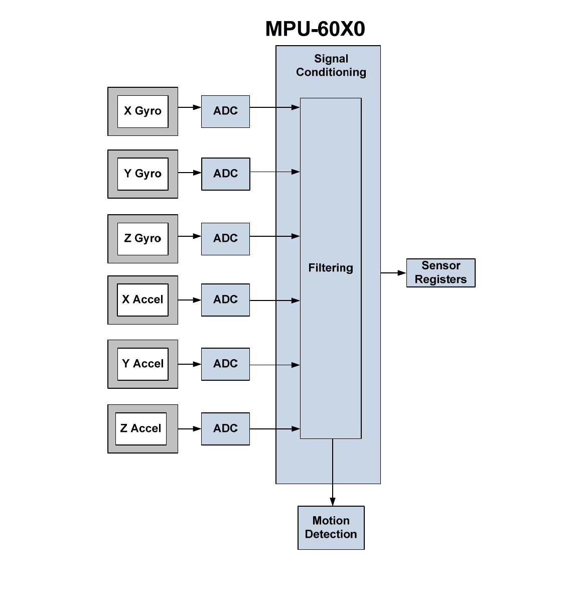

原 PDF 第 33 页图形区域。

Each digital low pass filter (DLPF) is configured identically, as is each sample rate divider and digital high pass filter (DHPF).

### 8.2 Free Fall Interrupt

Free fall is detected by checking if the accelerometer measurements from all 3 axes have an absolute value below a user-programmable threshold (acceleration threshold). For each sample where this condition is true (a qualifying sample), a counter is incremented. For each sample where this condition is false (a nonqualifying sample), the counter is decremented. Once the counter reaches a user-programmable threshold (the counter threshold), the Free Fall interrupt is triggered and a flag is set. The flag is cleared once the counter has decremented to zero. The counter does not increment above the counter threshold or decrement below zero.

The user is given several configuration parameters to fine tune Free Fall detection. Both, the acceleration threshold and counter threshold are user configurable. The FF_THR register allows the user to set a threshold in 1 m _g_ increments. The FF_DUR register allows the user to set duration in 1 ms increments.

The decrement rate for non-qualifying samples is also configurable. The MOT_DETECT_CTRL register allows the user to specify whether a non-qualifying sample makes the counter reset to zero, or decrement in steps of 1, 2, or 4.

### 8.3 Motion Interrupt

The MPU-60X0 provides Motion detection capability with similar functionality to Free Fall detection. Accelerometer measurements are passed through a configurable digital high pass filter (DHPF) in order to eliminate bias due to gravity. A qualifying motion sample is one where the high passed sample from any axis has an absolute value exceeding a user-programmable threshold. A counter increments for each qualifying sample, and decrements for each non-qualifying sample. Once the counter reaches a user-programmable counter threshold, a motion interrupt is triggered. The axis and polarity which caused the interrupt to be triggered is flagged in the MOT_DETECT_STATUS register.

Like Free Fall detection, Motion detection has a configurable acceleration threshold MOT_THR specified in 1 m _g_ increments. The counter threshold MOT_DUR is specified in 1 ms increments. The decrement rate has the same options as Free Fall detection, and is specified in the MOT_DETECT_CTRL register.

### 8.4 Zero Motion Interrupt

The Zero Motion detection capability uses the digital high pass filter (DHPF) and a similar threshold scheme to that of Free Fall detection. Each axis of the high passed accelerometer measurement must have an absolute value less than a threshold specified in the ZRMOT_THR register, which can be increased in 1 m _g_ increments. Each time a motion sample meets this condition, a counter increments. When this counter reaches a threshold specified in ZRMOT_DUR, an interrupt is generated.

Unlike Free Fall or Motion detection, Zero Motion detection triggers an interrupt both when Zero Motion is first detected and when Zero Motion is no longer detected. While Free Fall and Motion are indicated with a flag which clears after being read, reading the state of the Zero Motion detected from the MOT_DETECT_STATUS register does not clear its status.

## 9 Digital Interface

### 9.1 I²C and SPI (MPU-6000 only) Serial Interfaces

The internal registers and memory of the MPU-6000/MPU-6050 can be accessed using either I²C at 400 kHz or SPI at 1MHz (MPU-6000 only). SPI operates in four-wire mode.

**Serial Interface**

|Pin Number|MPU-6000|MPU-6050|Pin Name|Pin Description|
|---|---|---|---|---|
|8|Y||/CS|SPI chip select (0=SPI enable)|
|8||Y|VLOGIC|Digital I/O supply voltage. VLOGIC must be ≤ VDD at all times.|
|9|Y||AD0 / SDO|I²C Slave Address LSB (AD0); SPI serial data output (SDO)|
|9||Y|AD0|I²C Slave Address LSB|
|23|Y||SCL / SCLK|I²C serial clock (SCL); SPI serial clock (SCLK)|
|23||Y|SCL|I²C serial clock|
|24|Y||SDA / SDI|I²C serial data (SDA); SPI serial data input (SDI)|
|24||Y|SDA|I²C serial data|

**Note:**

To prevent switching into I²C mode when using SPI (MPU-6000), the I²C interface should be disabled by setting the `I2C_IF_DIS` configuration bit. Setting this bit should be performed immediately after waiting for the time specified by the “Start-Up Time for Register Read/Write” in Section 6.3.

For further information regarding the `I2C_IF_DIS` bit, please refer to the MPU-60X0 Register Map and Register Descriptions document.

### 9.2 I²C Interface

I²C is a two-wire interface comprised of the signals serial data (SDA) and serial clock (SCL). In general, the lines are open-drain and bi-directional. In a generalized I²C interface implementation, attached devices can be a master or a slave. The master device puts the slave address on the bus, and the slave device with the matching address acknowledges the master.

The MPU-60X0 always operates as a slave device when communicating to the system processor, which thus acts as the master. SDA and SCL lines typically need pull-up resistors to VDD. The maximum bus speed is

400 kHz.

The slave address of the MPU-60X0 is b110100X which is 7 bits long. The LSB bit of the 7 bit address is determined by the logic level on pin AD0. This allows two MPU-60X0s to be connected to the same I²C bus. When used in this configuration, the address of the one of the devices should be b1101000 (pin AD0 is logic low) and the address of the other should be b1101001 (pin AD0 is logic high).

### 9.3 I²C Communications Protocol

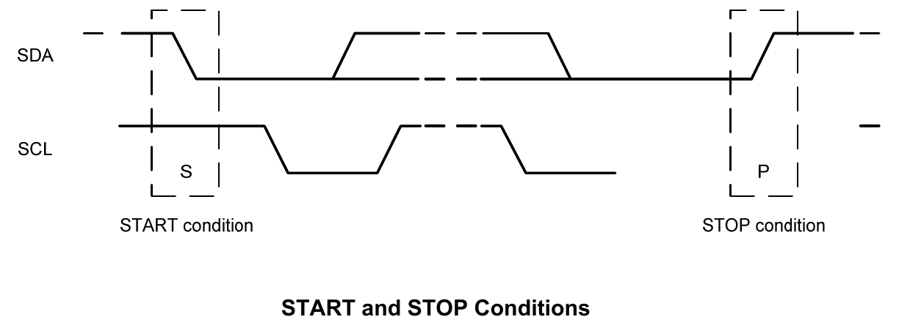

原 PDF 第 37 页图形区域。

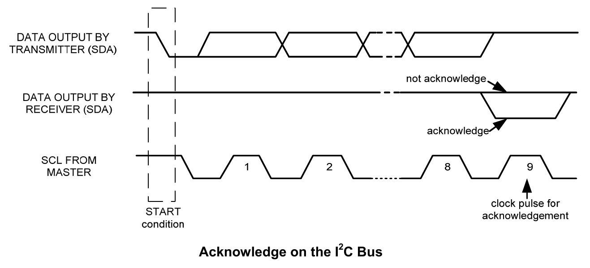

原 PDF 第 37 页图形区域。

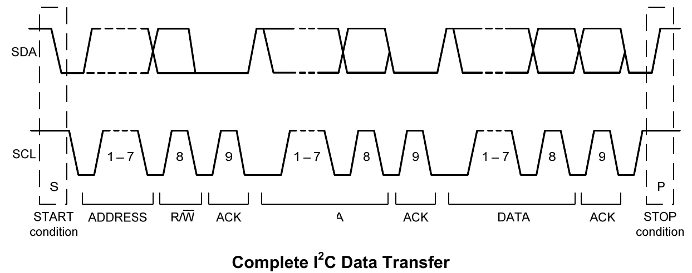

原 PDF 第 38 页图形区域。

_START (S) and STOP (P) Conditions_

Communication on the I²C bus starts when the master puts the START condition (S) on the bus, which is defined as a HIGH-to-LOW transition of the SDA line while SCL line is HIGH. The bus is considered to be busy until the master puts a STOP condition (P) on the bus, which is defined as a LOW to HIGH transition on the SDA line while SCL is HIGH.

Additionally, the bus remains busy if a repeated START (Sr) is generated instead of a STOP condition.

**START and STOP Conditions**

_Data Format / Acknowledge_

I²C data bytes are defined to be 8-bits long. There is no restriction to the number of bytes transmitted per data transfer. Each byte transferred must be followed by an acknowledge (ACK) signal. The clock for the acknowledge signal is generated by the master, while the receiver generates the actual acknowledge signal by pulling down SDA and holding it low during the HIGH portion of the acknowledge clock pulse.

If a slave is busy and cannot transmit or receive another byte of data until some other task has been performed, it can hold SCL LOW, thus forcing the master into a wait state. Normal data transfer resumes when the slave is ready, and releases the clock line.

_Communications_

After beginning communications with the START condition (S), the master sends a 7-bit slave address followed by an 8 th bit, the read/write bit. The read/write bit indicates whether the master is receiving data from or is writing to the slave device. Then, the master releases the SDA line and waits for the acknowledge signal (ACK) from the slave device. Each byte transferred must be followed by an acknowledge bit. To acknowledge, the slave device pulls the SDA line LOW and keeps it LOW for the high period of the SCL line. Data transmission is always terminated by the master with a STOP condition (P), thus freeing the communications line. However, the master can generate a repeated START condition (Sr), and address another slave without first generating a STOP condition (P). A LOW to HIGH transition on the SDA line while SCL is HIGH defines the stop condition. All SDA changes should take place when SCL is low, with the exception of start and stop conditions.

**Complete I** **2** **C Data Transfer**

To write the internal MPU-60X0 registers, the master transmits the start condition (S), followed by the I²C address and the write bit (0). At the 9 th clock cycle (when the clock is high), the MPU-60X0 acknowledges the transfer. Then the master puts the register address (RA) on the bus. After the MPU-60X0 acknowledges the reception of the register address, the master puts the register data onto the bus. This is followed by the ACK signal, and data transfer may be concluded by the stop condition (P). To write multiple bytes after the last ACK signal, the master can continue outputting data rather than transmitting a stop signal. In this case, the MPU-60X0 automatically increments the register address and loads the data to the appropriate register. The following tables show single and two-byte write sequences.

_Single-Byte Write Sequence_

|Master|S|AD+W||RA||DATA||P|
|---|---|---|---|---|---|---|---|---|
|Slave|||ACK||ACK||ACK||

_Burst Write Sequence_

|Master|S|AD+W||RA||DATA||DATA||P|
|---|---|---|---|---|---|---|---|---|---|---|
|Slave|||ACK||ACK||ACK||ACK||

To read the internal MPU-60X0 registers, the master sends a start condition, followed by the I²C address and a write bit, and then the register address that is going to be read. Upon receiving the ACK signal from the MPU-60X0, the master transmits a start signal followed by the slave address and read bit. As a result, the MPU-60X0 sends an ACK signal and the data. The communication ends with a not acknowledge (NACK) signal and a stop bit from master. The NACK condition is defined such that the SDA line remains high at the 9 th clock cycle. The following tables show single and two-byte read sequences.

_Single-Byte Read Sequence_

|Master|S|AD+W||RA||S|AD+R|||NACK|P|
|---|---|---|---|---|---|---|---|---|---|---|---|
|Slave|||ACK||ACK|||ACK|DATA|||

_Burst Read Sequence_

|Master|S|AD+W||RA||S|AD+R|||ACK||NACK|P|
|---|---|---|---|---|---|---|---|---|---|---|---|---|---|
|Slave|||ACK||ACK|||ACK|DATA||DATA|||

### 9.4 I²C Terms

|Signal|Description|
|---|---|
|S|Start Condition: SDA goes from high to low while SCL is high |
|AD|Slave I2C address|
|W|Write bit (0)|
|R|Read bit (1)|
|ACK|Acknowledge: SDA line is low while the SCL line is high at the 9th clock cycle |
|NACK|Not-Acknowledge: SDA line stays high at the 9th clock cycle|
|RA|MPU-60X0 internal register address|
|DATA|Transmit or received data|
|P|Stop condition: SDA going from low to high while SCL is high|

### 9.5 SPI Interface (MPU-6000 only)

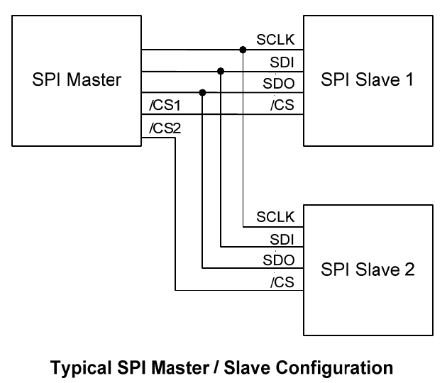

原 PDF 第 40 页图形区域。

SPI is a 4-wire synchronous serial interface that uses two control lines and two data lines. The MPU-6000 always operates as a Slave device during standard Master-Slave SPI operation.

With respect to the Master, the Serial Clock output (SCLK), the Serial Data Output (SDO) and the Serial Data Input (SDI) are shared among the Slave devices. Each SPI slave device requires its own Chip Select (/CS) line from the master.

/CS goes low (active) at the start of transmission and goes back high (inactive) at the end. Only one /CS line is active at a time, ensuring that only one slave is selected at any given time. The /CS lines of the nonselected slave devices are held high, causing their SDO lines to remain in a high-impedance (high-z) state so that they do not interfere with any active devices.

_SPI Operational Features_

1. Data is delivered MSB first and LSB last
2. Data is latched on the rising edge of SCLK
3. Data should be transitioned on the falling edge of SCLK
4. The maximum frequency of SCLK is 1MHz
5. SPI read and write operations are completed in 16 or more clock cycles (two or more bytes). The first byte contains the SPI Address, and the following byte(s) contain(s) the SPI data. The first bit of the first byte contains the Read/Write bit and indicates the Read (1) or Write (0) operation. The following 7 bits contain the Register Address. In cases of multiple-byte Read/Writes, data is two or more bytes:

_SPI Address format_

|MSB|||||||LSB|
|---|---|---|---|---|---|---|---|
|R/W|A6|A5|A4|A3|A2|A1|A0|

_SPI Data format_

|MSB|||||||LSB|
|---|---|---|---|---|---|---|---|
|D7|D6|D5|D4|D3|D2|D1|D0|

6. Supports Single or Burst Read/Writes.

## 10 Serial Interface Considerations (MPU-6050)

### 10.1 MPU-6050 Supported Interfaces

The MPU-6050 supports I²C communications on both its primary (microprocessor) serial interface and its auxiliary interface.

### 10.2 Logic Levels

The MPU-6050’s I/O logic levels are set to be either VDD or VLOGIC, as shown in the table below.

**I/O Logic Levels vs.** **`AUX_VDDIO`**

|AUX_VDDIO|MICROPROCESSOR LOGIC LEVELS (Pins: SDA, SCL, AD0, CLKIN, INT)|AUXILLARY LOGIC LEVELS (Pins: AUX_DA, AUX_CL)|
|---|---|---|
|0|VLOGIC|VLOGIC|
|1|VLOGIC|VDD|

Note: The power-on-reset value for `AUX_VDDIO` is 0.

VLOGIC may be set to be equal to VDD or to another voltage. However, VLOGIC must be ≤ VDD at all times. When `AUX_VDDIO` is set to 0 (its power-on-reset value), VLOGIC is the power supply voltage for both the microprocessor system bus and the auxiliary I²C bus, as described in Section 10.3. When `AUX_VDDIO` is set to 1, VLOGIC is the power supply voltage for the microprocessor system bus and VDD is the supply for the auxiliary I²C bus, as described in Section 10.4.

### 10.3 Logic Levels for AUX_VDDIO = 0

For a sample circuit with a third party magnetometer attached to the auxiliary I²C bus, the following notes describe logic levels for `AUX_VDDIO` = 0. Note: Actual configuration will depend on the auxiliary sensors used.

**I/O Levels and Connections for** **`AUX_VDDIO`** **= 0**

**Notes:**

1. AUX_VDDIO determines the IO voltage levels of AUX_DA and AUX_CL (0 = set output levels relative to VLOGIC)
2. CLKOUT is referenced to VDD.
3. All other MPU-6050 logic IOs are referenced to VLOGIC.

### 10.4 Logic Levels for AUX_VDDIO = 1

For a sample circuit with a 3 rd party magnetometer attached to the auxiliary I²C bus, the following notes describe logic levels for `AUX_VDDIO` = 1. This configuration is useful when the auxiliary sensor has only one supply for logic and power. Note: Actual configuration will depend on the auxiliary sensors used.

**I/O Levels and Connections for Two Example Power Configurations (** **`AUX_VDDIO`** **= 1)**

**Notes:**

1. `AUX_VDDIO` determines the IO voltage levels of AUX_DA and AUX_CL. `AUX_VDDIO` = 1 sets output levels relative to VDD.
2. 3 rd -party auxiliary device logic levels are referenced to VDD. Setting INT1 and INT2 to open drain configuration provides voltage compatibility when VDD ≠ VLOGIC. When VDD = VLOGIC, INT1 and INT2 may be set to push-pull outputs, and external pull-up resistors are not needed.
3. CLKOUT is referenced to VDD.
4. All other MPU-6050 logic IOs are referenced to VLOGIC.

## 11 Assembly

This section provides general guidelines for assembling InvenSense Micro Electro-Mechanical Systems (MEMS) gyros packaged in Quad Flat No leads package (QFN) surface mount integrated circuits.

### 11.1 Orientation of Axes

图形位置关系见原资料截图；参数表仍以本文文字为准。

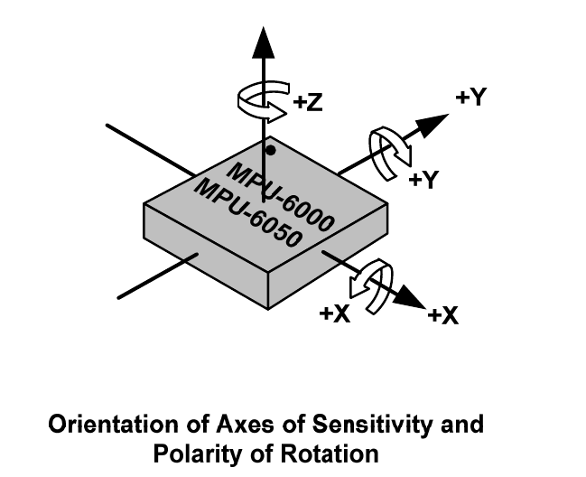

原 PDF 第 44 页图形区域。

### 11.2 Package Dimensions

24 Lead QFN (4x4x0.9) mm NiPdAu Lead-frame finish

图形位置关系见原资料截图；参数表仍以本文文字为准。

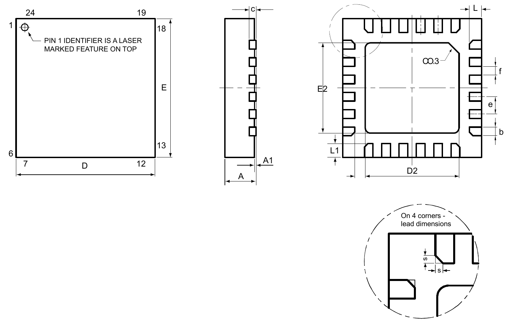

原 PDF 第 45 页图形区域。

|Symbol|Minimum (mm)|Nominal (mm)|Maximum (mm)|
|---|---|---|---|
|A|0.85|0.90|0.95|
|A1|0.00|0.02|0.05|
|b|0.18|0.25|0.30|
|c|‐‐‐|0.20 REF|‐‐‐|
|D|3.90|4.00|4.10|
|D2|2.65|2.70|2.75|
|E|3.90|4.00|4.10|
|E2|2.55|2.60|2.65|
|e|‐‐‐|0.50|‐‐‐|
|f (e‐b)|‐‐‐|0.25|‐‐‐|
|K|0.25|0.30|0.35|
|L|0.30|0.35|0.40|
|L1|0.35|0.40|0.45|
|s|0.05|‐‐‐|0.15|

### 11.3 PCB Design Guidelines

The Pad Dimensions Table shows pad sizing (mean dimensions) recommended for the MPU-60X0 product. 图形位置关系见原资料截图；参数表仍以本文文字为准。

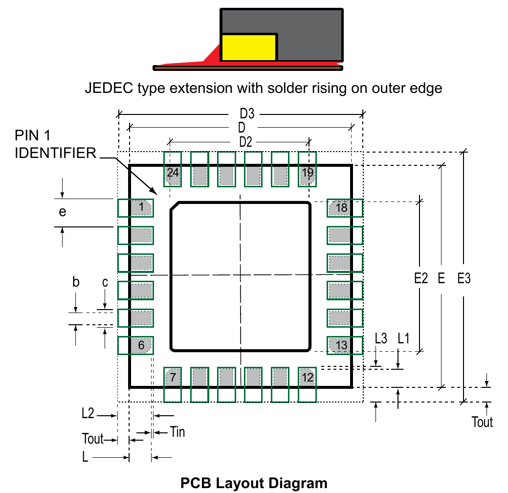

原 PDF 第 46 页图形区域。

JEDEC type extension with solder rising on outer edge

|Symbol|Description|Nominal dimension (mm)|
|---|---|---|
| **Nominal Package I/O Pad Dimensions**|||
|e|Pad Pitch|0.50|
|b|Pad Width|0.25|
|L|Pad Length|0.35|
|L1|Pad Length|0.40|
|D|Package Width|4.00|
|E|Package Length|4.00|
|D2|Exposed Pad Width|2.70|
|E2|Exposed Pad Length|2.60|
|**I/O Land Design Dimensions (Guidelines )**|||
|D3|I/O Pad Extent Width|4.80|
|E3|I/O Pad Extent Length|4.80|
|c|Land Width|0.35|
|Tout|Outward Extension|0.40|
|Tin|Inward Extension|0.05|
|L2|Land Length|0.80|
|L3|Land Length|0.85|

**PCB Dimensions Table (for PCB Lay-out Diagram)**

### 11.4 Assembly Precautions

#### 11.4.1 Gyroscope Surface Mount Guidelines

InvenSense MEMS Gyros sense rate of rotation. In addition, gyroscopes sense mechanical stress coming from the printed circuit board (PCB). This PCB stress can be minimized by adhering to certain design rules:

When using MEMS gyroscope components in plastic packages, PCB mounting and assembly can cause package stress. This package stress in turn can affect the output offset and its value over a wide range of temperatures. This stress is caused by the mismatch between the Coefficient of Linear Thermal Expansion (CTE) of the package material and the PCB. Care must be taken to avoid package stress due to mounting.

Traces connected to pads should be as symmetric as possible. Maximizing symmetry and balance for pad connection will help component self alignment and will lead to better control of solder paste reduction after reflow.

Any material used in the surface mount assembly process of the MEMS gyroscope should be free of restricted RoHS elements or compounds. Pb-free solders should be used for assembly.

#### 11.4.2 Exposed Die Pad Precautions

The MPU-60X0 has very low active and standby current consumption. The exposed die pad is not required for heat sinking, and should not be soldered to the PCB. Failure to adhere to this rule can induce performance changes due to package thermo-mechanical stress. There is no electrical connection between the pad and the CMOS.

#### 11.4.3 Trace Routing

Routing traces or vias under the gyro package such that they run under the exposed die pad is prohibited. Routed active signals may harmonically couple with the gyro MEMS devices, compromising gyro response. These devices are designed with the drive frequencies as follows: X = 33±3Khz, Y = 30±3Khz, and Z=27±3Khz. To avoid harmonic coupling don’t route active signals in non-shielded signal planes directly below, or above the gyro package. Note: For best performance, design a ground plane under the e-pad to reduce PCB signal noise from the board on which the gyro device is mounted. If the gyro device is stacked under an adjacent PCB board, design a ground plane directly above the gyro device to shield active signals from the adjacent PCB board.

#### 11.4.4 Component Placement

Do not place large insertion components such as keyboard or similar buttons, connectors, or shielding boxes at a distance of less than 6 mm from the MEMS gyro. Maintain generally accepted industry design practices for component placement near the MPU-60X0 to prevent noise coupling and thermo-mechanical stress.

#### 11.4.5 PCB Mounting and Cross-Axis Sensitivity

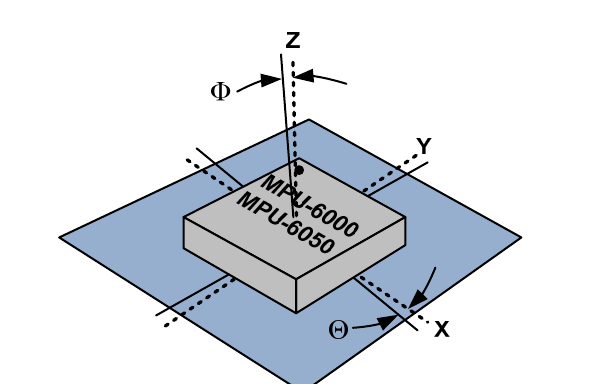

原 PDF 第 48 页图形区域。

Orientation errors of the gyroscope and accelerometer mounted to the printed circuit board can cause crossaxis sensitivity in which one gyro or accel responds to rotation or acceleration about another axis, respectively. For example, the X-axis gyroscope may respond to rotation about the Y or Z axes.

The table below shows the cross-axis sensitivity as a percentage of the gyroscope or accelerometer’s sensitivity for a given orientation error, respectively.

**Cross-Axis Sensitivity vs. Orientation Error**

|Orientation Error (θ or Φ)|Cross-Axis Sensitivity (sinθ or sinΦ)|
|---|---|
|0º|0%|
|0.5º|0.87%|
|1º|1.75%|

The specifications for cross-axis sensitivity in Section 6.1 and Section 6.2 include the effect of the die orientation error with respect to the package.

#### 11.4.6 MEMS Handling Instructions

MEMS (Micro Electro-Mechanical Systems) are a time-proven, robust technology used in hundreds of millions of consumer, automotive and industrial products. MEMS devices consist of microscopic moving mechanical structures. They differ from conventional IC products, even though they can be found in similar packages. Therefore, MEMS devices require different handling precautions than conventional ICs prior to mounting onto printed circuit boards (PCBs).

The MPU-60X0 has been qualified to a shock tolerance of 10,000 _g_ . InvenSense packages its gyroscopes as it deems proper for protection against normal handling and shipping. It recommends the following handling precautions to prevent potential damage.

- Do not drop individually packaged gyroscopes, or trays of gyroscopes onto hard surfaces. Components placed in trays could be subject to _g_ -forces in excess of 10,000 _g_ if dropped.

- Printed circuit boards that incorporate mounted gyroscopes should not be separated by manually snapping apart. This could also create _g_ -forces in excess of 10,000 _g._

#### 11.4.7 ESD Considerations

Establish and use ESD-safe handling precautions when unpacking and handling ESD-sensitive devices.

- Store ESD sensitive devices in ESD safe containers until ready for use. The Tape-and-Reel moisturesealed bag is an ESD approved barrier. The best practice is to keep the units in the original moisture sealed bags until ready for assembly.

Restrict all device handling to ESD protected work areas that measure less than 200V static charge. Ensure that all workstations and personnel are properly grounded to prevent ESD.

#### 11.4.8 Reflow Specification

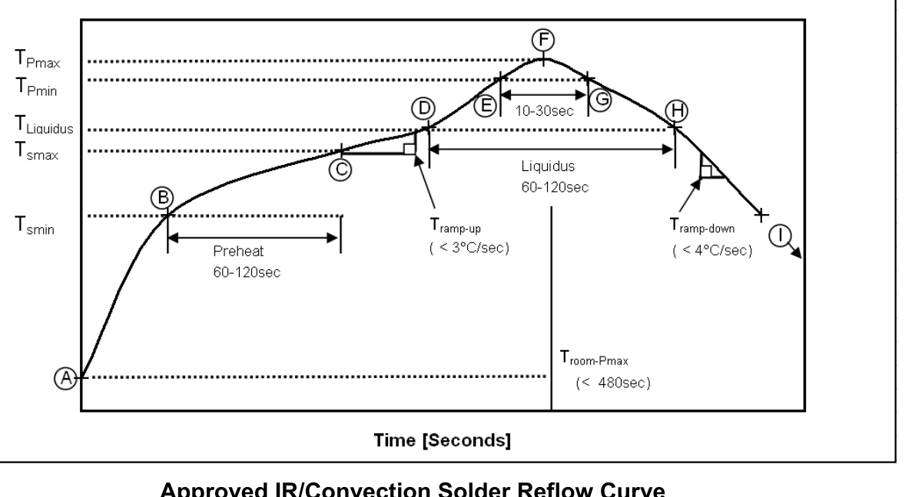

原 PDF 第 49 页图形区域。

Qualification Reflow: The MPU-60X0 was qualified in accordance with IPC/JEDEC J-STD-020D.01. This standard classifies proper packaging, storage and handling in order to avoid subsequent thermal and mechanical damage during the solder reflow attachment phase of assembly. The classification specifies a sequence consisting of a bake cycle, a moisture soak cycle in a temperature humidity oven, followed by three solder reflow cycles and functional testing for qualification. All temperatures refer to the topside of the QFN package, as measured on the package body surface. The peak solder reflow classification temperature requirement is (260 +5/-0°C) for lead-free soldering of components measuring less than 1.6 mm in thickness.

Production Reflow: Check the recommendations of your solder manufacturer. For optimum results, production solder reflow processes should reduce exposure to high temperatures, and use lower ramp-up and ramp-down rates than those used in the component qualification profile.

Production reflow should never exceed the maximum constraints listed in the table below that were used for the qualification profile, as these represent the maximum tolerable ratings for the device.

**Temperature Set Points for IR / Convection Reflow**

|Step|Setting|Temperature constraint (°C)|Time constraint (sec)|Rate constraint (°C/sec)|
|---|---|---|---|---|
|A|Troom|25|||
|B|TSmin|150|||
|C|TSmax|200|60 < tBC < 120||
|D|TLiquidus|217||r(TLiquidus-TPmax) < 3|
|E|TPmin [255°C, 260°C]|255||r(TLiquidus-TPmax) < 3|
|F|TPmax [ 260°C, 265°C]|260|tAF < 480|r(TLiquidus-TPmax) < 3|
|G|TPmin  [255°C, 260°C]|255|10< tEG < 30|r(TPmax-TLiquidus) < 4|
|H|TLiquidus|217|60 < tDH < 120||
|I|Troom|25|||

**Notes:**

- For users TPmax must not exceed the Classification temperature (260°C).

- For suppliers TPmax must equal or exceed the classification temperature.

### 11.5 Storage Specifications

The storage specification of the MPU-60X0 conforms to IPC/JEDEC J-STD-020D.01 Moisture Sensitivity Level (MSL) 3.

|Condition|Shelf-life and storage requirements|
|---|---|
|Calculated shelf-life in moisture-sealed bag|12 months -- Storage conditions: <40°C and <90% RH|
|After opening moisture-sealed bag|168 hours -- Storage conditions: ambient ≤30°C at 60%RH|

### 11.6 Package Marking Specification

图形位置关系见原资料截图；参数表仍以本文文字为准。

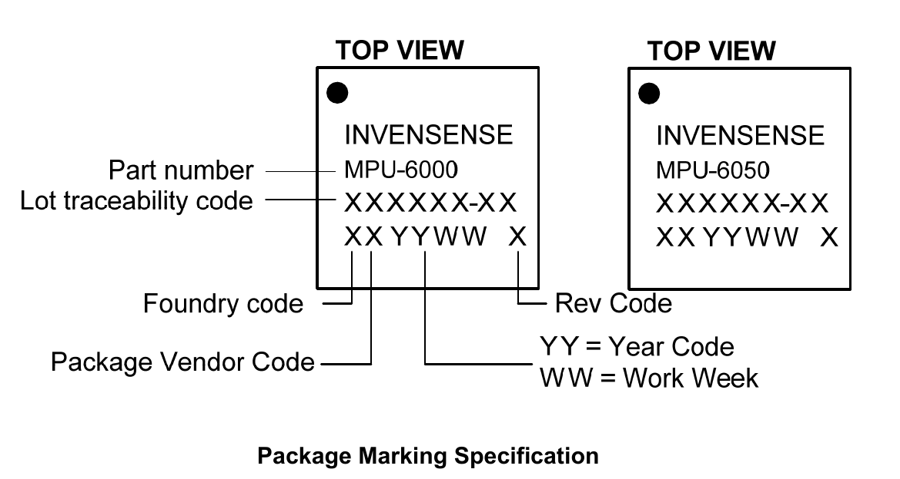

原 PDF 第 51 页图形区域。

### 11.7 Tape & Reel Specification

The following table and drawing describe the tape dimensions, reel outline and package size.

|Package size|Reel L (mm)|Reel V (mm)|Reel W (mm)|Reel Z (mm)|
|---|---|---|---|---|
|**4x4**|**330**|**100**|**13.2**|**2.2**|

图形位置关系见原资料截图；参数表仍以本文文字为准。

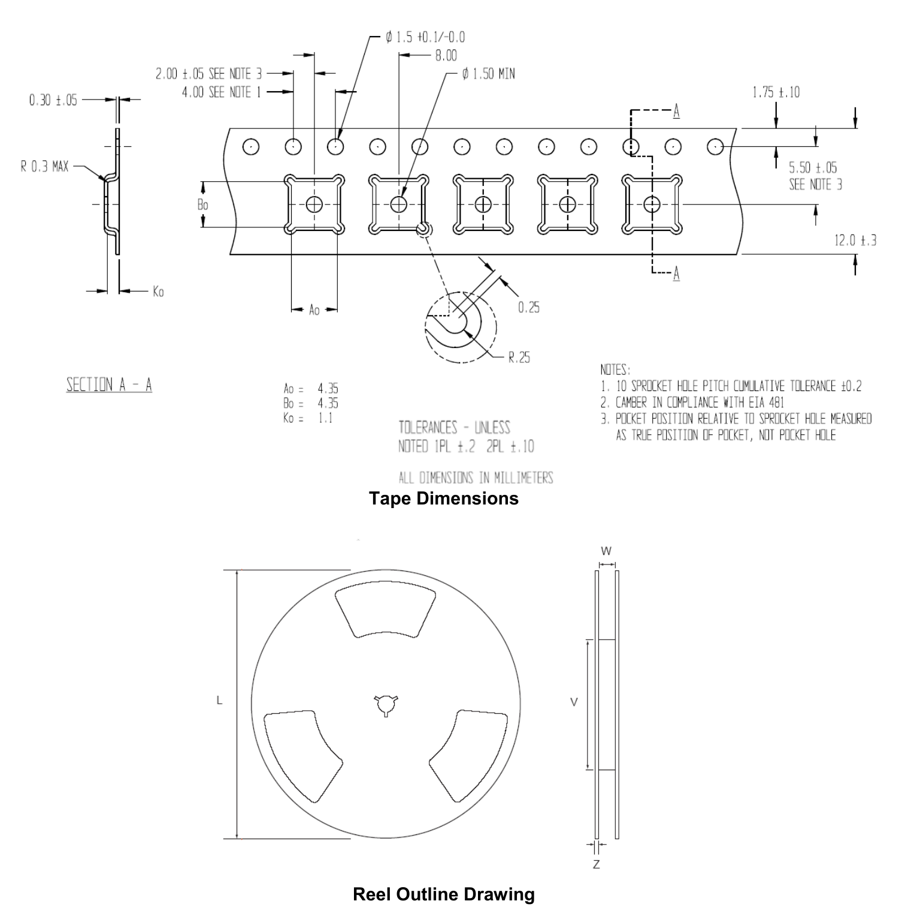

原 PDF 第 52 页图形区域。

|Reel Specifications||
|---|---|
|**Quantity Per Reel**|**5,000**|
|**Reels per Box**|**1 **|
|**Boxes Per Carton (max)**|**3 **|
|**Pcs/Carton (max)**|**15,000**|

### 11.8 Label

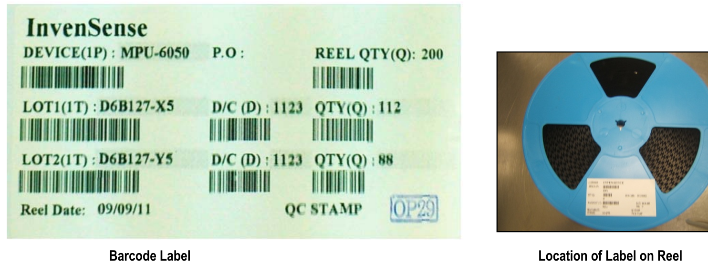

原 PDF 第 53 页图形区域。

图形位置关系见原资料截图；参数表仍以本文文字为准。

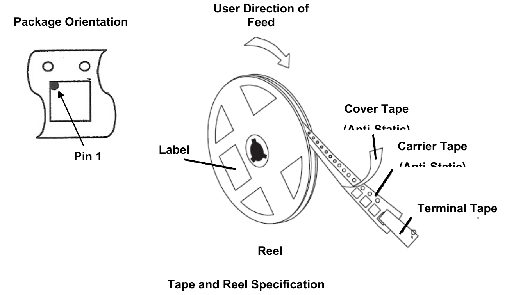

原 PDF 第 53 页图形区域。

### 11.9 Packaging

图形位置关系见原资料截图；参数表仍以本文文字为准。

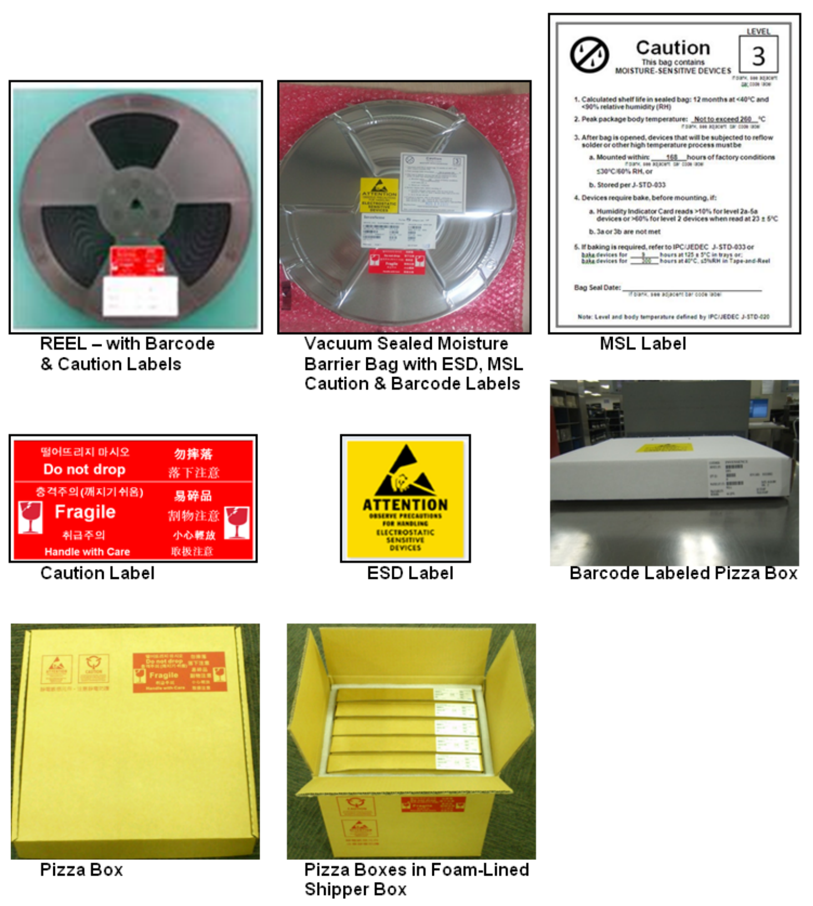

原 PDF 第 54 页图形区域。

## 12 Reliability

### 12.1 Qualification Test Policy

InvenSense’s products complete a Qualification Test Plan before being released to production. The Qualification Test Plan for the MPU-60X0 followed the JEDEC 47G.01 Standard, “Stress-Test-Driven Qualification of Integrated Circuits,” with the individual tests described below.

### 12.2 Qualification Test Plan

**Accelerated Life Tests**

|TEST|Method/Condition|Lot Quantity|Sample / Lot|Acc / Reject Criteria|
|---|---|---|---|---|
|**High Temperature** **Operating Life (HTOL/LFR)**|JEDEC JESD22-A108C, Dynamic, 3.63V biased, Tj>125°C [read-points 168, 500, 1000 hours]|3|77|(0/1)|
|**Highly Accelerated Stress** **Test, Unbiased(1) (HAST)** |JEDEC JESD22-A118 Condition A, 130°C, 85%RH, 33.3 psia., unbiased, [read-point 96 hours]|3|77|(0/1)|
|**High Temperature Storage** **Life (HTS)**|JEDEC JESD22-A103C, Cond. A, 125°C, Non-Biased Bake [read-points 168, 500, 1000 hours]|3  |77|(0/1)|

**Device Component Level Tests**

|TEST|Method/Condition|Lot Quantity|Sample / Lot|Acc / Reject Criteria|
|---|---|---|---|---|
|**ESD-HBM**|JEDEC JESD22-A114F, (2KV)|1|3|(0/1)|
|**ESD-MM**|JEDEC JESD22-A115-A, (200V)|1|3|(0/1)|
|**Latch Up**|JEDEC JESD78B Class II (2), 125°C; Level A ±100mA|1|6|(0/1)|
|**Mechanical Shock**|JEDEC JESD22-B104C, Mil-Std-883H, method 2002.5, Cond. E, 10,000_g’s_, 0.2ms, ±X, Y, Z – 6 directions, 5 times/direction|3|5|(0/1)|
|**Vibration**|JEDEC JESD22-B103B, Variable Frequency (random), Cond. B, 5-500Hz, X, Y, Z – 4 times/direction|3|5|(0/1)|
|**Temperature Cycling (TC)(1) **|JEDEC JESD22-A104D Condition N, [-40°C to +85°C], Soak Mode 2 [5’], 100 cycles|3|77|(0/1)|

**Board Level Tests**

|TEST|Method/Condition|Lot Quantity|Sample / Lot|Acc / Reject Criteria|
|---|---|---|---|---|
|**Board Mechanical Shock** |JEDEC JESD22-B104C, Mil-Std-883H, method 2002.5, Cond. E, 10000_g’s_, 0.2ms, ±X, Y, Z – 6 directions, 5 times/direction|1|5|(0/1)|

(1) Tests are preceded by MSL3 Preconditioning in accordance with JEDEC JESD22-A113F

## 13 Environmental Compliance

The MPU-60X0 is RoHS and Green compliant and is in full environmental compliance as evidenced in report HS-MPU-6000A, Materials Declaration Data Sheet.

**Environmental Declaration Disclaimer:**

InvenSense believes this environmental information to be correct but cannot guarantee accuracy or completeness. Conformity documents for the above component constitutes are on file. InvenSense subcontracts manufacturing and the information contained herein is based on data received from vendors and suppliers, which has not been validated by InvenSense.

## Legal notice

This information furnished by InvenSense is believed to be accurate and reliable. However, no responsibility is assumed by InvenSense for its use, or for any infringements of patents or other rights of third parties that may result from its use. Specifications are subject to change without notice. InvenSense reserves the right to make changes to this product, including its circuits and software, in order to improve its design and/or performance, without prior notice. InvenSense makes no warranties, neither expressed nor implied, regarding the information and specifications contained in this document. InvenSense assumes no responsibility for any claims or damages arising from information contained in this document, or from the use of products and services detailed therein. This includes, but is not limited to, claims or damages based on the infringement of patents, copyrights, mask work and/or other intellectual property rights.

Certain intellectual property owned by InvenSense and described in this document is patent protected. No license is granted by implication or otherwise under any patent or patent rights of InvenSense. This publication supersedes and replaces all information previously supplied. Trademarks that are registered trademarks are the property of their respective companies. InvenSense sensors should not be used or sold in the development, storage, production or utilization of any conventional or mass-destructive weapons or for any other weapons or life threatening applications, as well as in any other life critical applications such as medical equipment, transportation, aerospace and nuclear instruments, undersea equipment, power plant equipment, disaster prevention and crime prevention equipment.

InvenSense®, MotionCommand®, TouchAnywhere®, and AirSign® are registered trademarks of InvenSense, Inc.  MPU™, MPU6000™, MPU-6050™, MPU-60X0™, Motion Processing Unit™, MotionFusion™, MotionProcessing™, MotionApps™, Digital Motion Processor™, Digital Motion Processing™, DMP™, BlurFree™, and InstantGesture™ are trademarks of InvenSense, Inc.

©2011 InvenSense, Inc. All rights reserved.

返回：[文档索引](../../README.md)。
