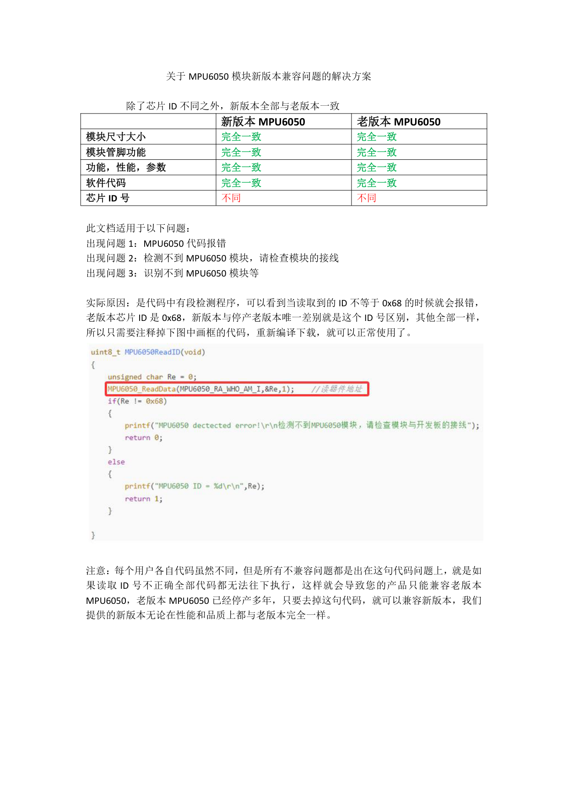

# MPU6050 模块新版本兼容问题的解决方案

> 来源：`关于MPU6050模块新版本兼容问题的解决方案2.pdf`，共 1 页。以下整理原供应资料观点，保留含代码的完整截图。原资料未给出新版本的具体芯片 ID；实际器件型号、兼容性及本项目适用性待确认，未修改或执行项目驱动。

## 原文第 1 页

### 原资料的新旧版本比较

原资料称：“除了芯片 ID 不同之外，新版本全部与老版本一致。”

| 对比项 | 新版本 MPU6050 | 老版本 MPU6050 |
| --- | --- | --- |
| 模块尺寸大小 | 完全一致 | 完全一致 |
| 模块管脚功能 | 完全一致 | 完全一致 |
| 功能、性能、参数 | 完全一致 | 完全一致 |
| 软件代码 | 完全一致 | 完全一致 |
| 芯片 ID 号 | 不同 | 不同 |

### 原资料列出的适用现象

1. MPU6050 代码报错。
2. “检测不到 MPU6050 模块，请检查模块的接线”。
3. 识别不到 MPU6050 模块等。

### 原资料对原因与解决方法的描述

代码中有一段检测程序，当读取到的 ID 不等于 `0x68` 时会报错。原资料称老版本芯片 ID 为 `0x68`，新版本与停产老版本的唯一区别是 ID，其余完全相同；因此提出注释掉截图中画框的代码，再重新编译下载。

原资料还称：用户代码各不相同，但其所述不兼容问题均来自 ID 检查失败后无法继续执行；仅允许旧 ID 会使产品只兼容老版本。原资料称老版本已停产多年，去掉该检查可兼容新版本，并声明其提供的新版本在性能和品质上与老版本完全相同。

以上为原供应资料的说法，尚未通过本项目实物验证，不能据此将所有识别失败都判定为 ID 兼容问题。

相关资料：[寄存器手册](RM-MPU-6000A-EN.md) · [产品规格书](PS-MPU-6000A-EN.md) · [模块原理图](MPU6050-V1-SCH.md)。

返回：[文档索引](../../README.md)。
