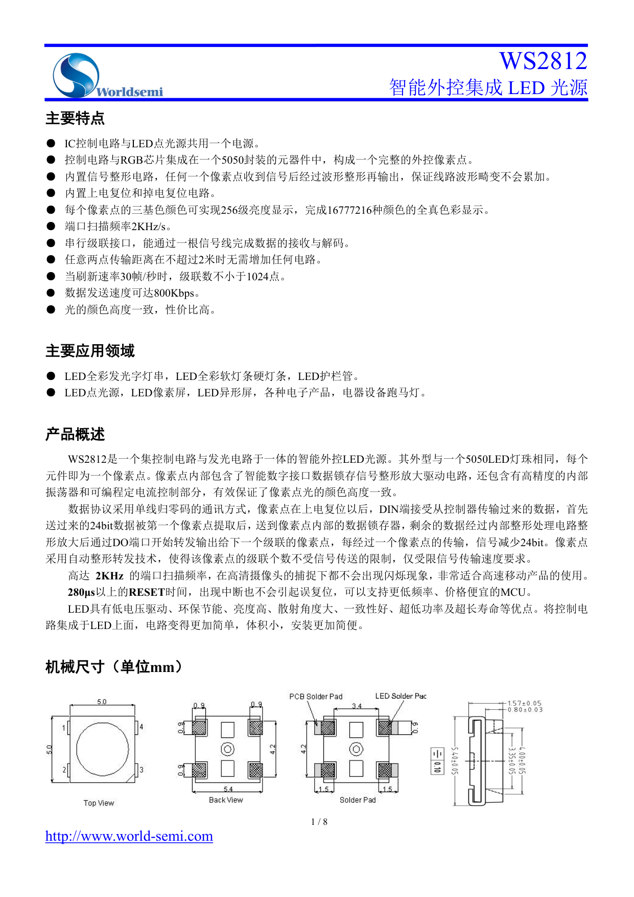
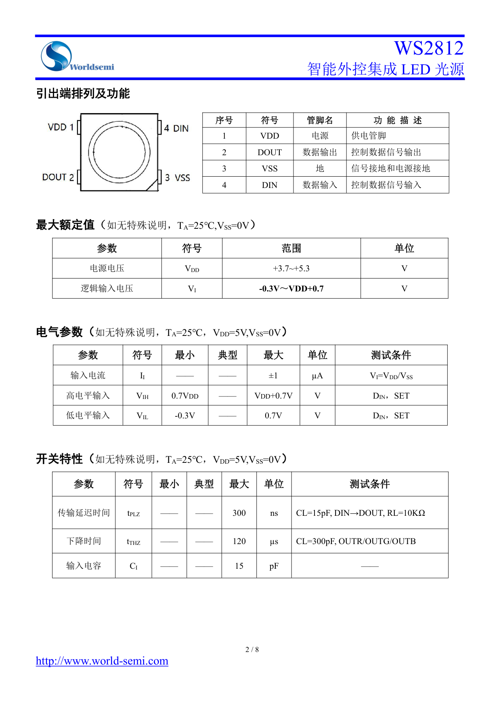
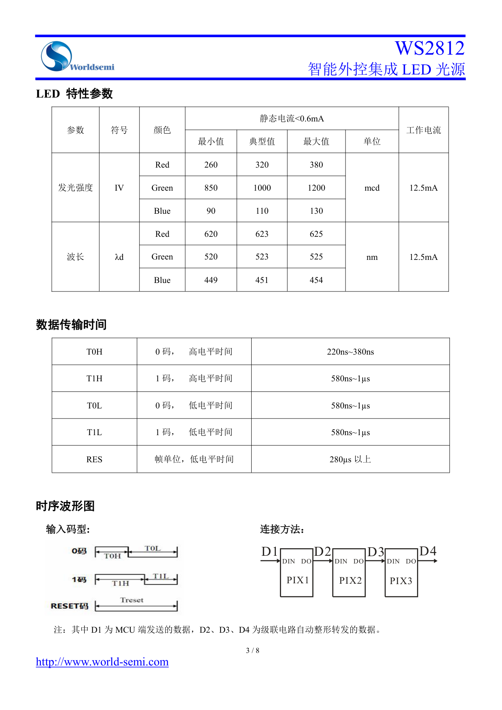
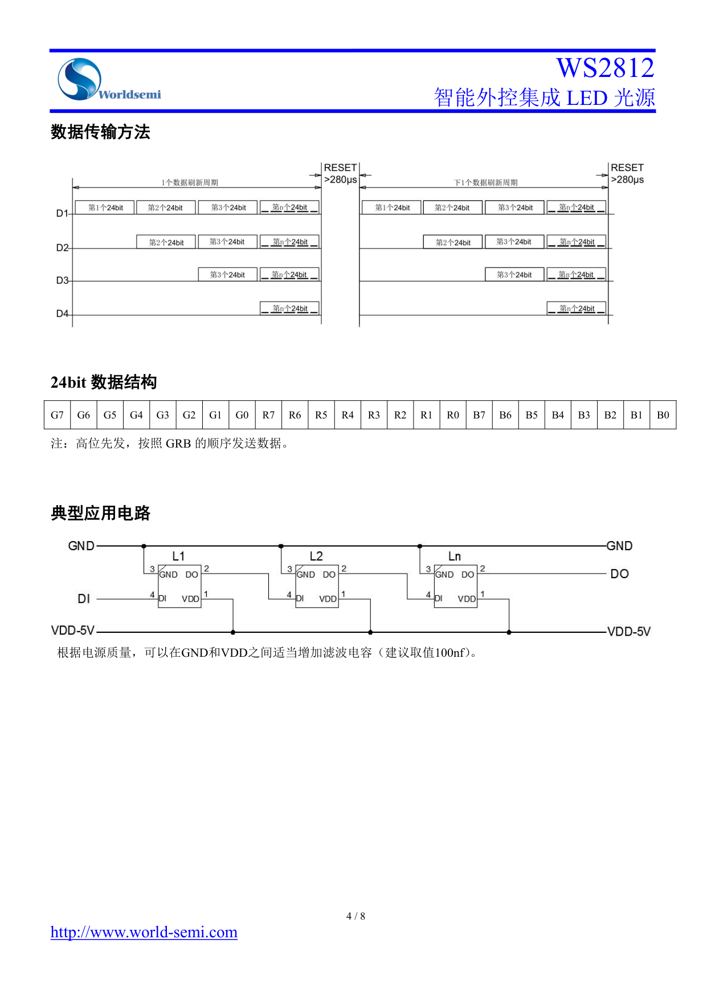
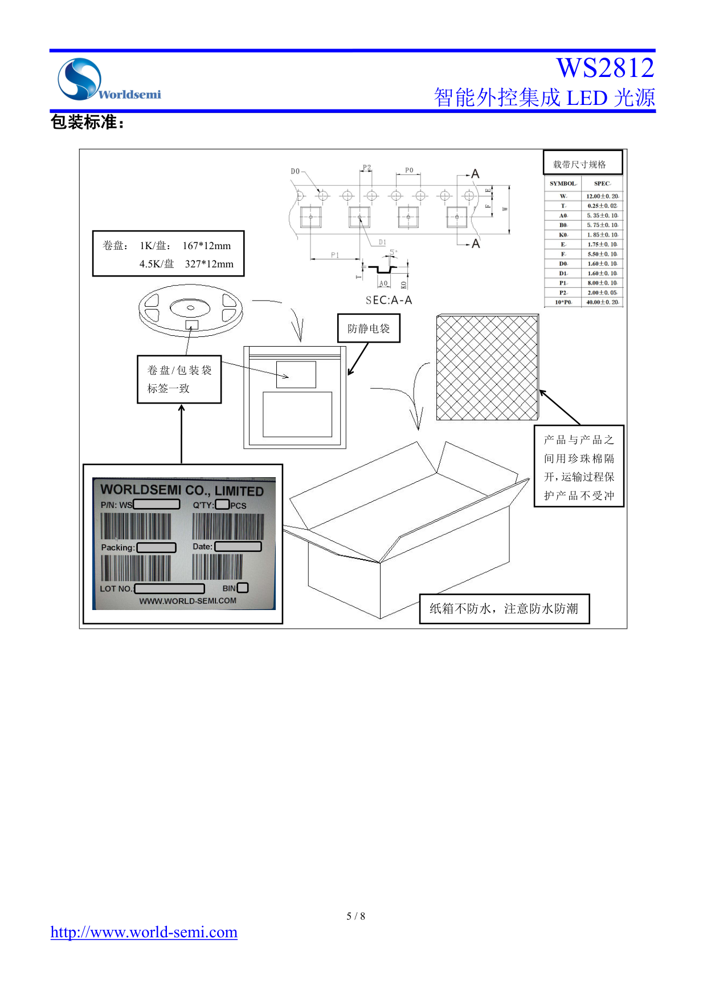
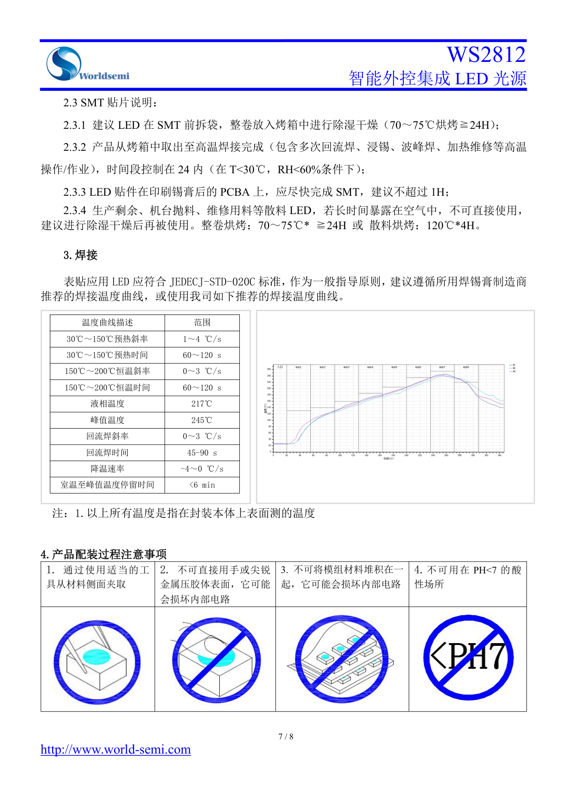

# WS2812 数据手册

本文包含 WS2812 灯珠的引脚、电气参数、GRB 数据结构、传输时序、级联电路与焊接要求。灯圈示例代码见[参考例程说明](参考例程说明.md)。

> 来源：`WS2812_Datasheet.pdf`。实际灯圈型号、电源及逻辑电平兼容性待确认，未进行实物验证。

## 主要特点

- IC控制电路与LED点光源共用一个电源。

- 控制电路与RGB芯片集成在一个5050封装的元器件中，构成一个完整的外控像素点。

- 内置信号整形电路，任何一个像素点收到信号后经过波形整形再输出，保证线路波形畸变不会累加。

- 内置上电复位和掉电复位电路。

- 每个像素点的三基色颜色可实现256级亮度显示，完成16777216种颜色的全真色彩显示。

- 端口扫描频率2KHz/s。

- 串行级联接口，能通过一根信号线完成数据的接收与解码。

- 任意两点传输距离在不超过2米时无需增加任何电路。

- 当刷新速率30帧/秒时，级联数不小于1024点。

- 数据发送速度可达800Kbps。

- 光的颜色高度一致，性价比高。

## 主要应用领域

- LED全彩发光字灯串，LED全彩软灯条硬灯条，LED护栏管。

- LED点光源，LED像素屏，LED异形屏，各种电子产品，电器设备跑马灯。

## 产品概述

WS2812是一个集控制电路与发光电路于一体的智能外控LED光源。其外型与一个5050LED灯珠相同，每个元件即为一个像素点。像素点内部包含了智能数字接口数据锁存信号整形放大驱动电路，还包含有高精度的内部振荡器和可编程定电流控制部分，有效保证了像素点光的颜色高度一致。

数据协议采用单线归零码的通讯方式，像素点在上电复位以后，DIN端接受从控制器传输过来的数据，首先送过来的24bit数据被第一个像素点提取后，送到像素点内部的数据锁存器，剩余的数据经过内部整形处理电路整形放大后通过DO端口开始转发输出给下一个级联的像素点，每经过一个像素点的传输，信号减少24bit。像素点采用自动整形转发技术，使得该像素点的级联个数不受信号传送的限制，仅受限信号传输速度要求。

高达 **2KHz** 的端口扫描频率，在高清摄像头的捕捉下都不会出现闪烁现象，非常适合高速移动产品的使用。 **280μs** 以上的 **RESET** 时间，出现中断也不会引起误复位，可以支持更低频率、价格便宜的MCU。 LED具有低电压驱动、环保节能、亮度高、散射角度大、一致性好、超低功率及超长寿命等优点。将控制电路集成于LED上面，电路变得更加简单，体积小，安装更加简便。

## 机械尺寸（单位 mm ）



## 引出端排列及功能

|序号|符号|管脚名|功 能 描 述|
|---|---|---|---|
|1|VDD|电源|供电管脚|
|2|DOUT|数据输出|控制数据信号输出|
|3|VSS|地|信号接地和电源接地|
|4|DIN|数据输入|控制数据信号输入|

## 最大额定值（ 如无特殊说明，TA=25℃,VSS=0V ）

|参数|符号|范围|单位|
|---|---|---|---|
|电源电压|VDD|+3.7~+5.3|V|
|逻辑输入电压|VI|**-0.3V**～**VDD+0.7**|V|

## 电气参数（ 如无特殊说明，TA=25℃，VDD=5V,VSS=0V ）

|参数|符号|最小|典型|最大|单位|测试条件|
|---|---|---|---|---|---|---|
|输入电流|II|——|——|±1|µA|VI=VDD/VSS|
|高电平输入|VIH|0.7VDD|——|VDD+0.7V|V|DIN，SET|
|低电平输入|VIL|-0.3V|——|0.7V|V|DIN，SET|

## 开关特性（ 如无特殊说明，TA=25℃，VDD=5V,VSS=0V ）

|参数|符号|最小|典型|最大|单位|测试条件|
|---|---|---|---|---|---|---|
|传输延迟时间|tPLZ|——|——|300|ns|CL=15pF, DIN→DOUT, RL=10KΩ|
|下降时间|tTHZ|——|——|120|µs|CL=300pF, OUTR/OUTG/OUTB|
|输入电容|CI|——|——|15|pF|——|



## LED 特性参数

原表标注静态电流 < 0.6 mA；下列光学参数的工作电流为 12.5 mA。

| 参数 | 符号 | 颜色 | 最小值 | 典型值 | 最大值 | 单位 |
| --- | --- | --- | --- | --- | --- | --- |
| 发光强度 | IV | Red | 260 | 320 | 380 | mcd |
| 发光强度 | IV | Green | 850 | 1000 | 1200 | mcd |
| 发光强度 | IV | Blue | 90 | 110 | 130 | mcd |
| 波长 | λd | Red | 620 | 623 | 625 | nm |
| 波长 | λd | Green | 520 | 523 | 525 | nm |
| 波长 | λd | Blue | 449 | 451 | 454 | nm |

## 数据传输时间

| 符号 | 含义 | 原表范围 |
| --- | --- | --- |
| T0H | 0 码高电平时间 | 220–380 ns |
| T1H | 1 码高电平时间 | 580 ns–1 μs |
| T0L | 0 码低电平时间 | 580 ns–1 μs |
| T1L | 1 码低电平时间 | 580 ns–1 μs |
| RES | 帧单位低电平时间 | 280 μs 以上 |

## 时序波形图

输入码型和连接方法见下图。D1 为 MCU 端发送的数据，D2、D3、D4 为级联电路自动整形转发的数据。



## 24 位数据结构与发送顺序

```text
G7 G6 G5 G4 G3 G2 G1 G0 R7 R6 R5 R4 R3 R2 R1 R0 B7 B6 B5 B4 B3 B2 B1 B0
```

注：高位先发，按照 GRB 的顺序发送数据。

## 典型应用电路

根据电源质量，可以在GND和VDD之间适当增加滤波电容（建议取值100nf）。



## 包装标准

- 卷盘：1K／盘为 167 × 12 mm，4.5K／盘为 327 × 12 mm。
- 载带尺寸、卷盘与包装方式见下图。
- 卷盘与包装袋标签一致；使用防静电袋。
- 产品与产品之间用珍珠棉隔开，运输过程中保护产品不受冲击。
- 纸箱不防水，注意防水防潮。



## 表面贴装 LED 使用注意事项

### 使用范围

通常LED 也像其它的电子元件一样有着相同的使用方法，为了让客户更好地使用华彩威的LED 产品，请参看下面的LED 保护预防措施。

### 灰尘与清洁

LED 的表面是采用改性环氧胶封装的，环氧胶对于LED 的光学系统和抗老化性能都起到很好的保护作用。环氧胶易粘灰尘，保持作业环境的洁净。当LED 表面有一定限度内的尘埃，也不会影响到发光亮度，但我们仍应避免尘埃落到LED 表面。打开包装袋的就优先使用，安装过LED 的组件应存放在干净的容器中，在LED 表面需要清洁时，如果使用三氨乙烯或者丙酮等溶液会出现使LED 表面溶解等现象，不可使用具用溶解性的溶液清洁LED，可使用一此异丙基的溶液，在使用任何清洁溶液之前都应确认是否会对LED 有溶解作用；请不要用超声波的方法清洁LED，如果产品必须使用超声波，那么就要评估影响LED 的一些参数，如超声波功率，烘烤的时间和装配的条件等，在清洁之前必须试运行，确认是否会影响到LED。

### 防潮包装

LED 属于湿敏元件，将LED 包装在铝膜的袋中是为了避免LED 在运输和储存时吸收湿气，在包装袋中放有干燥剂，以吸收湿气。如果LED 吸收了水气，那么在LED 过回流焊时，水气就会蒸发而膨胀，有可能使胶体与支架脱离以及损害LED 的光学系统。由于这个原因，防湿包装是为了使包装袋内避免有湿气，但通常保护时间仅能维持1～2 个月。此款产品防潮等级(MSL)为： 5a . SMT 时请参照IPC/JEDECJ-STD-020 规定的材料防潮等级(MSL)定义进行MSL 管控。

|防潮等级|包装拆封后车间寿命|条件|
|---|---|---|
|LEVEL1|无限制|≤30℃/85%RH|
|LEVEL2|1 年|≤30℃/60%RH|
|LEVEL2a|4 周|≤30℃/60%RH|
|LEVEL3|168 小时|≤30℃/60%RH|
|LEVEL4|72 小时|原文为“≤30℃160%RH”，疑似分隔符排版问题，待确认|
|LEVEL5|48 小时|≤30℃/60%RH|
|LEVEL5a|24 小时|**≤**30℃/60%RH|
|LEVEL6|取出即用|≤30℃/60%RH|

### SMT 贴片

1. 建议 LED 在 SMT 前拆袋，整卷放入烤箱中进行除湿干燥（70～75℃烘烤≧24H）；

2. 产品从烤箱中取出至高温焊接完成（包含多次回流焊、浸锡、波峰焊、加热维修等高温操作/作业），时间段控制在 24 内（在 T<30℃，RH<60%条件下）；

3. LED 贴件在印刷锡膏后的 PCBA 上，应尽快完成 SMT，建议不超过 1H；

4. 生产剩余、机台抛料、维修用料等散料 LED，若长时间暴露在空气中，不可直接使用， 建议进行除湿干燥后再被使用。整卷烘烤：70～75℃* ≧24H 或散料烘烤：120℃*4H。

### 焊接

表贴应用LED 应符合JEDECJ-STD-020C 标准，作为一般指导原则，建议遵循所用焊锡膏制造商推荐的焊接温度曲线，或使用我司如下推荐的焊接温度曲线。

|温度曲线描述|范围|
|---|---|
|30℃～150℃预热斜率|1～4 ℃/s|
|30℃～150℃预热时间|60～120 s|
|150℃～200℃恒温斜率|0～3 ℃/s|
|150℃～200℃恒温时间|60～120 s|
|液相温度|217℃|
|峰值温度|245℃|
|回流焊斜率|0～3 ℃/s|
|回流焊时间|45-90 s|
|降温速率|-4～0 ℃/s|
|室温至峰值温度停留时间|<6 min|

注：1.以上所有温度是指在封装本体上表面测的温度

### 配装注意事项

1. 使用适当的工具从材料侧面夹取。
2. 不可直接用手或尖锐金属压胶体表面，可能损坏内部电路。
3. 不可将模组材料堆积在一起，可能损坏内部电路。
4. 不可用于 pH < 7 的酸性场所。



## 文件更改记录

|版本号|状态|修改内容概要|修订日期|修订人|批准人|
|---|---|---|---|---|---|
|V1.0|N|新建|20201123|余行辉|尹华平|
|V1.1|M|胶体变更为半雾状，型号改为WS2812|2021/12/2|余行辉|尹华平|

注：初始版本号V1.0；每次修订批准后，版本号顺序加“0.1”；

状态包括：N--新建，A--增加，M--修改，D--删除。

相关资料：[灯圈参考例程说明](参考例程说明.md)。实际接线、供电与运行步骤待确认。

返回：[文档索引](../../README.md)。
