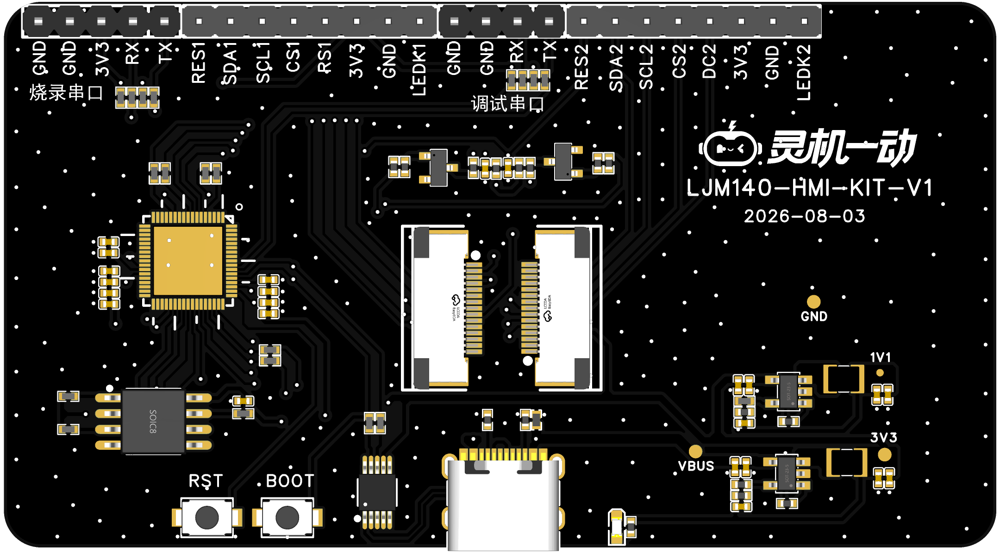
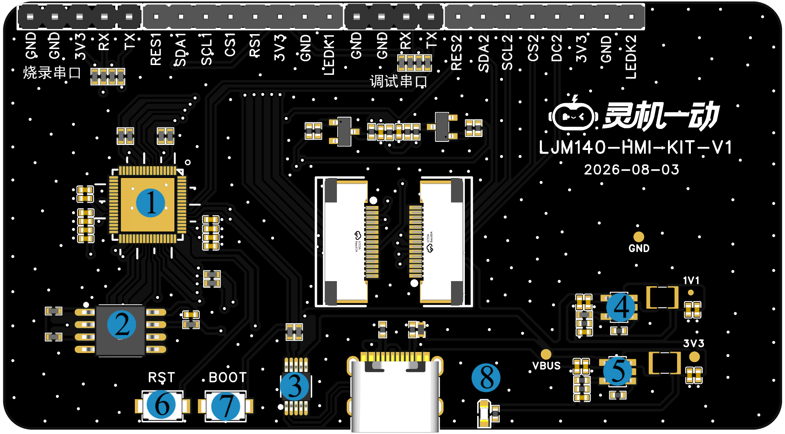
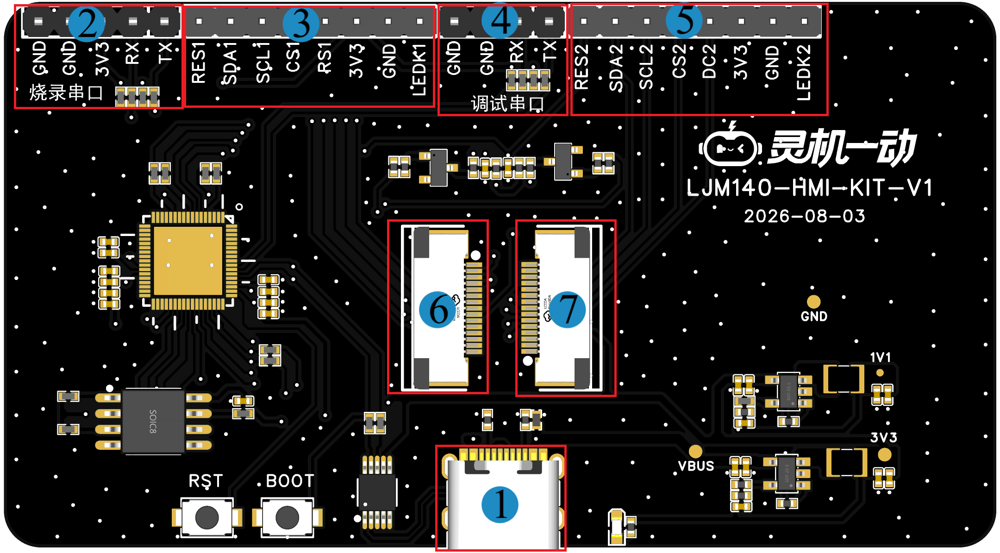
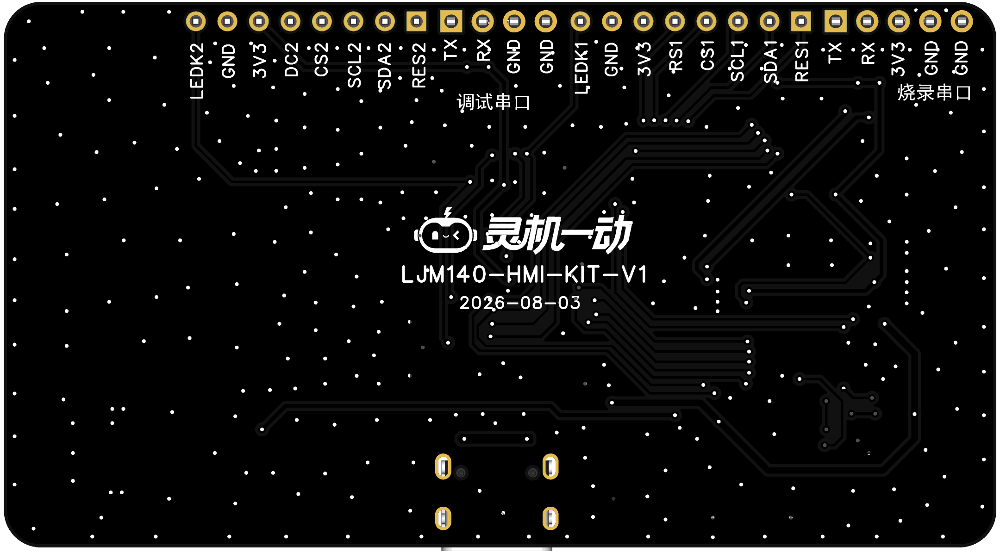
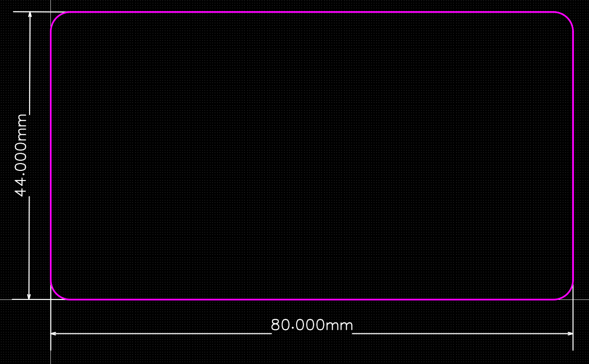

# LJM140-HMI-KIT-V1

> 来源：[灵机官方语雀 · LJM140-HMI-KIT-V1](https://xjiangiot.yuque.com/afahpl/qrhct7/lvr8v2ud74g5vcmx)。原文内容更新时间：2026-10-23（UTC 日期）；整理日期：2026-10-29。
>
> 本文整理源页面的文字、表格、代码和可解析的流程图，保留官方示例口径；不代表本项目已采用或已验证。必要的板卡外观、组件、接口和尺寸图保存在同目录 `img/` 并就近引用，图片来源均为本页顶部的官方语雀页面；其他界面截图仍需回源查看。图中型号、引脚位置和接线方向须与实际板卡核对。附件已有本地整理时链接到本地，其余保留源站链接，未下载、执行或展开。
>
> 本页为板卡资料，设备型号、供电和运行步骤以正文对应型号为限；实际套件、外设接线及烧录包适配待实物核对。本次仅做资料整理，未进行烧录或实物验证。

## 1. 概述

### 1.1开发板概述

D121双屏开发板，使用D121BBV为主控核心，可接双屏幕，采用 2.54mm 标准排针引出烧录串口与调试串口，以及屏幕引脚，单 Type‑C 接口集成供电、固件烧录、调试三大功能，便于开发者快速开展屏幕显示功能原型开发、验证与调试。

### 1.2核心功能

| 项目 | 内容 |
| --- | --- |
| 主控能力 | 使用D121BBV为主控核心，显示接口支持 RGB/SPI/8080，最高可驱动 **1024x768@60FPS** 的屏幕。 |
| 外设扩展 | 2.54mm 标准排针引出串口与屏幕，方便外接其他开发板，便于原型拓展。 |

表1 核心功能表

### 1.3 硬件参数

| 项目 | 内容 |
| --- | --- |
| **主控芯片** | 基于 RISC-V 架构（E907），主频高达 **400MHz**，配备 32KB SRAM。  内置 **8MB PSRAM**（16-bit 位宽），显示接口支持 RGB/SPI/8080，最高可驱动 **1024x768@60FPS** 的屏幕。 |
| **工作电压** | TYPE-C供电工作电压：5V； |
| **功能接口** | 1.烧录与调试接口引出排针  2.TYPE-C供电与烧录调试接口  3.3.3V输出接口  4.屏幕引脚引出排针 |
| **工作温度** | -40~+85℃ |

表2 硬件参数表

### 1.4应用场景

**该设备的主要适用场景有：**

- 工业与商用HMI
- 只能家电与家居设备
- 仪表盘与信息显示终端
- 嵌入式软件开发与调试平台

## 2. 产品组件功能

### 2.1系统框图

系统框图文字转录（连线只表示原图连接关系，不据此推断实际接线方向）：

- 节点：ESP32；CH340；TYPE-C；按键；排针；DC-DC 3.3V；DC-DC 1.1V；双屏
- CH340 — TYPE-C；标注：USB
- 按键 — ESP32；标注：BOOT+RST
- ESP32 — 排针；标注：调试与屏幕接口
- DC-DC 3.3V — ESP32
- CH340 — ESP32；标注：烧录
- DC-DC 1.1V — ESP32
- ESP32 — 双屏；标注：I2C

图1 系统框图（仅供参考）

### 2.2产品组件图

| **组件图** |
| --- |
|  |

图2 组件图

| 序号 | 组件名称 | 介绍 |
| --- | --- | --- |
| 1 | **D121BBV** | 基于 RISC-V 架构（E907），主频高达 **400MHz**，配备 32KB SRAM。  内置 **8MB PSRAM**（16-bit 位宽），显示接口支持 RGB/SPI/8080，最高可驱动 **1024x768@60FPS** 的屏幕。 |
| 2 | **FLASH芯片** | 用于数据存储 |
| 3 | **USB转换芯片** | CH343E，USB转UART，通过此芯片可直接使用USB下载固件。 |
| 4 | **DC-DC电源芯片** | SY8088AAC 高频率、高效率同步降压 DC-DC 转换器 ，输入电压范围2.5-5.5V,输出电流1A。 |
| 5 | **DC-DC电源芯片** | SY8088AAC 高频率、高效率同步降压 DC-DC 转换器 ，输入电压范围2.5-5.5V,输出电流1A。 |
| 6 | **RST键** | 复位按键。 |
| 7 | **BOOT键** | 下载按键。上电或复位时按下则进入升级烧录模式，通过串口下载固件。 |
| 8 | **电源指示灯** | 用于指示板子是否上电。 |

表3 组件介绍表

## 3. 开发板接口

### 3.1. 开发板接口图（图片仅供参考具体以实物为准）

| 项目 | 内容 |
| --- | --- |
| **顶视图** | **底视图** |
|  |  |

图3 开发板接口定义图（顶视图+底视图）

### 3.2. 开发板接口描述

| 序号 | 接口名称 | 功能 |
| --- | --- | --- |
| 1 | **TYPE-C接口** | 外接 5V 1A TYPE-C线，用于开发板供电和模组固件烧写调试。 |
| 2 | **烧录串口** | 2.54-1*5P排针座子，用于烧录。 |
| 3 | **屏幕接口1外接排针** | 2.54-1*8P排针座子，用于调试屏幕。 |
| 4 | **调试串口** | 2.54-1*4P排针座子，用于开发调试。 |
| 5 | **屏幕接口2外接排针** | 2.54-1*8P排针座子，用于调试屏幕 |
| 6 | **屏幕接口1** | 用于连接屏幕。 |
| 7 | **屏幕接口2** | 用于连接屏幕。 |

表4 顶视图接口

## 4.电气特性

### 4.1绝对最大额定值

超出下表5 绝对最大额定值可能导致器件永久性损坏。这只是强调的额定值，不涉及器件在这些或其它条件下超出表7 建议工作条件技术规格指标的功能性操作。长时间暴露在绝对最大额定条件下可能会影响模组的可靠性。

| 符号 | 参数 | 最小值 | 最大值 | 单位符号 | 备注说明 |
| --- | --- | --- | --- | --- | --- |
| VBUS | USB输入电压 | / | 7 | V |  |
| T*STORE* | 储存温度 | -40 | 105 | ℃ |  |

表5 绝对最大额定值

### 4.2 建议工作条件

| **符号** | **参数** | **最小值** | **典型值** | **最大值** | **单位符号** |
| --- | --- | --- | --- | --- | --- |
| VBUS | 电源管脚电压 | 4.0 | 5.0 | 5.5 | V |
| T*STORE* | 工作温度 | -40 | -- | 85 | ℃ |
| Ivdd | 外部供电电流 | 0.5 | - | - | A |

表6 建议工作条件

## 5.开发板尺寸图（单位：mm）

### 5.1 PCB边框尺寸(44.0x80.0x1.6)

图4 开发板尺寸图（仅供参考，具体以实物为准）

## 6.固件烧录

| **步骤** | **操作内容** | **操作要点与注意事项** | **参考图示** |
| --- | --- | --- | --- |
| **1** | **烧录准备** |  |  |
| **2** | **打开升级程序** |  |  |
| **3** | **选择烧录文件** |  |  |
| **4** | **连接烧录器** |  |  |
| **5** | **开始烧录** |  |  |

## 7. 附件资料

7.1 原理图

[SCH_Schematic1_2026-10-23.pdf（源站附件）](https://xjiangiot.yuque.com/attachments/yuque/0/2026/pdf/62766000/1792735055328-df7849e3-d819-4d56-a6a3-b9365af55017.pdf)

7.2 PCB文件

[PCB_PCB1_2026-10-23.pdf（源站附件）](https://xjiangiot.yuque.com/attachments/yuque/0/2026/pdf/62766000/1792735055176-bca7487e-22fc-4350-8300-34632665956e.pdf)

7.3 D121BBV

[D12x Brief.pdf（源站附件）](https://xjiangiot.yuque.com/attachments/yuque/0/2026/pdf/62766000/1792735055399-71e56524-36a7-400a-9d6b-39c76ed0968a.pdf)
[D12x_Datasheet.pdf（源站附件）](https://xjiangiot.yuque.com/attachments/yuque/0/2026/pdf/62766000/1792735055156-4d1eb6dd-fea5-4c27-8d55-f8ca3b638c52.pdf)

7.4 屏幕

[QZ138QV005A规格书.pdf（源站附件）](https://xjiangiot.yuque.com/attachments/yuque/0/2026/pdf/62766000/1792735055401-7fa221de-527f-441f-8436-7042bfb1a46b.pdf)

## 8. 版本更新

| **日期** | **版本** | **修改人** | **更新内容** |
| --- | --- | --- | --- |
| 2026/10/23 | V1.0 | 杨震 | 初稿 |
|  |  |  |  |
|  |  |  |  |
|  |  |  |  |
|  |  |  |  |
|  |  |  |  |

---

相关文档：[设备开发资料索引](../../../开发/灵机设备开发资料索引.md) · [项目文档索引](../../../README.md)。
