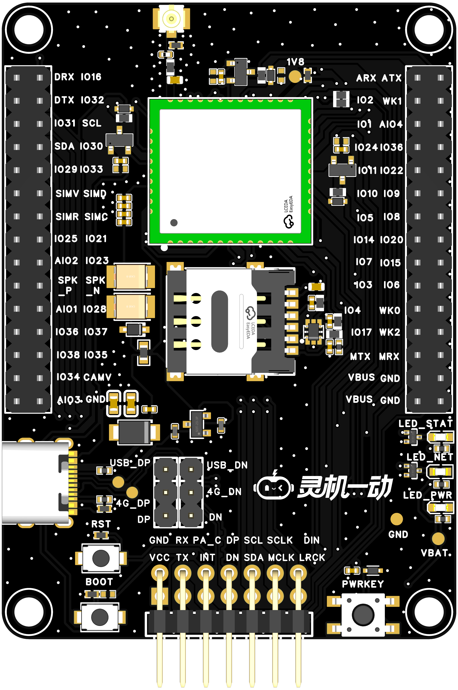
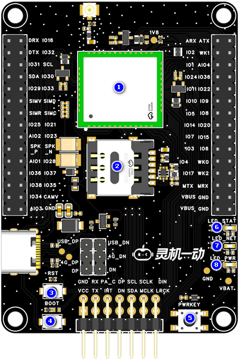
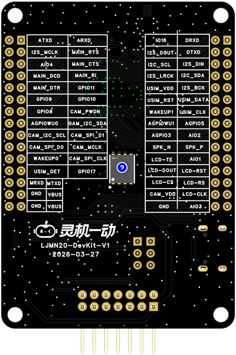
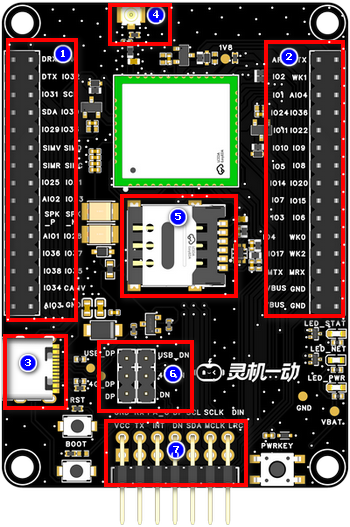
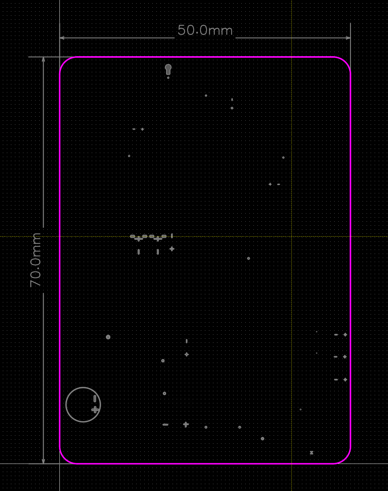

# LJMN20-DevKit-V1

> 来源：[灵机官方语雀 · LJMN20-DevKit-V1](https://xjiangiot.yuque.com/afahpl/qrhct7/bxc5u7w20cuzn5g5)。原文内容更新时间：2026-10-22（UTC 日期）；整理日期：2026-10-29。
>
> 本文整理源页面的文字、表格、代码和可解析的流程图，保留官方示例口径；不代表本项目已采用或已验证。必要的板卡外观、组件、接口和尺寸图保存在同目录 `img/` 并就近引用，图片来源均为本页顶部的官方语雀页面；其他界面截图仍需回源查看。图中型号、引脚位置和接线方向须与实际板卡核对。附件已有本地整理时链接到本地，其余保留源站链接，未下载、执行或展开。
>
> 本页为板卡资料，设备型号、供电和运行步骤以正文对应型号为限；实际套件、外设接线及烧录包适配待实物核对。本次仅做资料整理，未进行烧录或实物验证。

## 章节导航

- [1. 概述](#section-1)
- [1.1开发板概述](#section-2)
- [1.2核心功能](#section-3)
- [1.3 硬件参数](#section-4)
- [1.4应用场景](#section-5)
- [2. 产品组件功能](#section-6)
- [2.1系统框图](#section-7)
- [2.2产品组件图](#section-8)
- [3. 开发板接口](#section-9)
- [3.1. 开发板接口图（图片仅供参考具体以实物为准）](#section-10)
- [3.2. 开发板接口描述](#section-11)
- [4.电气特性](#section-12)
- [4.1绝对最大额定值](#section-13)
- [4.2 建议工作条件](#section-14)
- [5.开发板尺寸图（单位：mm）](#section-15)
- [5.1 PCB边框尺寸(50x70x1.6)](#section-16)
- [6. 烧录调试](#section-17)
- [7. 附件资料](#section-18)
- [8. 版本更新](#section-19)

## 1. 概述

### 1.1开发板概述

灵机 AI 分体方案4G主控板，采用利尔达4G 模组为NT26F6B0为主控核心，预留分体语音板对插插座，可灵活选配不同型号语音子板；采用 2.54mm 标准排针引出全部 GPIO，单 Type‑C 接口集成供电、固件烧录、调试三大能力，帮助开发者快速开展语音功能原型开发、验证与调试。

### 1.2核心功能

| 项目 | 内容 |
| --- | --- |
| 4G 联网能力 | 支持**国内主流 4G 频段（TD-LTE/FDD-LTE）**，可实现稳定的远程数据传输、网络接入、指令下发 / 上报。 |
| 硬件扩展与二次开发能力 | 芯片引脚全引出， 快速原型验证，排针采用标准化设计，适合快速迭代开发。 |
| 语音扩展 | 预留分体语音板对插插座，支持灵活选配、更换不同型号语音子板，适配各类语音交互方案。 |

表1 核心功能表

### 1.3 硬件参数

| 项目 | 内容 |
| --- | --- |
| **主控4G芯片** | CPU **和片上存储器 ：**ROM 4M和RAM 4M;  • 覆盖全球主流NB-IoT频段：  FDD-LTE: B1/B3/B5/B8  TDD-LTE: B34/B38/B39/B40/B41  • 支持 3GPP Rel.13/14 Cat.1 无线电通信接口和协议  • 支持 TCP/UDP/HTTP(S)/SSL/MQTT(S)/FOTA/PPP/RNDIS/  FTP/ECM 等协议  • LTE-FDD：最大下行速率 10Mbps，最大上行速率 5Mbps  • LTE-TDD：最大下行速率 8.96Mbps，最大上行速率 3.1Mbps。 |
| **语音芯片** | 32 位 RISC-V CPU（带 DSP+FPU 扩展），最高主频 200MHz；  集成 gxNPU V122 神经网络处理器（最高主频 200MHz）  内置 176KB SRAM；SIP 封装 2MB QSPI Nor Flash（支持 XIP，最高时钟 120MHz）；256 位 OTP 存储器；支持外接 PSRAM |
| **工作电压** | TYPE-C供电工作电压：5V。 |
| **麦克风** | **JMO-627B-423C-104P**驻极体麦克风（灵敏度≥-28dB，信噪比≥65dB） |
| **功能接口** | 1.4G芯片引脚引出排针  2.TYPE-C供电和烧录调试接口  3.天线接口  4.预留分体语音板对插接口  5.预留SIM卡接口 |
| **工作温度** | -40~+85℃ 。 |

表2 硬件参数表

### 1.4应用场景

**该设备的主要适用场景有：**

- 4G 通信功能快速验证
- 本地语音交互方案原型验证
- 硬件接口与外设联调
- AIoT 产品方案前期可行性验证
- 嵌入式软件开发与调试平台

## 2. 产品组件功能

### 2.1系统框图

系统框图文字转录（连线只表示原图连接关系，不据此推断实际接线方向）：

- 节点：4G模组；贴片SIM卡；TYPE-C；BOOT按键；RST按键；开关机按键；二极管；排针；电平转换；串口*3；网络指示灯；电源指示灯；模组状态指示灯；分体语音板接口
- 贴片SIM卡 — 4G模组
- TYPE-C — 4G模组；标注：USB
- BOOT按键 — 4G模组
- RST按键 — 4G模组
- 开关机按键 — 4G模组
- TYPE-C — 二极管
- 二极管 — 4G模组
- TYPE-C — 分体语音板接口
- 4G模组 — 排针；标注：剩余GPIO
- 电平转换 — 4G模组
- 电平转换 — 串口*3
- 网络指示灯 — 4G模组
- 二极管 — 电源指示灯
- 模组状态指示灯 — 4G模组
- 串口*3 — 排针
- 分体语音板接口 — 4G模组
- 串口*3 — 分体语音板接口

图1 系统框图（仅供参考）

### 2.2产品组件图

| 项目 | 内容 |
| --- | --- |
| **组件图TOP** | **组件图BOT** |
|  |  |

图2 组件图

| 序号 | 组件名称 | 介绍 |
| --- | --- | --- |
| 1 | **4G模组** | 利尔达 4G 模组 NT26FCNB60，做为设备的主控芯片。 |
| 2 | **SIM卡卡座** | 放入SIM卡，用于模组4G上网。 |
| 3 | **4G RST键** | 用于复位4G模组。 |
| 4 | **4G BOOT键** | 下载按键。按住 Boot 键的同时按PWRKEY按键开机，设备会进入强制烧写模式。 |
| 5 | **PWRKEY按键** | 4G开机按键，长按设备开关机。 |
| 6 | **4G 状态指示灯** | 用于指示4G模组是否开机。 |
| 7 | **4G 网络指示灯** | 用于指示4G模组当前网络状态。 |
| 8 | **电源指示灯** | 用于指示板子是否上电。 |
| 9 | **预留贴片ESIM卡** | MS1物联网贴片卡，用于模组4G上网。 |

表3 组件介绍表

## 3. 开发板接口

### 3.1. 开发板接口图（图片仅供参考具体以实物为准）

| 项目 | 内容 |
| --- | --- |
| **顶视图** | **底视图** |
|  |  |

图3 开发板接口定义图（顶视图+底视图）

### 3.2. 开发板接口描述

| 序号 | 接口名称 | 功能 |
| --- | --- | --- |
| 1 | **4G引脚引出排针1** | 2.54-2*15P排针座子， 方便外设扩展， 开发调试与功能验证。 |
| 2 | **4G引脚引出排针2** | 2.54-2*15P排针座子，方便外设扩展， 开发调试与功能验证。 |
| 3 | **TYPE-C接口** | 外接 5V 1A TYPE-C线，用于开发板供电和4G模组固件烧写调试。 |
| 4 | **4G天线接口** | IPEX一代座子，用于连接天线。 |
| 5 | **SIM卡卡座** | 放入SIM卡，用于模组4G上网。 |
| 6 | **USB信号切换接口** | 2.54-3P排针座子，使用跳线帽短接，切换USB信号选通功能，短接上面则可以烧录调试4G芯片，短接下面可以和USB信号传输语音板交互 |
| 7 | **分体语音板接口** | 2.54-2*7P排针座子，可对插分体语音板。 |

表4 顶视图接口

## 4.电气特性

### 4.1绝对最大额定值

超出下表6 绝对最大额定值可能导致器件永久性损坏。这只是强调的额定值，不涉及器件在这些或其它条件下超出表7 建议工作条件技术规格指标的功能性操作。长时间暴露在绝对最大额定条件下可能会影响模组的可靠性。

| 符号 | 参数 | 最小值 | 最大值 | 单位符号 | 备注说明 |
| --- | --- | --- | --- | --- | --- |
| VBUS | USB输入电压 | / | 7 | V |  |
| T*STORE* | 储存温度 | -40 | 105 | ℃ |  |

表5 绝对最大额定值

### 4.2 建议工作条件

| **符号** | **参数** | **最小值** | **典型值** | **最大值** | **单位符号** |
| --- | --- | --- | --- | --- | --- |
| VBUS | 电源管脚电压 | 4.0 | 5.0 | 6.0 | V |
| T*STORE* | 工作温度 | -40 | -- | 85 | ℃ |
| Ivdd | 外部供电电流 | 0.5 | - | - | A |

表6 建议工作条件

## 5.开发板尺寸图（单位：mm）

### 5.1 PCB边框尺寸(50x70x1.6)

图4 开发板尺寸图（仅供参考，具体以实物为准）

## 6. 烧录调试

## 7. 附件资料

7.1 原理图

[SCH_分体WIFI主控板_2026-10-14.pdf（源站附件）](https://xjiangiot.yuque.com/attachments/yuque/0/2026/pdf/62766000/1792654951552-f641e4bc-e273-488d-9567-18023c01e4d6.pdf)

7.2 PCB文件

[PCB_分体WIFI主控板_2026-10-14.pdf（源站附件）](https://xjiangiot.yuque.com/attachments/yuque/0/2026/pdf/62766000/1792654951482-52160ae9-617f-4f6a-9184-52b59c37f19b.pdf)

7.3 小匠模组规格书

[XJWB03模组规格书V1.0.pdf（源站附件）](https://xjiangiot.yuque.com/attachments/yuque/0/2026/pdf/62766000/1792654951482-692e397e-5519-4e49-a224-55232c6e7585.pdf)

7.4 麦克风

[CMO-627BA283C-104P.pdf（源站附件）](https://xjiangiot.yuque.com/attachments/yuque/0/2026/pdf/62766000/1792654951452-d5380192-d3ab-4a18-bc1d-3a5fa7639e63.pdf)

7.5 喇叭

[JB2831NR04W03-W06 V2.0.pdf（源站附件）](https://xjiangiot.yuque.com/attachments/yuque/0/2026/pdf/62766000/1792654951458-11884e1d-c348-43ac-a9ce-e4e5885e4cc9.pdf)

## 8. 版本更新

| **日期** | **版本** | **修改人** | **更新内容** |
| --- | --- | --- | --- |
| 2026/10/14 | V1 | 包菜 | 初稿 |
|  |  |  |  |
|  |  |  |  |
|  |  |  |  |
|  |  |  |  |
|  |  |  |  |

---

相关文档：[设备开发资料索引](../../../开发/灵机设备开发资料索引.md) · [项目文档索引](../../../README.md)。
