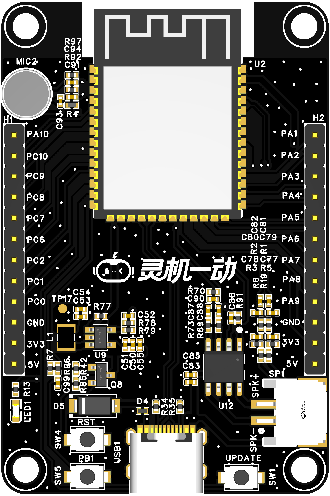
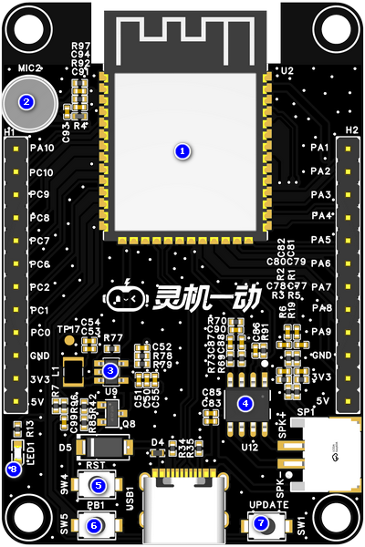
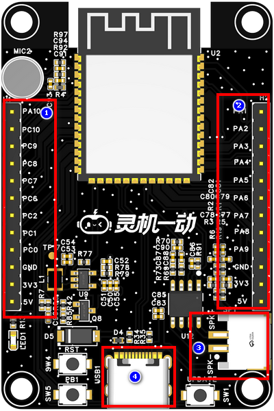
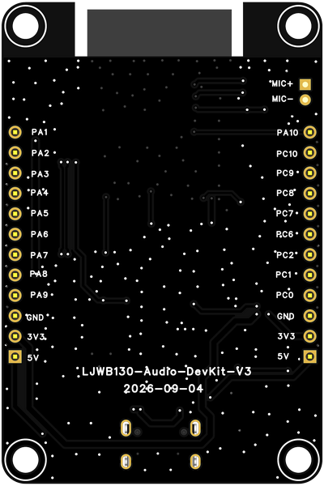
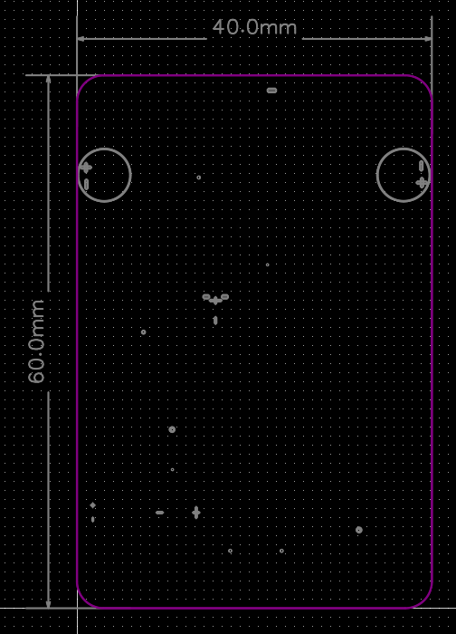

# LJWB130-Audio-DevKit-V2

> 来源：[灵机官方语雀 · LJWB130-Audio-DevKit-V2](https://xjiangiot.yuque.com/afahpl/qrhct7/ipm3utgz7gy5dk5u)。原文内容更新时间：2026-10-22（UTC 日期）；整理日期：2026-10-29。
>
> 本文整理源页面的文字、表格、代码和可解析的流程图，保留官方示例口径；不代表本项目已采用或已验证。必要的板卡外观、组件、接口和尺寸图保存在同目录 `img/` 并就近引用，图片来源均为本页顶部的官方语雀页面；其他界面截图仍需回源查看。图中型号、引脚位置和接线方向须与实际板卡核对。附件已有本地整理时链接到本地，其余保留源站链接，未下载、执行或展开。
>
> 本页为板卡资料，设备型号、供电和运行步骤以正文对应型号为限；实际套件、外设接线及烧录包适配待实物核对。本次仅做资料整理，未进行烧录或实物验证。

## 1. 概述

### 1.1开发板概述

杰理模组单麦方案开发板以AC79111BA芯片为核心，专为本地高性能语音交互设计。板载NS4150C功放芯片，并集成AEC硬件电路，搭配双麦克风阵列，支持高效的噪声抑制、回声消除和自动增益控制，确保在嘈杂环境下仍能实现稳定可靠的语音交互。接口方面采用简洁实用的设计，TYPE-C接口同时支持供电与程序烧写，核心芯片的其余引脚通过排针引出，便于连接各类外设，整体集成度高，调试方便，广泛应用于智能家居、车载设备等语音智能硬件的开发、调试与前期验证。

### 1.2核心功能

| 项目 | 内容 |
| --- | --- |
| 高精度语音识别与唤醒 | 支持本地离线语音唤醒（支持自定义唤醒词）、端侧语音指令识别，响应速度快且无需依赖网络，识别准确率高，适配智能家居、车载、工控等多场景语音控制需求。 |
| 回声消除功能 | 内置AEC 回声消除算法，提升语音清晰度，适配复杂声学环境。 |
| 丰富的外设接口与扩展 | 芯片核心引脚通过排针引出，提供 UART/I2C/SPI/ADC/PWM 等标准接口，支持对接传感器、4G / 蓝牙模组、显示屏、继电器等外设，满足语音交互 + 多外设联动的定制化开发需求。 |
| 低功耗与场景适配 | 优化的功耗设计适配电池供电场景，支持低功耗唤醒、休眠模式，可灵活应用于便携式语音设备、智能穿戴、低功耗物联网终端等产品开发。 |

表1 核心功能表

### 1.3 硬件参数

| 项目 | 内容 |
| --- | --- |
| **主控芯片** | 核心处理器：高性能32位RISC双核CPU，支持FPU（浮点运算单元），主频最高可达320MHz；内置24KB D-Cache和32KB I-Cache |
| **连接方式** | 集成Wi-Fi 802.11b/g/n（支持AP/STA模式）与双模蓝牙V5.0（支持BR/EDR/BLE）。 |
| **工作电压** | TYPE-C供电工作电压：5V。 |
| **麦克风** | **JMO-627B-423C-104P**驻极体麦克风（灵敏度≥-28dB，信噪比≥65dB） |
| **功能接口** | 1.TYPE-C供电和烧录调试接口  2.扬声器接口  3.芯片核心引脚引出排针 |
| **工作温度** | -40~+85℃ 。 |

表2 硬件参数表

### 1.4应用场景

**该设备的主要适用场景有：**

- 语音交互方案原型验证与调试
- 工业 / 商用语音交互终端
- 便携式 / 低功耗语音交互设备
- 车载智能语音设备
- 智能家居语音控制终端

## 2. 产品组件功能

### 2.1系统框图

系统框图文字转录（连线只表示原图连接关系，不据此推断实际接线方向）：

- 节点：XJ-WBJL01-B；TYPE-C电源输入；DC-DC 3V3；MIC1；功放芯片；喇叭；AEC；排针；复位按键；程序更新按键
- DC-DC 3V3 — XJ-WBJL01-B
- TYPE-C电源输入 — DC-DC 3V3
- 功放芯片 — XJ-WBJL01-B；标注：DACL
- 喇叭 — 功放芯片
- 喇叭 — AEC
- AEC — XJ-WBJL01-B；标注：REC_P/N
- MIC1 — XJ-WBJL01-B；标注：MIC3_P
- TYPE-C电源输入 — XJ-WBJL01-B；标注：USB烧录
- XJ-WBJL01-B — 排针；标注：剩余GPIO
- 复位按键 — XJ-WBJL01-B；标注：GPIO
- 程序更新按键 — XJ-WBJL01-B

图1 系统框图（仅供参考）

### 2.2产品组件图

| **组件图** |
| --- |
|  |

图2 组件图

| 序号 | 组件名称 | 介绍 |
| --- | --- | --- |
| 1 | **XJ-WBJL01-B** | 通用型 Wi-Fi + 低功耗蓝牙 MCU 模组，具有丰富的外设接口、强大的神经网络运算能力和信号处理能力，专为人工智能和 AIoT 市场打造。 |
| 2 | **驻极体麦克风** | JMO-627B-423C-104P驻极体麦克风（灵敏度≥-28dB，信噪比≥65dB）。 |
| 3 | **DC-DC电源芯片** | LP3220S是一款1.5MHz固定频率电流模式PWM降压转换器,适用于单节锂离子电池供电,最大输出电流为1.0A,效率高达94%,支持低关断电流和软启动功能。 |
| 4 | **功放芯片** | NS4150C是一款超低EMI、无需滤波器3W单声道D类音频功率放大器。在5V电源下，能够向4Ω负载提供3W的功率，并具有高达90%的效率。 |
| 5 | **硬件复位按键** | 按下按键可直接切断对芯片的供电。 |
| 6 | **PB1按键** | 功能按键 |
| 7 | **烧录按键** | 按下按键进行烧录。 |
| 8 | **电源指示灯** | 用于指示板子是否上电。 |

表3 组件介绍表

## 3. 开发板接口

### 3.1. 开发板接口图（图片仅供参考具体以实物为准）

| 项目 | 内容 |
| --- | --- |
| **顶视图** | **底视图** |
|  |  |

图3 开发板接口定义图（顶视图+底视图）

### 3.2. 开发板接口描述

| 序号 | 接口名称 | 功能 |
| --- | --- | --- |
| 1 | **杰理引脚引出排针1** | 2.54-10P排针座子， 方便外设扩展， 开发调试与功能验证。 |
| 2 | **杰理引脚引出排针2** | 2.54-10P排针座子，方便外设扩展， 开发调试与功能验证。 |
| 3 | **喇叭接口** | 外接4Ω 3W喇叭，端子间距尺寸2.0mm-2P。 |
| 4 | **TYPE-C接口** | 外接 5V 1A TYPE-C线，用于开发板供电和杰理芯片固件烧写调试。 |

表4 顶视图接口

## 4.电气特性

### 4.1绝对最大额定值

超出下表6 绝对最大额定值可能导致器件永久性损坏。这只是强调的额定值，不涉及器件在这些或其它条件下超出表7 建议工作条件技术规格指标的功能性操作。长时间暴露在绝对最大额定条件下可能会影响模组的可靠性。

| 符号 | 参数 | 最小值 | 最大值 | 单位符号 | 备注说明 |
| --- | --- | --- | --- | --- | --- |
| VBUS | USB输入电压 | / | 6 | V |  |
| T*STORE* | 储存温度 | -40 | 105 | ℃ |  |

表5 绝对最大额定值

### 4.2 建议工作条件

| **符号** | **参数** | **最小值** | **典型值** | **最大值** | **单位符号** |
| --- | --- | --- | --- | --- | --- |
| VBUS | 电源管脚电压 | 4.0 | 5.0 | 5.5 | V |
| T*STORE* | 工作温度 | -40 | -- | 85 | ℃ |
| Ivdd | 外部供电电流 | 0.5 | - | - | A |

表6 建议工作条件

## 5.开发板尺寸图（单位：mm）

### 5.1 PCB边框尺寸(50x70x1.6)

图4 开发板尺寸图（仅供参考，具体以实物为准）

## 6. 烧录调试

## 7. 附件资料

7.1 原理图

[SCH_杰理模组单麦方案_2026-10-16.pdf（源站附件）](https://xjiangiot.yuque.com/attachments/yuque/0/2026/pdf/62766000/1792655140813-02339447-3f54-40fe-88ba-79d9f686d47e.pdf)

7.2 PCB文件

[PCB_杰理模组单麦方案_2026-10-16.pdf（源站附件）](https://xjiangiot.yuque.com/attachments/yuque/0/2026/pdf/62766000/1792655140804-5f6920b4-cd29-49fc-a4f2-d70239d1f446.pdf)

7.3 AC7911BA

[AC7911B_Datasheet_V1.4.pdf（源站附件）](https://xjiangiot.yuque.com/attachments/yuque/0/2026/pdf/62766000/1792655140790-c87087c4-fe3d-4b68-85b5-d4dda532cf5a.pdf)
[AC791N硬件设计指南20220212.pdf（源站附件）](https://xjiangiot.yuque.com/attachments/yuque/0/2026/pdf/62766000/1792655141007-4e7abea2-9da2-4361-9bcd-8a70e91745ab.pdf)

7.4 麦克风

[CMO-627BA283C-104P.pdf（源站附件）](https://xjiangiot.yuque.com/attachments/yuque/0/2026/pdf/62766000/1792655141063-21343523-6201-4670-aaf2-48971b45213e.pdf)

7.5 喇叭

[JB2831NR04W03-W06 V2.0.pdf（源站附件）](https://xjiangiot.yuque.com/attachments/yuque/0/2026/pdf/62766000/1792655141057-a930f8fe-f9ee-42c8-ab5d-b57cf7be6035.pdf)

## 8. 版本更新

| **日期** | **版本** | **修改人** | **更新内容** |
| --- | --- | --- | --- |
| 2026/03/14 | V1.0 | 包思远 | 初稿 |
|  |  |  |  |
|  |  |  |  |
|  |  |  |  |
|  |  |  |  |
|  |  |  |  |

---

相关文档：[设备开发资料索引](../../../开发/灵机设备开发资料索引.md) · [项目文档索引](../../../README.md)。
