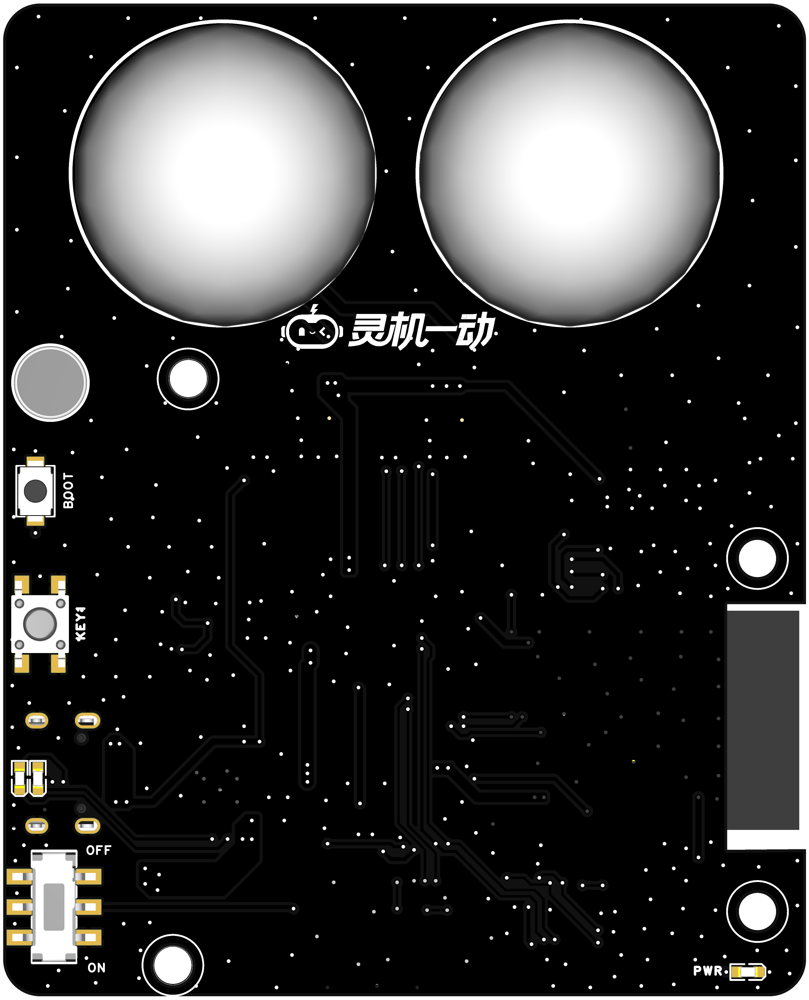
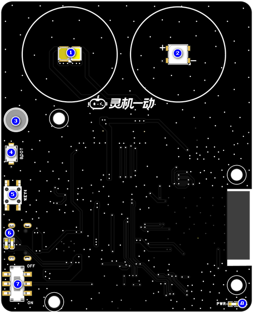
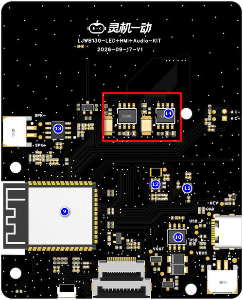
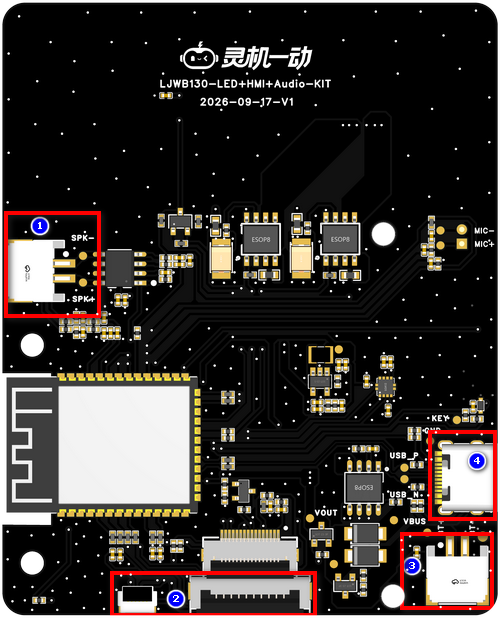
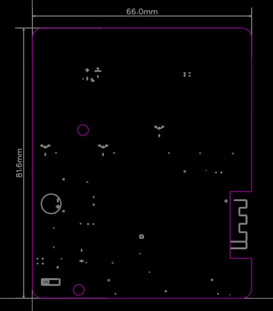

# LJWB130-LED+HMI+Audio-KIT

> 来源：[灵机官方语雀 · LJWB130-LED+HMI+Audio-KIT](https://xjiangiot.yuque.com/afahpl/qrhct7/zay238vitaqbgdet)。原文内容更新时间：2026-10-22（UTC 日期）；整理日期：2026-10-29。
>
> 本文整理源页面的文字、表格、代码和可解析的流程图，保留官方示例口径；不代表本项目已采用或已验证。必要的板卡外观、组件、接口和尺寸图保存在同目录 `img/` 并就近引用，图片来源均为本页顶部的官方语雀页面；其他界面截图仍需回源查看。图中型号、引脚位置和接线方向须与实际板卡核对。附件已有本地整理时链接到本地，其余保留源站链接，未下载、执行或展开。
>
> 本页为板卡资料，设备型号、供电和运行步骤以正文对应型号为限；实际套件、外设接线及烧录包适配待实物核对。本次仅做资料整理，未进行烧录或实物验证。

## 章节导航

- [1. 概述](#section-1)
- [1.1开发板概述](#section-2)
- [1.2核心功能](#section-3)
- [1.3 硬件参数](#section-4)
- [1.4应用场景](#section-5)
- [2. 产品组件功能](#section-6)
- [2.1系统框图](#section-7)
- [2.2产品组件图](#section-8)
- [3. 开发板接口](#section-9)
- [3.1. 开发板接口图（图片仅供参考具体以实物为准）](#section-10)
- [3.2. 开发板接口描述](#section-11)
- [4.电气特性](#section-12)
- [4.1绝对最大额定值](#section-13)
- [4.2 建议工作条件](#section-14)
- [5.开发板尺寸图（单位：mm）](#section-15)
- [5.1 PCB边框尺寸(81.6x66.0x1.6)](#section-16)
- [6. 烧录调试](#section-17)
- [7. 附件资料](#section-18)
- [8. 版本更新](#section-19)

## 1. 概述

### 1.1开发板概述

本方案基于**杰理AC7911BA芯片**打造一体化开发板套件，芯片主频高达320MHz，搭载硬件DSP与AI神经网络算力，内置WiFi/蓝牙双模、多路音频ADC/DAC、SPI、RTC、MCPWM等丰富外设，完美适配智能灯光、定时闹钟、AI语音交互类产品开发场景。

开发板核心集成2.4寸 SPI触控显示屏、锂电池充放电管理、AI语音对话、单功能按键控制、冷暖色灯、RGB氛围灯等核心功能。挖掘芯片外设能力，拓展适配智能家居、便携智能硬件的实用功能，打造一款集教学开发、产品验证、功能演示于一体的高性价比通用开发套件，可直接用于成品量产落地与嵌入式AI开发教学。

### 1.2核心功能

| 项目 | 内容 |
| --- | --- |
| 语音控制 | 语音指令控制灯光开关、冷暖色温调节、RGB 色彩切换、亮度调节 |
| 回声消除功能 | 内置AEC 回声消除算法，提升语音清晰度，适配复杂声学环境。 |
| 低功耗声学唤醒功能 | 硬件 VAD 模块加持，待机功耗低至 25mW，语音唤醒响应时间≤20ms，支持无语音休眠模式，自动降低无效功耗，适配低功耗应用场景。 |
| 可视化交互 | 2.4寸屏显示灯光状态、操作反馈，支持触摸调节色温 / 亮度 |
| 便携使用 | 锂电池供电，脱离市电可独立使用；拨码开关便捷控制供电 |

表1 核心功能表

### 1.3 硬件参数

| 项目 | 内容 |
| --- | --- |
| **主控芯片** | 双核 32 位 RISC 浮点 DSP（FPU），最高主频 320MHz；I-Cache 32KB、D-Cache 24KB，带 MMU，128 向量中断、4 级中断优先级 |
| **连接方式** | Wi‑Fi + BLE 蓝牙双模 |
| **工作电压** | TYPE-C供电工作电压：5V；  电池供电工作电压：3.5-4.2V。 |
| **充电规格** | 5V/0.5A |
| **麦克风** | **JMO-627B-423C-104P**驻极体麦克风（灵敏度≥-28dB，信噪比≥65dB） |
| **功能接口** | 1.扬声器接口  2.TYPE-C接口(可用于电池充电，开发板供电烧录)  3.锂电池接口  4.2.4寸屏幕接口 |
| **工作温度** | -40~+85℃ |

表2 硬件参数表

### 1.4应用场景

**该设备的主要适用场景有：**

- 家居全屋
- 商业办公
- 商业消费
- 公共空间
- 教育教学
- 工业园区

## 2. 产品组件功能

### 2.1系统框图

系统框图文字转录（连线只表示原图连接关系，不据此推断实际接线方向）：

- 节点：杰理AC7911BA；2.4寸SPI+触摸屏幕；冷暖灯；功能按键；TYPE-C电源输入接口；电池；电池管理芯片；24Mhz无源晶振；FLASH；程序更新按键；MIC接口；功放芯片；喇叭接口；AEC；DC-DC 3V3；RGB氛围灯；三轴传感器
- 电池管理芯片 — 电池
- 电池 — 杰理AC7911BA；标注：3.7V
- 连线标注：SPI（端点无法由文字确认）
- 程序更新按键 — FLASH
- 喇叭接口 — 功放芯片
- 喇叭接口 — AEC
- AEC — 杰理AC7911BA；标注：MIC1_P/N
- MIC接口 — 杰理AC7911BA；标注：MIC3
- 连线标注：DACL（端点无法由文字确认）
- TYPE-C电源输入接口 — 电池管理芯片
- DC-DC 3V3 — 杰理AC7911BA；标注：3V3
- 电池 — DC-DC 3V3
- 2.4寸SPI+触摸屏幕 — 杰理AC7911BA
- 冷暖灯 — 杰理AC7911BA
- 功能按键 — 杰理AC7911BA
- RGB氛围灯 — 杰理AC7911BA
- 三轴传感器 — 杰理AC7911BA
- TYPE-C电源输入接口 — 杰理AC7911BA；标注：USB

图1 系统框图（仅供参考）

### 2.2产品组件图

| 项目 | 内容 |
| --- | --- |
| **组件图TOP** | **组件图BOT** |
|  |  |

图2 组件图

| 序号 | 组件名称 | 介绍 |
| --- | --- | --- |
| 1 | **冷暖灯** | 使用一组冷暖贴片灯珠，搭配外壳匀光面罩，可展示冷暖灯光效果。 |
| 2 | **RGB灯** | 使用贴片RGB灯，搭配外壳匀光面罩，可展示氛围灯效果。 |
| 3 | **驻极体麦克风** | JMO-627B-423C-104P驻极体麦克风（灵敏度≥-28dB，信噪比≥65dB）。 |
| 4 | **BOOT键** | 下载按键。按住 Boot 键的同时对板子重新上电，进入烧录模式。上下电可以通过拨动开关。 |
| 5 | **功能按键** | 可自定义功能。 |
| 6 | **充电状态指示灯** | 插入TYPE-C时，电池满电则绿色常亮，红灯熄灭。  电池充电时，红灯常亮， 绿灯熄灭。 |
| 7 | **开关机拨动开关** | 控制设备电池上下电，拨到OFF关闭电源，ON开启电源。 |
| 8 | **开机指示灯** | 设备上电指示灯常亮。 |
| 9 | **XJ-WBJL01-B模组** | 通用型 Wi-Fi + 低功耗蓝牙 MCU 模组，具有丰富的外设接口、强大的神经网络运算能力和信号处理能力，专为人工智能和 AIoT 市场打造。 |
| 10 | **SM5206** | 电池充电芯片，耐30V输入高压。 |
| 11 | **三轴传感器** | SC7A20HTR |
| 12 | **DC-DC电源芯片** | SY8088AAC 高频率、高效率同步降压 DC-DC 转换器 ，输入电压范围2.5-5.5V,输出电流1A。 |
| 13 | **功放芯片** | NS4150C 是一款超低EMI、无需滤波器3W单声道D类音频功率放大器。 |
| 14 | **LED恒流芯片** | Hi1246E高精准单路线性 LED 恒流驱动芯片，1A 大电流输出 ， 输出电流恒流精度 ≤±3%，保证 LED 灯光亮度稳定无频闪；支持1000:1 深度调光 ，兼容20KHz 以上高频 PWM 调光和模拟调光两种模式 。 |

表3 组件介绍表

## 3. 开发板接口

### 3.1. 开发板接口图（图片仅供参考具体以实物为准）

| **底视图** |
| --- |
|  |

图3 开发板接口定义图（底视图）

### 3.2. 开发板接口描述

| 序号 | 接口名称 | 功能 |
| --- | --- | --- |
| 1 | **喇叭接口** | 外接4Ω 3W喇叭，端子间距尺寸2.0mm-2P。 |
| 2 | **显示屏接口** | 连接配套2.4寸SPI触摸屏 |
| 3 | **电池接口** | 外接3.7V 锂电池，端子间距尺寸2.0mm-2P。 |
| 4 | **TYPE-C接口** | 外接 5V 1A TYPE-C线，用于电池充电，开发板供电烧录。 |

表5 底视图接口

## 4.电气特性

### 4.1绝对最大额定值

超出下表6 绝对最大额定值可能导致器件永久性损坏。这只是强调的额定值，不涉及器件在这些或其它条件下超出表7 建议工作条件技术规格指标的功能性操作。长时间暴露在绝对最大额定条件下可能会影响模组的可靠性。

| 符号 | 参数 | 最小值 | 最大值 | 单位符号 | 备注说明 |
| --- | --- | --- | --- | --- | --- |
| VBUS | USB输入电压 | / | 6 | V |  |
| T*STORE* | 储存温度 | -40 | 105 | ℃ |  |

表6 绝对最大额定值

### 4.2 建议工作条件

| **符号** | **参数** | **最小值** | **典型值** | **最大值** | **单位符号** |
| --- | --- | --- | --- | --- | --- |
| VBUS | 电源管脚电压 | 4.0 | 5.0 | 5.5 | V |
| T*STORE* | 工作温度 | -40 | -- | 85 | ℃ |
| Ivdd | 外部供电电流 | 0.5 | - | - | A |

表7 建议工作条件

## 5.开发板尺寸图（单位：mm）

### 5.1 PCB边框尺寸(81.6x66.0x1.6)

图4 开发板尺寸图（仅供参考，具体以实物为准）

## 6. 烧录调试

## 7. 附件资料

7.1 原理图

[SCH_多媒体套件_2026-09-22.pdf（源站附件）](https://xjiangiot.yuque.com/attachments/yuque/0/2026/pdf/62766000/1792655307439-13d5d68c-7239-4bea-a44f-c9e2e51dfc63.pdf)

7.2 PCB文件

[PCB_多媒体套件_2026-09-22.pdf（源站附件）](https://xjiangiot.yuque.com/attachments/yuque/0/2026/pdf/62766000/1792655307423-f29c017a-387e-440e-b397-7876820ef5b1.pdf)

7.3 AC7911BA

[AC791N规格书.rar（源站附件）](https://xjiangiot.yuque.com/attachments/yuque/0/2026/rar/62766000/1792655307402-e9f8a9a5-b105-42d5-8517-2e296e7b6b79.rar)

7.4 麦克风

[CMO-627BA283C-104P.pdf（源站附件）](https://xjiangiot.yuque.com/attachments/yuque/0/2026/pdf/62766000/1792655307403-cf4e69c2-d0f5-4ea6-a800-cd94efcc3c6b.pdf)

7.5 喇叭

[JB2831NR04W03-W06 V2.0.pdf（源站附件）](https://xjiangiot.yuque.com/attachments/yuque/0/2026/pdf/62766000/1792655307683-ebbffe16-7ecc-4493-975c-9c9bb4a11dc9.pdf)

## 8. 版本更新

| **日期** | **版本** | **修改人** | **更新内容** |
| --- | --- | --- | --- |
| 2026/03/11 | V1.0 | 包思远 | 初稿 |
|  |  |  |  |
|  |  |  |  |
|  |  |  |  |
|  |  |  |  |
|  |  |  |  |

---

相关文档：[设备开发资料索引](../../../开发/灵机设备开发资料索引.md) · [项目文档索引](../../../README.md)。
