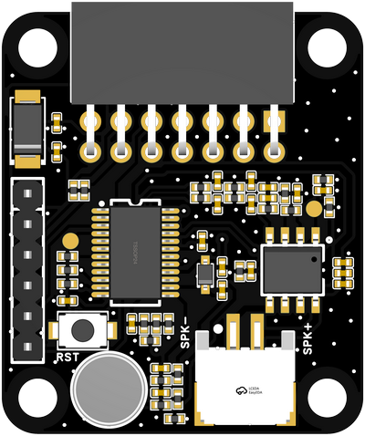
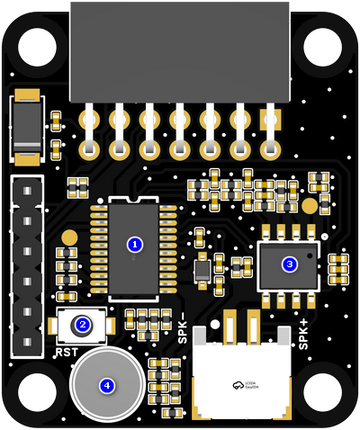
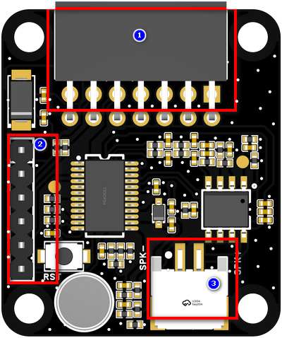
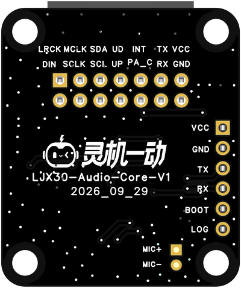
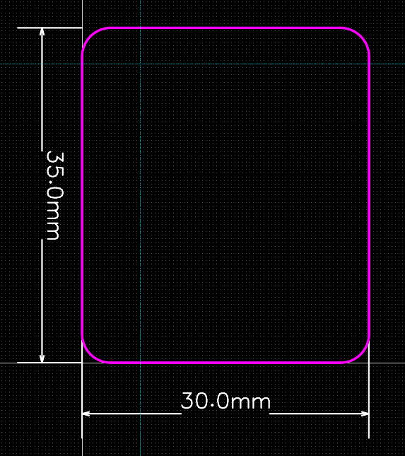

# LJX30-Auido-KIT-V1

> 来源：[灵机官方语雀 · LJX30-Auido-KIT-V1](https://xjiangiot.yuque.com/afahpl/qrhct7/bc29kok6cde8o1vt)。原文内容更新时间：2026-10-22（UTC 日期）；整理日期：2026-10-29。
>
> 本文整理源页面的文字、表格、代码和可解析的流程图，保留官方示例口径；不代表本项目已采用或已验证。必要的板卡外观、组件、接口和尺寸图保存在同目录 `img/` 并就近引用，图片来源均为本页顶部的官方语雀页面；其他界面截图仍需回源查看。图中型号、引脚位置和接线方向须与实际板卡核对。附件已有本地整理时链接到本地，其余保留源站链接，未下载、执行或展开。
>
> 本页为板卡资料，设备型号、供电和运行步骤以正文对应型号为限；实际套件、外设接线及烧录包适配待实物核对。本次仅做资料整理，未进行烧录或实物验证。

## 1. 概述

### 1.1开发板概述

分体GX8006语音板，采用**国芯 GX8006**语音芯片，需外接主控板使用，支持本地语音识别、实时语音交互与智能指令解析，可实现自然流畅的人机对话体验。

板载麦克风，标配PH2.0 喇叭接口，满足音频输入输出一体化需求；通信引脚通过排针外引，可外接主控板，便于外设扩展、二次开发与快速原型验证，适用于 AIoT、智能语音、WIFI 物联网等多场景应用开发。

### 1.2核心功能

| 项目 | 内容 |
| --- | --- |
| 语音交互 | 支持本地离线语音识别，可快速响应自定义语音指令，实现实时语音对话与智能语义理解 。 |
| 回声消除功能 | 内置AEC 回声消除算法，提升语音清晰度，适配复杂声学环境。 |

表1 核心功能表

### 1.3 硬件参数

| 项目 | 内容 |
| --- | --- |
| **语音芯片** | 32位 RISC-V 处理器，配备数字信号处理器（DSP）与浮点运算单元（FPU）扩展，拥有 8KB 指令缓存与 4KB 数据缓存，最大频率为 200MHz，支持多种音频编码与解码功能。集成神经处理器 gxNPU V122，最大工作频率：200MHz，支持 8/16 位量化与权重压缩，支持深度神经网络（DNN）、卷积神经网络（CNN）、长短期记忆网络（LSTM）及其他常用神经网络架构。 |
| **工作电压** | TYPE-A供电工作电压：5V；外接主控板供电 |
| **麦克风** | **JMO-627B-423C-104P**驻极体麦克风（灵敏度≥-28dB，信噪比≥65dB） |
| **功能接口** | 1.引出通信引脚用于与主控板通信  2.TYPE-A供电与烧录调试接口  5.扬声器接口 |
| **工作温度** | -40~+85℃ |

表2 硬件参数表

### 1.4应用场景

**该设备的主要适用场景有：**

- 外接主控板二次开发
- 本地语音交互方案原型验证
- AIoT 产品方案前期可行性验证
- 嵌入式软件开发与调试平台

## 2. 产品组件功能

### 2.1系统框图

系统框图文字转录（连线只表示原图连接关系，不据此推断实际接线方向）：

- 节点：GX8006；板载麦克风；喇叭接口；烧录调试排针接口；主控板对插接口；主控板
- 板载麦克风 — GX8006
- GX8006 — 喇叭接口
- 烧录调试排针接口 — GX8006；标注：UART
- 主控板对插接口 — GX8006
- 主控板对插接口 — 主控板

图1 系统框图（仅供参考）

### 2.2产品组件图

| 组件图 |
| --- |
|  |

图2 组件图

| 序号 | 组件名称 | 介绍 |
| --- | --- | --- |
| 1 | **GX8006语音芯片** | GX8006 高性能低功耗离线语音识别 SoC 芯片，离线唤醒率>=98%,内置AEC回声消除算法。 |
| 2 | **RST键** | 复位按键。 |
| 3 | **功放芯片** | NS8002是一款AB类桥式输出音频功率放大器。其应用电路简单，只需极少数外围器件。输出不需要外接耦合电容或上举电容和缓冲网络。 |
| 4 | **驻极体麦克风** | JMO-627B-423C-104P驻极体麦克风（灵敏度≥-28dB，信噪比≥65dB） |

表3 组件介绍表

## 3. 开发板接口

### 3.1. 开发板接口图（图片仅供参考具体以实物为准）

| 项目 | 内容 |
| --- | --- |
| 顶视图 | 底视图 |
|  |  |

图3 开发板接口定义图（顶视图+底视图）

### 3.2. 开发板接口描述

| 序号 | 接口名称 | 功能 |
| --- | --- | --- |
| 1 | **芯片通信引脚引出排针** | 2.54-2*7P排母，引出电源与通信接口，用于外接主控板 |
| 3 | **烧录调试排针** | 用于GX8006芯片烧写和调试 |
| 2 | **喇叭接口** | 外接4Ω 3W喇叭，端子间距尺寸2.0mm-2P。 |

表4 顶视图接口

## 4.电气特性

### 4.1绝对最大额定值

超出下表5 绝对最大额定值可能导致器件永久性损坏。这只是强调的额定值，不涉及器件在这些或其它条件下超出表7 建议工作条件技术规格指标的功能性操作。长时间暴露在绝对最大额定条件下可能会影响模组的可靠性。

| 符号 | 参数 | 最小值 | 最大值 | 单位符号 | 备注说明 |
| --- | --- | --- | --- | --- | --- |
| VBUS | USB输入电压 | / | 5.5 | V |  |
| T*STORE* | 储存温度 | -40 | 150 | ℃ |  |

表5 绝对最大额定值

### 4.2 建议工作条件

| **符号** | **参数** | **最小值** | **典型值** | **最大值** | **单位符号** |
| --- | --- | --- | --- | --- | --- |
| VBUS | 电源管脚电压 | 4.0 | 5.0 | 5.5 | V |
| T*STORE* | 工作温度 | -40 | -- | 85 | ℃ |

表6 建议工作条件

## 5.开发板尺寸图（单位：mm）

### 5.1 PCB边框尺寸(35.0x30.0x1.6)

图4 开发板尺寸图（仅供参考，具体以实物为准）

## 6. 烧录调试

## 7. 附件资料

7.1 原理图

[SCH_分体GX8006语音板_2026-10-14.pdf（源站附件）](https://xjiangiot.yuque.com/attachments/yuque/0/2026/pdf/62766000/1792654338862-630e4850-f6fc-467b-b926-20c286f4cb99.pdf)

7.2 PCB文件

[PCB_分体GX8006语音板_2026-10-14.pdf（源站附件）](https://xjiangiot.yuque.com/attachments/yuque/0/2026/pdf/62766000/1792654338927-ac2421cc-1414-454e-9c0a-ec8c991e605b.pdf)

7.3 GX8006

[GX8006_datasheet_V1.0语音板.pdf（源站附件）](https://xjiangiot.yuque.com/attachments/yuque/0/2026/pdf/62766000/1792654338960-0470f57c-dbcb-4928-bf4d-0f58a1de22d8.pdf)
[GX8006_DEV_V1.0_User's Guide.pdf（源站附件）](https://xjiangiot.yuque.com/attachments/yuque/0/2026/pdf/62766000/1792654338900-7f4c7af9-f953-4bd7-a75c-a60484ffb280.pdf)

7.4 麦克风

[CMO-627BA283C-104P.pdf（源站附件）](https://xjiangiot.yuque.com/attachments/yuque/0/2026/pdf/62766000/1792654339256-067d38fe-7620-4cb9-93dd-920607af3296.pdf)

7.5 喇叭

[JB2831NR04W03-W06 V2.0.pdf（源站附件）](https://xjiangiot.yuque.com/attachments/yuque/0/2026/pdf/62766000/1792654339419-ddfc4532-a1cf-4e35-978d-64eef08ecdc5.pdf)

## 8. 版本更新

| **日期** | **版本** | **修改人** | **更新内容** |
| --- | --- | --- | --- |
| 2026/10/14 | V1.0 | 包菜 | 初稿 |
|  |  |  |  |
|  |  |  |  |
|  |  |  |  |
|  |  |  |  |
|  |  |  |  |

---

相关文档：[设备开发资料索引](../../../开发/灵机设备开发资料索引.md) · [项目文档索引](../../../README.md)。
