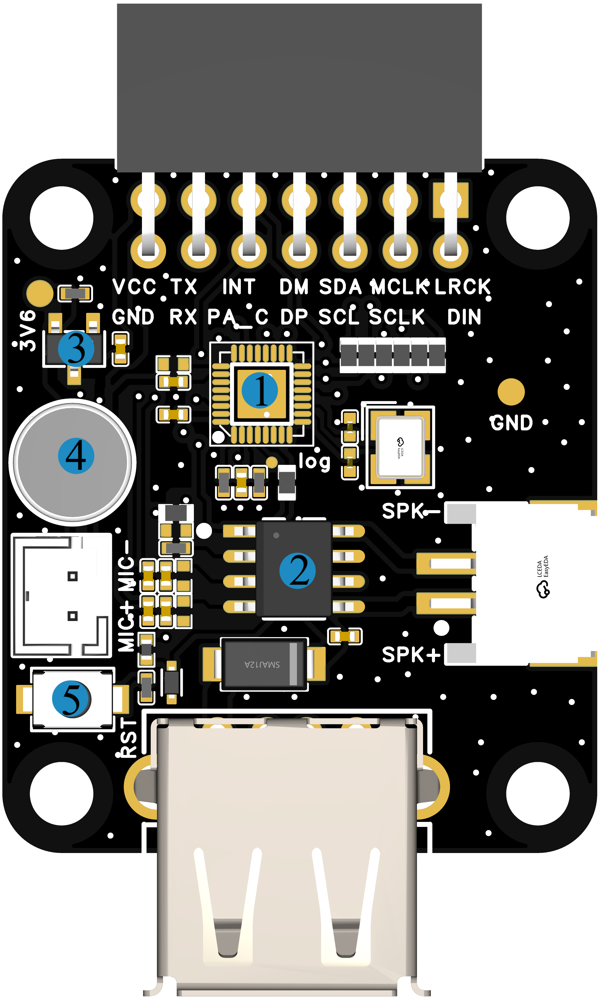
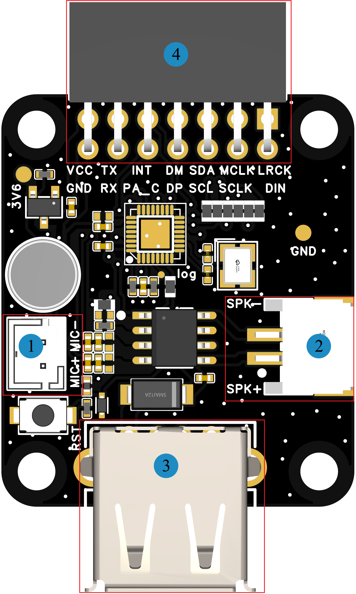
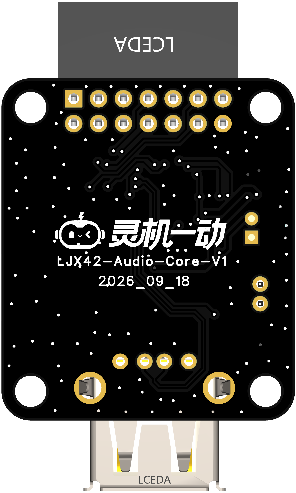
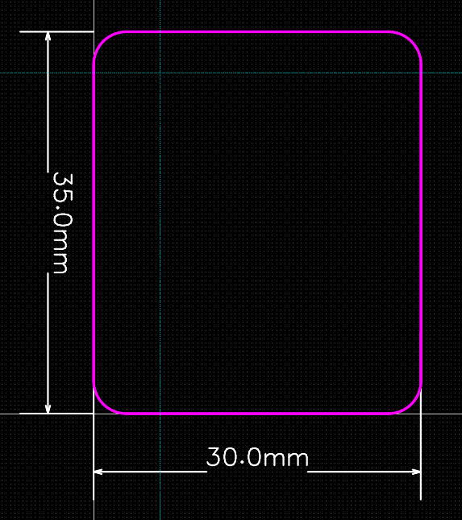

# LJX42-Auido-KIT-V1

> 来源：[灵机官方语雀 · LJX42-Auido-KIT-V1](https://xjiangiot.yuque.com/afahpl/qrhct7/ubgzwwfdlgesia0s)。原文内容更新时间：2026-10-22（UTC 日期）；整理日期：2026-10-29。
>
> 本文整理源页面的文字、表格、代码和可解析的流程图，保留官方示例口径；不代表本项目已采用或已验证。必要的板卡外观、组件、接口和尺寸图保存在同目录 `img/` 并就近引用，图片来源均为本页顶部的官方语雀页面；其他界面截图仍需回源查看。图中型号、引脚位置和接线方向须与实际板卡核对。附件已有本地整理时链接到本地，其余保留源站链接，未下载、执行或展开。
>
> 本页为板卡资料，设备型号、供电和运行步骤以正文对应型号为限；实际套件、外设接线及烧录包适配待实物核对。本次仅做资料整理，未进行烧录或实物验证。

## 1. 概述

### 1.1开发板概述

分体华镇7014语音板，采用**华镇 VB7076A**语音芯片，需外接主控板使用，支持本地语音识别、实时语音交互与智能指令解析，可实现自然流畅的人机对话体验。

板载麦克风，标配PH2.0 喇叭接口，满足音频输入输出一体化需求；通信引脚通过排针外引，可外接主控板，便于外设扩展、二次开发与快速原型验证，适用于 AIoT、智能语音、WIFI 物联网等多场景应用开发。

### 1.2核心功能

| 项目 | 内容 |
| --- | --- |
| 语音交互 | 支持本地离线语音识别，可快速响应自定义语音指令，实现实时语音对话与智能语义理解 。 |
| 回声消除功能 | 内置AEC 回声消除算法，提升语音清晰度，适配复杂声学环境。 |

表1 核心功能表

### 1.3 硬件参数

| 项目 | 内容 |
| --- | --- |
| **语音芯片** | 高性能 32 位音频处理器，支持硬件浮点运算  内置 Flash， VB7076A6（16Mb flash）/ VB7076A3（32Mb flash） |
| **工作电压** | TYPE-A供电工作电压：5V；外接主控板供电 |
| **麦克风** | **JMO-627B-423C-104P**驻极体麦克风（灵敏度≥-28dB，信噪比≥65dB） |
| **功能接口** | 1.引出通信引脚用于与主控板通信  2.TYPE-A供电与烧录调试接口  5.扬声器接口 |
| **工作温度** | -40~+85℃ |

表2 硬件参数表

### 1.4应用场景

**该设备的主要适用场景有：**

- 外接主控板二次开发
- 本地语音交互方案原型验证
- AIoT 产品方案前期可行性验证
- 嵌入式软件开发与调试平台

## 2. 产品组件功能

### 2.1系统框图

系统框图文字转录（连线只表示原图连接关系，不据此推断实际接线方向）：

- 节点：VB7076A；麦克风；喇叭；TYPE-A烧录+供电；排针；主控板
- 麦克风 — VB7076A
- VB7076A — 喇叭
- TYPE-A烧录+供电 — VB7076A；标注：USB
- 排针 — VB7076A
- 排针 — 主控板

图1 系统框图（仅供参考）

### 2.2产品组件图

| 组件图 |
| --- |
|  |

图2 组件图

| 序号 | 组件名称 | 介绍 |
| --- | --- | --- |
| 1 | **7076语音芯片** | 双核 32 位音频处理器，集成专用音频 DSP 内核和 AI 神经网络加速单元 |
| 2 | **功放芯片** | NS4150C，是一款超低EMI、无需滤波器3W单声道D类音频功率放大器。 |
| 3 | **DC-DC电源芯片** | XC6206P362MR是一款高精度，低功耗，高电压，正电压调整器的芯片，工作电压6V，输出电压3.6V |
| 4 | **驻极体麦克风** | JMO-627B-423C-104P驻极体麦克风（灵敏度≥-28dB，信噪比≥65dB） |
| 5 | **RST键** | 复位按键。 |

表3 组件介绍表

## 3. 开发板接口

### 3.1. 开发板接口图（图片仅供参考具体以实物为准）

| 项目 | 内容 |
| --- | --- |
| 顶视图 | 底视图 |
|  |  |

图3 开发板接口定义图（顶视图+底视图）

### 3.2. 开发板接口描述

| 序号 | 接口名称 | 功能 |
| --- | --- | --- |
| 1 | **麦克风接口** | 可外接麦克风 |
| 2 | **喇叭接口** | 外接4Ω 3W喇叭，端子间距尺寸2.0mm-2P。 |
| 3 | **TYPE-A接口** | 外接TYPE-A线，用于供电与芯片烧写调试 |
| 4 | **芯片通信引脚引出排针** | 2.54-2*7P排母，引出电源与通信接口，用于外接主控板 |

表4 顶视图接口

## 4.电气特性

### 4.1绝对最大额定值

超出下表5 绝对最大额定值可能导致器件永久性损坏。这只是强调的额定值，不涉及器件在这些或其它条件下超出表7 建议工作条件技术规格指标的功能性操作。长时间暴露在绝对最大额定条件下可能会影响模组的可靠性。

| 符号 | 参数 | 最小值 | 最大值 | 单位符号 | 备注说明 |
| --- | --- | --- | --- | --- | --- |
| VBUS | USB输入电压 | / | 5.5 | V |  |
| T*STORE* | 储存温度 | -40 | 105 | ℃ |  |

表5 绝对最大额定值

### 4.2 建议工作条件

| **符号** | **参数** | **最小值** | **典型值** | **最大值** | **单位符号** |
| --- | --- | --- | --- | --- | --- |
| VBUS | 电源管脚电压 | 4.0 | 5.0 | 5.5 | V |
| T*STORE* | 工作温度 | -40 | -- | 85 | ℃ |
| Ivdd | 外部供电电流 | 0.5 | - | - | A |

表6 建议工作条件

## 5.开发板尺寸图（单位：mm）

### 5.1 PCB边框尺寸(35.0x30.0x1.6)

图4 开发板尺寸图（仅供参考，具体以实物为准）

## 6. 烧录调试(待添加)

## 7. 附件资料

7.1 原理图

[SCH_语音外挂板7076_2026-10-14.pdf（源站附件）](https://xjiangiot.yuque.com/attachments/yuque/0/2026/pdf/62766000/1792654165145-7bc6c869-c24d-4c13-b699-812706fa5ead.pdf)

7.2 PCB文件

[PCB_PCB2_2026-10-14.pdf（源站附件）](https://xjiangiot.yuque.com/attachments/yuque/0/2026/pdf/62766000/1792654165134-319c1c32-ebc9-4757-823d-c6bdf6e07f9f.pdf)

7.3 VB7076A

[语音大脑平台_VB7076A芯片_Datasheet_Ver1.0.pdf（源站附件）](https://xjiangiot.yuque.com/attachments/yuque/0/2026/pdf/62766000/1792654165135-1b2b9446-e7d3-44c2-a85f-416c3e66678d.pdf)

7.4 麦克风

[CMO-627BA283C-104P.pdf（源站附件）](https://xjiangiot.yuque.com/attachments/yuque/0/2026/pdf/62766000/1792654165183-45728c10-f501-439a-a3a9-c49729b14455.pdf)

7.5 喇叭

[JB2831NR04W03-W06 V2.0.pdf（源站附件）](https://xjiangiot.yuque.com/attachments/yuque/0/2026/pdf/62766000/1792654165402-45c9373f-ba6b-4d67-918c-3ba025d64da5.pdf)

## 8. 版本更新

| **日期** | **版本** | **修改人** | **更新内容** |
| --- | --- | --- | --- |
| 2026/10/14 | V1.0 | 杨震 | 初稿 |
|  |  |  |  |
|  |  |  |  |
|  |  |  |  |
|  |  |  |  |
|  |  |  |  |

---

相关文档：[设备开发资料索引](../../../开发/灵机设备开发资料索引.md) · [项目文档索引](../../../README.md)。
