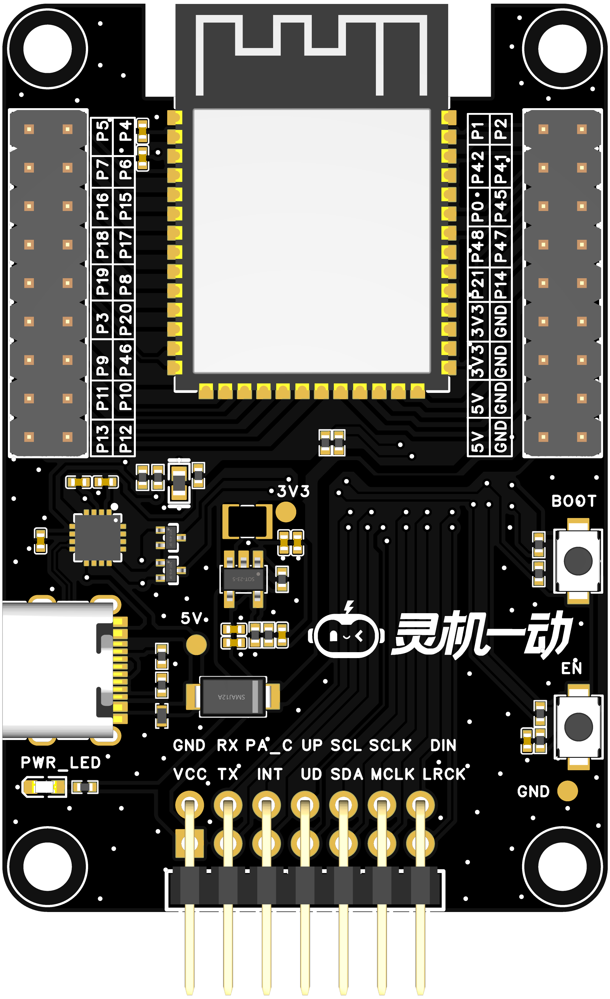
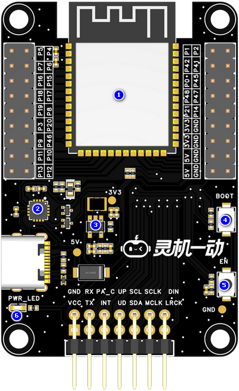
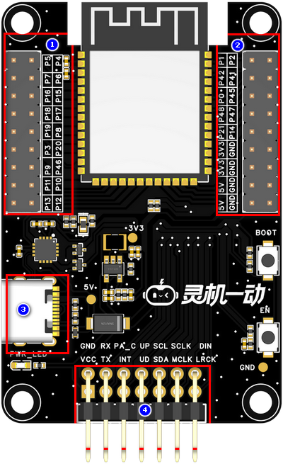
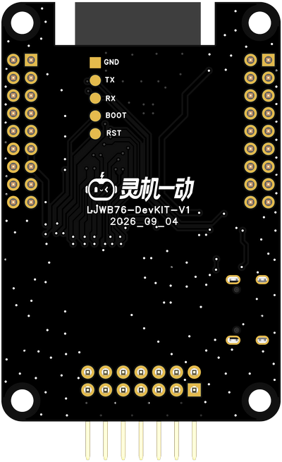
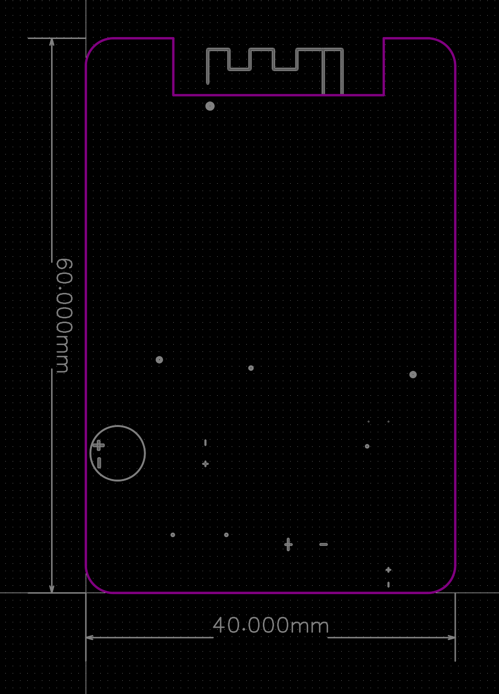

# XJWB03-DevKIT-V1

> 来源：[灵机官方语雀 · XJWB03-DevKIT-V1](https://xjiangiot.yuque.com/afahpl/qrhct7/aq51zc65s4i6ebt2)。原文内容更新时间：2026-10-27（UTC 日期）；整理日期：2026-10-29。
>
> 本文整理源页面的文字、表格、代码和可解析的流程图，保留官方示例口径；不代表本项目已采用或已验证。必要的板卡外观、组件、接口和尺寸图保存在同目录 `img/` 并就近引用，图片来源均为本页顶部的官方语雀页面；其他界面截图仍需回源查看。图中型号、引脚位置和接线方向须与实际板卡核对。附件已有本地整理时链接到本地，其余保留源站链接，未下载、执行或展开。
>
> 本页为板卡资料，设备型号、供电和运行步骤以正文对应型号为限；实际套件、外设接线及烧录包适配待实物核对。本次仅做资料整理，未进行烧录或实物验证。
>
> **项目适用性与原文差异：** 原文“Wi-Fi 6（802.11ax）+ 经典蓝牙”与 ESP32-S3 的 Wi-Fi 4（802.11b/g/n）及 Bluetooth LE 能力不符，不作为本项目参数；语音芯片、麦克风等字段也需按实际搭配核对。原文烧录工具中单文件地址 `0x0000` 仅能用于与之匹配的合并固件；本项目分区镜像与 `flashall` 用法见上手手册，不能把单独应用镜像照此烧录。

## 章节导航

- [1. 概述](#section-1)
- [1.1开发板概述](#section-2)
- [1.2核心功能](#section-3)
- [1.3 硬件参数](#section-4)
- [1.4应用场景](#section-5)
- [2. 产品组件功能](#section-6)
- [2.1系统框图](#section-7)
- [2.2产品组件图](#section-8)
- [3. 开发板接口](#section-9)
- [3.1. 开发板接口图（图片仅供参考具体以实物为准）](#section-10)
- [3.2. 开发板接口描述](#section-11)
- [4.电气特性](#section-12)
- [4.1绝对最大额定值](#section-13)
- [4.2 建议工作条件](#section-14)
- [5.开发板尺寸图（单位：mm）](#section-15)
- [5.1 PCB边框尺寸(60.0x40.0x1.6)](#section-16)
- [6. 烧录调试](#section-17)
- [6.1 烧录工具](#section-18)
- [6.2 烧录步骤](#section-19)
- [7. 附件资料](#section-20)
- [8. 版本更新](#section-21)

## 1. 概述

### 1.1开发板概述

灵机AI 分体方案WIFI主控板，以XJWB03模组为主控核心，预留分体语音板对插座，可灵活外接不同型号语音子板；采用 2.54mm 标准排针引出全部 GPIO，单 Type‑C 接口集成供电、固件烧录、调试三大功能，便于开发者快速开展语音功能原型开发、验证与调试。

### 1.2核心功能

| 项目 | 内容 |
| --- | --- |
| 语音扩展 | 预留分体语音板对插插座，支持灵活选配、更换不同型号语音子板，适配各类语音交互方案。 |
| 主控能力 | 搭载 XJWB03 模组作为核心，自带 WiFi 通信能力，作为分体方案主控单元。 |
| 外设扩展 | 2.54mm 标准排针引出全部 GPIO，方便外接传感器、执行器等外设，便于原型拓展。 |

表1 核心功能表

### 1.3 硬件参数

| 项目 | 内容 |
| --- | --- |
| **主控芯片** | 内置ESP32-S3 系列芯片，Xtensa® 双核 32 位LX7 微处理器 (支持单精度浮点运算单元)，支持高达 240 MHz 的时钟频率;  片上存储：384 KB ROM,512 KB SRAM,16 KB RTC SRAM ,最大 16 MB PSRAM。 |
| **语音芯片** | 32 位 RISC-V CPU（带 DSP+FPU 扩展），最高主频 200MHz；  集成 gxNPU V122 神经网络处理器（最高主频 200MHz）  内置 176KB SRAM；SIP 封装 2MB QSPI Nor Flash（支持 XIP，最高时钟 120MHz）；256 位 OTP 存储器；支持外接 PSRAM |
| **连接方式** | 支持Wi-Fi 6（802.11ax）+ 蓝牙 5.0（BLE 5.0 / 经典蓝牙）连接。 |
| **工作电压** | TYPE-C供电工作电压：5V； |
| **麦克风** | **JMO-627B-423C-104P**驻极体麦克风（灵敏度≥-28dB，信噪比≥65dB） |
| **功能接口** | 1.XJWB03模组引脚引出排针  2.TYPE-C供电与烧录调试接口  3.3.3V和5V输出接口  4.预留分体语音板对插接口 |
| **工作温度** | -40~+85℃ |

表2 硬件参数表

### 1.4应用场景

**该设备的主要适用场景有：**

- WIFI 通信功能快速验证
- 本地语音交互方案原型验证
- 硬件接口与外设联调
- AIoT 产品方案前期可行性验证
- 嵌入式软件开发与调试平台

## 2. 产品组件功能

### 2.1系统框图

系统框图文字转录（连线只表示原图连接关系，不据此推断实际接线方向）：

- 节点：ESP32；CH343；TYPE-C；按键；排针；DC-DC 3.3V；分体语音板接口
- CH343 — TYPE-C；标注：USB
- 按键 — ESP32；标注：BOOT+RST
- ESP32 — 排针；标注：剩余GPIO
- DC-DC 3.3V — ESP32
- TYPE-C — DC-DC 3.3V
- CH343 — ESP32；标注：烧录
- 分体语音板接口 — ESP32
- TYPE-C — 分体语音板接口；标注：VCC

图1 系统框图（仅供参考）

### 2.2产品组件图

| **组件图** |
| --- |
|  |

图2 组件图

| 序号 | 组件名称 | 介绍 |
| --- | --- | --- |
| 1 | **XJWB03模组** | 通用型 Wi-Fi + 低功耗蓝牙 MCU 模组，具有丰富的外设接口、强大的神经网络运算能力和信号处理能力，专为人工智能和 AIoT 市场打造。 |
| 2 | **USB转换芯片** | CH343P，USB转UART，通过此芯片可直接使用USB下载固件。 |
| 3 | **DC-DC电源芯片** | SY8088AAC 高频率、高效率同步降压 DC-DC 转换器 ，输入电压范围2.5-5.5V,输出电流1A。 |
| 4 | **BOOT键** | 下载按键。按住 Boot 键的同时按一下 Reset 键进入“固件下载”模式，通过串口下载固件。 |
| 5 | **RST键** | 复位按键。 |
| 6 | **电源指示灯** | 用于指示板子是否上电。 |

表3 组件介绍表

## 3. 开发板接口

### 3.1. 开发板接口图（图片仅供参考具体以实物为准）

| 项目 | 内容 |
| --- | --- |
| **顶视图** | **底视图** |
|  |  |

图3 开发板接口定义图（顶视图+底视图）

### 3.2. 开发板接口描述

| 序号 | 接口名称 | 功能 |
| --- | --- | --- |
| 1 | **模组引脚引出排针1** | 2.54-2*15P排针座子， 方便外设扩展， 开发调试与功能验证。 |
| 2 | **模组引脚引出排针2** | 2.54-2*15P排针座子，方便外设扩展， 开发调试与功能验证。 |
| 3 | **TYPE-C接口** | 外接 5V 1A TYPE-C线，用于开发板供电和模组固件烧写调试。 |
| 4 | **分体语音板接口** | 2.54-7P*2排针座子，可对插分体语音板。 |

表4 顶视图接口

## 4.电气特性

### 4.1绝对最大额定值

超出下表5 绝对最大额定值可能导致器件永久性损坏。这只是强调的额定值，不涉及器件在这些或其它条件下超出表7 建议工作条件技术规格指标的功能性操作。长时间暴露在绝对最大额定条件下可能会影响模组的可靠性。

| 符号 | 参数 | 最小值 | 最大值 | 单位符号 | 备注说明 |
| --- | --- | --- | --- | --- | --- |
| VBUS | USB输入电压 | / | 7 | V |  |
| T*STORE* | 储存温度 | -40 | 105 | ℃ |  |

表5 绝对最大额定值

### 4.2 建议工作条件

| **符号** | **参数** | **最小值** | **典型值** | **最大值** | **单位符号** |
| --- | --- | --- | --- | --- | --- |
| VBUS | 电源管脚电压 | 4.0 | 5.0 | 6.0 | V |
| T*STORE* | 工作温度 | -40 | -- | 85 | ℃ |
| Ivdd | 外部供电电流 | 0.5 | - | - | A |

表6 建议工作条件

## 5.开发板尺寸图（单位：mm）

### 5.1 PCB边框尺寸(60.0x40.0x1.6)

图4 开发板尺寸图（仅供参考，具体以实物为准）

## 6. 烧录调试

### 6.1 烧录工具

[flash_download_tool.rar（源站附件）](https://xjiangiot.yuque.com/attachments/yuque/0/2026/rar/62766000/1792123214947-5ccaa5fe-ba80-4dd3-835a-93cb9e97b8fe.rar)

### 6.2 烧录步骤

| 步骤 | 操作内容 | 操作要点与注意事项 | 图示 |
| --- | --- | --- | --- |
| 1 | 烧录准备 | TYPE-C数据线 |  |
| 2 | 打开烧录工具 | 进入解压后的文件夹，双击运行“.exe”文件。 | 〔图示见来源页面；未转录图中文字〕  图5 打开烧录工具 |
| 3 | 选择烧录方式 | 在弹出的窗口第一条选择“ESP32-S3”，第三条选择“USB” | 〔图示见来源页面；未转录图中文字〕  图6 烧录选择 |
| 4 | 选择烧录文件 | 图中1处勾上，2处点击选择固件，3处地址输入“0x0000” | 〔图示见来源页面；未转录图中文字〕  图7 选择烧录文件 |
| 5 | 开始烧录 | 用数据线把开发板与电脑连接，"COM"选择连接时出现的端口号，"BAUD"选择"115200"，点击"START"即可开始烧录。 | 〔图示见来源页面；未转录图中文字〕  图8 开始烧录 |

## 7. 附件资料

7.1 原理图：

[SCH_分体WIFI主控板_2026-10-14.pdf（源站附件）](https://xjiangiot.yuque.com/attachments/yuque/0/2026/pdf/71234954/1791960476056-3c14319a-5bf7-49d8-a729-1e02891ded71.pdf)

7.2 pcb文件:

[PCB_分体WIFI主控板_2026-10-14.pdf（源站附件）](https://xjiangiot.yuque.com/attachments/yuque/0/2026/pdf/71234954/1791960507237-81fa44e3-ef71-4942-b262-f9229aca0901.pdf)

7.3 小匠模块规格书：

[XJWB03模组规格书V1.0.pdf（源站附件）](https://xjiangiot.yuque.com/attachments/yuque/0/2026/pdf/71234954/1791960550835-e1eb1374-6be8-4c9b-a4d9-910124daad66.pdf)

7.4 麦克风：

[CMO-627BA283C-104P.pdf（源站附件）](https://xjiangiot.yuque.com/attachments/yuque/0/2026/pdf/71234954/1791960575339-595c79e0-1faa-4216-9aca-178f33852c68.pdf)

7.5 喇叭：

[JB2831NR04W03-W06 V2.0.pdf（源站附件）](https://xjiangiot.yuque.com/attachments/yuque/0/2026/pdf/71234954/1791960594464-46073adf-592b-429a-be3a-ac5c1e2496e8.pdf)

7.6 六轴传感器：

[MPU6050-V1-SCH.pdf（已有本地整理）](../../MPU6050/MPU6050-V1-SCH.md)
[PS-MPU-6000A-EN.pdf（已有本地整理）](../../MPU6050/PS-MPU-6000A-EN.md)
[RM-MPU-6000A-EN.pdf（已有本地整理）](../../MPU6050/RM-MPU-6000A-EN.md)
[关于MPU6050模块新版本兼容问题的解决方案2.pdf（已有本地整理）](../../MPU6050/关于MPU6050模块新版本兼容问题的解决方案2.md)

7.7 舵机：

[舵机.pdf（已有本地整理）](../../舵机/舵机.md)

7.8 WS2812灯圈：

[WS2812_Datasheet.pdf（已有本地整理）](../../WS2812灯圈/WS2812_Datasheet.md)

[WS2812灯圈.zip（已有本地整理）](../../WS2812灯圈/WS2812灯圈.zip)

7.9 震动马达：

[震动马达.pdf（已有本地整理）](../../震动马达/震动马达.md)

7.10 摄像头：

[AS-BD108A93D17-19-V2.0.pdf（已有本地整理）](../../摄像头/AS-BD108A93D17-19-V2.0.md)

7.11 摄像头转接板：

[PCB_摄像头转接板_2026-10-16.pdf（已有本地整理）](../../摄像头/接线说明.md#pcb)
[SCH_摄像头转接板_2026-10-16.pdf（已有本地整理）](../../摄像头/接线说明.md#schematic)

[接线说明.md（已有本地整理）](../../摄像头/接线说明.md)

[转接板实拍图.zip（源站附件）](https://xjiangiot.yuque.com/attachments/yuque/0/2026/zip/71234954/1792765247299-f78165e5-d42b-4f5b-8cc7-6b3fed587963.zip)

## 8. 版本更新

| **日期** | **版本** | **修改人** | **更新内容** |
| --- | --- | --- | --- |
| 2026/10/14 | V1.0 | 包菜 | 初稿 |
|  |  |  |  |
|  |  |  |  |
|  |  |  |  |
|  |  |  |  |
|  |  |  |  |

---

相关文档：[设备开发资料索引](../../../开发/灵机设备开发资料索引.md) · [项目文档索引](../../../README.md)。
