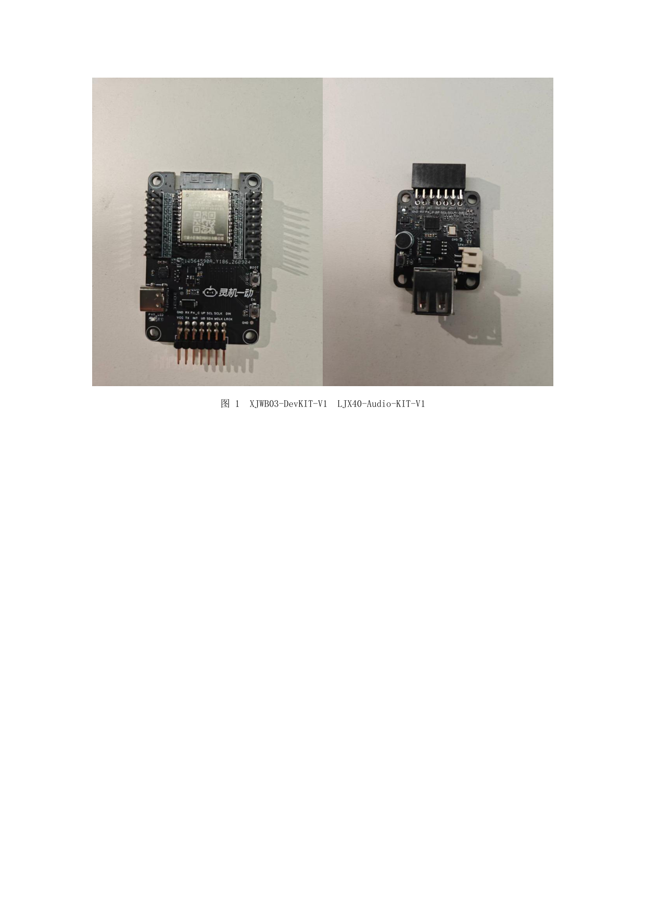

# 灵机 XJWB03 标准开发板使用文档

适用于 XJWB03-DevKIT-V1 底板与 LJX40-Audio-KIT-V1 语音模块的快速上手、二次开发和故障排查。

> 来源：`灵机XJWB03标准开发板使用文档.pdf`，V1.1，2026-10。文中的命令、平台操作和硬件功能尚未在本项目验证。赛题使用 LJWB03 命名，与 XJWB03 的对应关系待确认。

## 章节导航

- [1 阅读指南](#chapter-1)
- [2 快速体验总览](#chapter-2)
- [3 第一步：硬件准备](#chapter-3)
- [4 第二步：准备编译环境](#chapter-4)
- [5 第三步：平台产品与 PID](#chapter-5)
- [6 第四步：编译与烧录](#chapter-6)
- [7 第五步：配网与绑定](#chapter-7)
- [8 第六步：功能验证](#chapter-8)
- [9 常见问题](#chapter-9)
- [10 附录 A：硬件与接口](#chapter-10)
- [11 附录 B：SDK 结构与插件开关](#chapter-11)
- [12 附录 C：链接汇总](#chapter-12)
- [13 开发设备展示](#chapter-13)

XJWB03-DevKIT-V1 底板 + LJX40-Audio-KIT-V1 语音模块开发板

ESP32-S3 · 16 MB Flash · Wi-Fi / BLE · ESP-IDF + QUMIOS

|项目|内容|
|---|---|
|文档版本|V1.1|
|适用 SDK|https://gitee.com/xj-open/ljyd_xjwb03_agent_public_developer|
|目标芯片|ESP32-S3|
|更新日期|2026-10|

阅读提示：SDK、平台及开发者文档入口集中在[第 12 章「链接汇总」](#links)。配网、绑定等具体子页面直链原资料未提供，可先从开发者文档中心进入；具体子页面地址待补充。

<a id="chapter-1"></a>

## 1 阅读指南

本文档只回答一个问题：拿到这块板子之后，怎样最快把它跑通并验证。

全文分为三段：第 2 章是流程总览，第 3～8 章按顺序操作一遍即可完成“接线 → 编译烧录 → 配网绑定 → 功能验证”，第 9～12 章是出问题时的排查表和硬件、软件参考。

### 1.1 三条阅读路线

|你的目标|建议路线|重点章节|
|---|---|---|
|只想让设备跑起来体验|接线 → 用现成烧录包烧录 →配网绑定 → 逐项验证（无需装编译环境）|2、3、6.3、7、8|
|要做二次开发 / 做自己的产品|按顺序完整阅读；改宏开关、换 PID、重新编译|1～8、10、11|
|设备已经在跑，遇到问题|先看第 9 章常见问题，再用调试命令行定位|8.4、9|

### 1.2 三个必须知道的名词

|名词|含义|在哪里用到|
|---|---|---|
|PID|灵机开放平台上产品的唯一标识，设备靠它对应到你的产品|第 5 章写入固件；决定蓝牙广播名|
|AGENT|平台上为产品创建的智能体，设备连云后由它负责语音对话|第 7 章创建 / 绑定|
|配网|通过蓝牙把 Wi-Fi 名称和密码下发给设备，设备联网后自动连云|第 7 章小程序操作|

<a id="chapter-2"></a>

## 2 快速体验总览

整个流程共七步。每一步都有明确的“完成标志”，做完再进入下一步，避免在没准备好的情况下反复烧录。

### 2.1 七步流程

|步骤|要做的事|完成标志|章节|
|---|---|---|---|
|1 选方案|直接采用「灵机 ESP32组合开发板」标准方案|明确要做的产品形态|1|
|2 买硬件|XJWB03-DevKIT-V1 底板 + LJX40-Audio-KIT-V1 语音模块|板子、喇叭、USB 数据线到手|3|
|3 准备环境|拉仓库、装工具链（或跳过，直接用烧录包）|dev.bat build 编译通过|4|
|4 建产品|平台注册、创建产品与AGENT，取得 PID 与密钥|拿到 PID 和 SECRET|5|
|5 编译烧录|写入 PID，首次用flashall 烧全部镜像|串口有启动日志、有开机提示音|6|
|6 配网绑定|小程序 BLE 配网 →绑定设备 → 绑定AGENT|设备出现在账号下且在线|7|
|7 开始体验|语音对话、音量、闹钟逐项验证|各项功能符合预期|8|

### 2.2 流程示意

选择方案 → 购买开发板 → 准备编译环境 → 创建产品取得 PID → 编译烧录 → 配网与绑定 → 开始体验

### 2.3 开始前的准备清单

|类别|需要准备|说明|
|---|---|---|
|硬件|开发板套件、USB Type-C 数据线、2.4 GHz Wi-Fi 路由器|USB 线需支持数据传输|
|电脑|Windows 10 / 11，可用 USB口|需要可传输数据的type-c 数据线|
|软件|Git、Python 3（仅编译需要）|使用烧录包时不需要安装任何工具|
|账号|灵机开放平台账号、微信（小程序）|平台地址：https://platform.ljyd.cn|

提示：设备出厂 / 换板后第一次使用，建议先按 6.3 节用烧录包把固件烧成最新版本，再开始配网，可以避开旧固件的已知问题。

<a id="chapter-3"></a>

## 3 第一步：硬件准备

### 3.1 套件构成

|部件|型号|作用|
|---|---|---|
|核心开发板|XJWB03-DevKIT-V1|ESP32-S3 主控、16 MBFlash、USB 接口、外设排针|
|语音模块开发板|LJX40-Audio-KIT-V1|麦克风、喇叭接口、VB701N 音频编解码|
|音频芯片|VB701N|通过 UART 与主控通信，音频格式为 Opus 16 kHz / 单声道/ 20 ms|
|可选外设|MPU6050、舵机、振动马达、WS2812 灯带|按产品需要选配，默认示例中未全部启用|

### 3.2 最小可用连接（只做四件事）

- 把语音模块的排线插到底板对应的座子上，注意方向，不要硬插。

- 喇叭接到语音模块的喇叭接口；麦克风在模块板上，不需要外接。

- USB 线一端接底板的 USB 口，另一端接电脑，用于供电和烧录。

- 需要看日志时，type-c 连接开发板，波特率 115200。

### 3.3 上电前检查

- 排线方向、喇叭线是否插紧，供电电压是否符合底板标注。

- 不要带电插拔语音模块排线。

- USB 口必须是数据口，部分充电线只能供电，插上后电脑不会出现串口。

### 3.4 识别串口

打开“设备管理器 → 端口 (COM 和 LPT)”，记下设备对应的 COM 号；也可以在 PowerShell 中执行：

```powershell
[System.IO.Ports.SerialPort]::GetPortNames()
```

如果没有出现串口，按底板的 USB 转串口芯片安装对应驱动。

<a id="chapter-4"></a>

## 4 第二步：准备编译环境

只使用现成烧录包体验设备的话，可以跳过本章，直接看 6.3 节。需要改代码、换 PID、裁剪功能时，按本章准备环境。

本项目将 SDK 放在 `src/firmware/`，通过 Git 子模块固定版本；本地目录、SSH 获取方式与实际版本见[固件代码获取与运行说明](../../开发/固件代码获取与运行说明.md)。以下获取方式用于单独克隆上游；已有本项目工作区时，按该说明初始化即可，无需重复克隆。

### 4.1 前置条件

- Git for Windows，且在新终端中可以执行 git --version。

- Python 3，python 能在 PATH 中执行；如果指向 Microsoft Store 的应用别名，请先关闭该别名。

- 原手册称 esp-idf、qumios-dev 是两个子模块；2026-10-22 获取的上游版本已将它们作为普通目录内置。建议使用 Git 获取完整源码并保留版本记录，实际依赖结构以所检出的版本为准。

### 4.2 获取代码

```powershell
git clone --recurse-submodules https://gitee.com/xj-open/ljyd_xjwb03_agent_public_developer
```

仓库地址：https://gitee.com/xj-open/ljyd_xjwb03_agent_public_developer

递归初始化命令如下；当前 SDK 版本没有额外的 Git 子模块，此命令用于兼容其他版本的依赖：

```powershell
git submodule update --init --recursive
```

### 4.3 安装工具链

在 SDK 根目录执行一键安装脚本；当前版本复用内置 ESP-IDF 源码，安装 CMake、Ninja、Xtensa 工具链和 Python 环境：

```batch
install.bat
```

安装耗时取决于网络状况，中途不要关闭窗口。安装完成后再执行编译。

### 4.4 验证环境

```batch
dev.bat build
```

成功时输出 [dev] build done. output dir: ...\apps\build，应用固件为 apps\build\vb701n.bin。

|报错|原因|处理|
|---|---|---|
|python env not found|工具链路径未找到|确认 install.bat 已成功；或设置 IDF_TOOLS_PATH 指向 .espressif 目录|
|idf.py not found|SDK 中的 esp-idf 源码不完整，或 SDK 本身未初始化|先在主项目执行 git submodule update --init --recursive，再检查 SDK 的 esp-idf/tools/idf.py；当前版本中 esp-idf 是内置目录|
|Invalid character escape|路径使用了反斜杠|脚本内部已使用正斜杠；自定义路径时不要写反斜杠|

<a id="chapter-5"></a>

## 5 第三步：平台产品与 PID

设备属于哪个产品、连哪个服务器，全部由 PID 与密钥决定。这一步做错，后面配网一定搜不到设备或连不上云。

### 5.1 注册并创建产品

- 打开灵机开放平台（地址见[第 12 章链接汇总](#links)），注册并登录账号。

- 在账号下创建产品，记下产品 ID（PID）与密钥（SECRET）。

- 为产品创建 AGENT，决定设备连上云端后使用哪个智能体。

注意：平台分测试服与正式服，两套环境的 PID 不能混用。仓库中的示例 PID 11665 属于测试服，仅用于验证链路。

### 5.2 把 PID 与密钥写入 SDK

产品身份只在一处配置：apps/main/cloud/ljyd_cloud.h。把下面两行换成你自己的产品信息：

```c
#define CONFIG_XJIANG_CLOUD_PID  11665
#define CONFIG_XJIANG_CLOUD_SECERT "F7B6033204064B698FEDE033605DDDBA"
```

修改后必须重新编译并烧录，只改源码不烧录不会生效（编译 / 烧录命令见 6.1 / 6.2 节）。

### 5.3 配置注意事项

- 密钥错误时设备能被搜到，但动态注册失败，日志停在 dynreg 阶段，无法连云。

- 换了 PID 之后要重新配网：旧设备证书与旧产品绑定，继续用会连云失败。

<a id="chapter-6"></a>

## 6 第四步：编译与烧录

### 6.1 编译命令

|命令|作用|什么时候用|
|---|---|---|
|dev.bat build|增量编译|日常改代码后|
|dev.bat rebuild|删除 apps\build 后全量编译|改了 qm_config.h 的宏、换了PID、换了分区表|
|dev.bat clean|删除整个编译缓存|编译产物异常、需要彻底重来|
|dev.bat clean obj|只清对象文件，保留sdkconfig|只怀疑对象文件损坏时|

### 6.2 烧录命令

|命令|作用|说明|
|---|---|---|
|dev.bat flash -p COMx|只烧应用分区|日常改代码快速验证|
|dev.bat flashall -p COMx|烧写 flash_args 中的全部镜像|首次烧录、换分区表、整片擦除之后必须使用|
|dev.bat flashall -p COMx erase|先整片擦除再全烧|会清掉配网信息与 KV 数据|

重要：全量镜像共 6 个，其中包括 0x810000 处的姿态模型分区。只烧应用而模型分区为空时，设备会在启动阶段反复崩溃重启，务必使用 flashall 或烧录包。

### 6.3 不装环境也能烧：独立烧录包

原手册说明：烧录包解压即用，SDK 仓库的 demoflashpack 目录下提供快速验证固件，点击脚本一键运行，能正常对话即为设备正常。在该目录下执行以下命令：

> 2026-10-22 核对：本项目获取的 SDK 提交 `bebdc80209f1b3c2611f9602577be1c0d1ac4b96` 未包含 `demoflashpack/`。以下命令保留作原资料参考，烧录包获取位置待上游补充；当前可按 6.1、6.2 节自行编译后烧录。

|命令|作用|
|---|---|
|flashdownload.bat COMx|烧录|

提示：烧录包里的固件是固定版本。修改代码或更换 PID 后，需要自己编译，或重新制作烧录包。设备默认名称为”宝可梦百典”

### 6.4 烧录后检查

把 UART0 接到电脑，串口参数 115200 8N1。设备上电后依次出现以下关键日志（未配网时）：

```text
qm_audio ready, opus 20ms
opus ready ... 16000 Hz mono 20 ms ...
ble provision start ret=0
cloud connecting
iot start ok
cloud connected
```

|日志|含义|
|---|---|
|qm_audio ready, opus 20ms|音频链路初始化成功，随后会播放开机提示音|
|ble provision start|设备未配网（或已复位），正在等待小程序配网|
|iot start ok|云端会话任务已启动；失败时会打印 session task create failed|
|cloud connected|已连云，可以唤醒对话|

如果只出现前半段，说明卡在联网：优先检查 Wi-Fi 频段、PID / 密钥和平台环境是否匹配。

<a id="chapter-7"></a>

## 7 第五步：配网与绑定

### 7.1 配网前确认

- 设备已烧录并重启，喇叭有开机提示音。

- 手机蓝牙已打开，小程序已登录并授予蓝牙、定位权限。

- Wi-Fi 为 2.4 GHz（ESP32-S3 不支持 5 GHz），密码正确。

- 设备未被其它账号绑定；已绑定过的设备需先解绑，或长按 GPIO14 三秒复位配网（见 7.2 节）。

### 7.2 Wi-Fi 设备：小程序 BLE 配网

- 打开小程序，进入“添加设备 / 配网”，按产品选择“灵机 ESP32 组合开发板”（操作资料入口见[第 12 章链接汇总](#links)，具体步骤页面待补充）。

- 输入家中 Wi-Fi 的名称与密码，等待进度到 100%，设备会自动重启并连云。

成功标志：小程序显示设备在线，串口日志出现 cloud connected。

复位配网：设备已联网时可长按 GPIO14 三秒：云端在线则请求解绑，云端不在线则清除本地配网信息并重启，随后重新进入 BLE 配网状态。

### 7.3 绑定设备与 AGENT

- 绑定设备：在平台或小程序把设备归属到你的账号（操作资料入口见[第 12 章链接汇总](#links)，具体步骤页面待补充）。

- AGENT：为产品选择或创建智能体，设备连云后用它进行语音对话（操作资料入口见[第 12 章链接汇总](#links)，具体步骤页面待补充）。

绑定完成后重新上电，设备带着绑定信息连云，即可开始对话。

配网 / 绑定失败时的现象排查与处理，见第 9 章常见问题。

<a id="chapter-8"></a>

## 8 第六步：功能验证

建议按“语音对话 → 音量 → 闹钟 → 其他插件”的顺序验证。每项都给出操作、期望结果和排查入口，逐项打勾即可确认设备跑通。

### 8.1 验证清单

|功能|怎么验|期望结果|排查入口|
|---|---|---|---|
|语音对话|说唤醒词，听到提示后提问“现在几点”|喇叭有语音回答|日志 agent / ttsfinal|
|音量控制|小程序把音量从 30 调到80，再说“声音大一点”|音量变化，小程序状态回显|日志标签 volume|
|云端闹钟|通过小程序或语音创建“一分钟后提醒我”|到点响铃，云端列表有该闹钟|日志 alarm|
|本地闹钟|串口执行 alarm add +1|一分钟后响铃，alarmstate 变为 ringing|8.4 节|
|响铃后对话|响铃结束后再唤醒一次|能正常继续对话、有声音|日志 boot_snd /local play done|
|番茄钟（可选）|云端下发pomodoro/start|进入专注计时并上报状态|日志 pomodoro|
|资源播放（可选）|云端下发播放任务|喇叭播放内容，唤醒词可打断|日志 player|
|姿态识别（可选）|打开CONFIG_QM_POSE_SUPPORT并烧录模型分区|串口输出姿态关键点结果|需 flashall 烧0x810000|

### 8.2 语音对话验证

- 确认串口已经出现 cloud connected。

- 说出唤醒词（唤醒词默认“你好，小灵”），听到应答提示音。

- 对着麦克风提问，例如“你好，介绍一下你自己”，喇叭应有语音回复。

- 对话中再次说唤醒词可以打断；也可以说“退出”结束会话。

排查：唤醒有反应但没声音，先确认音量为 10 以上、喇叭已接好；日志有 tts final 但无声音，检查喇叭与音频串口（GPIO39 / GPIO40）。

### 8.3 闹钟验证

云端入口：通过语音创建闹钟，设备日志出现 alarm 下行，到点响铃，可说“设置一个两分钟后的闹钟”。

本地入口（不依赖云，用于验证设备自身链路）：在 UART0 命令行输入 alarm 命令即可增删查闹钟、触发响铃与暂停，命令说明见开发者文档中心。

说明：一次性闹钟响过之后由组件自动置为非使能；对时成功后会自动重排下一次触发，不需要应用层判断。

### 8.4 日志标签对照

|标签|负责的内容|
|---|---|
|audio / opus|音频采集、编码、播放与 Opus 收发|
|cloud|动态注册、连云、属性与方法下发|
|provision|BLE 配网与 Wi-Fi 连接|
|agent|语音会话、ASR / TTS、会话状态|
|alarm|闹钟排程、下行解析、响铃状态|
|volume|音量读写与影子上报|
|player|资源播放|

<a id="chapter-9"></a>

## 9 常见问题

|现象|可能原因|处理|
|---|---|---|
|小程序卡在 99%|内部 RAM 不足，云端 session任务创建失败|关闭一些功能，裁剪代码，dev.bat rebuild 后 flashall|
|小程序搜不到设备|PID 与产品不匹配；设备已配网；手机权限未开|核对 PID；GPIO14 长按三秒复位；开蓝牙与定位|
|烧录报 Failed to connect|串口被占用；没进入下载模式；线只供电|关闭串口监视器；按住 BOOT再上电；换数据线|
|烧完全擦固件后反复重启|只烧了应用，姿态模型分区为空|改用 flashall 或烧录包，烧全部 6 个镜像|
|上电正常但连不上云|密钥 / PID 错误；Wi-Fi 为 5GHz；环境不匹配|核对 ljyd_cloud.h；改用 2.4GHz；看 dynreg 日志|
|唤醒有反应但没声音|音量过低；喇叭未接；音频串口异常|调高音量；检查喇叭；查看vb701n 日志|
|响铃正常但之后对话没声音|旧固件的音频通路抢占问题|更新到仓库最新固件后重新烧录|
|串口日志乱码|波特率不是 115200|改为 115200 8N1|
|日志不断刷 SUM fail|VB701N 驱动的固有校验噪声|可忽略；排查时把VB701N_UART_TRACE 设为 0|
|编译报 dependencies.lock 路径不存在|仓库被移动，lock 内是本机绝对路径|直接 dev.bat build，脚本会自动修正|

<a id="chapter-10"></a>

## 10 附录 A：硬件与接口

### 10.1 硬件规格

|项目|规格|
|---|---|
|主控|ESP32-S3，Xtensa 双核 + Wi-Fi + BLE 5|
|核心板|XJWB03-DevKIT-V1|
|语音模块|LJX40-Audio-KIT-V1（麦克风、喇叭接口、VB701N 音频编解码）|
|音频链路|UART，TX = GPIO40，RX = GPIO39，流控 =GPIO38；Opus 16 kHz / 单声道 / 20 ms|
|日志 / 调试|UART0，115200 8N1，TX = GPIO43，RX =GPIO44|
|存储|16 MB Flash，双 OTA 分区；KV（nvs）保存配网凭据与运行数据|
|可选外设|MPU6050 / 舵机 / 振动马达 / WS2812 灯带 /摄像头|

### 10.2 引脚分配

|GPIO|用途|方向|备注|
|---|---|---|---|
|1|WS2812 灯带|输出|默认 8 颗灯珠，串行级联只接 DI|
|4|舵机 PWM|输出|与摄像头 CS 复用；摄像头默认未启用|
|5|振动马达|输出|经三极管 / MOS 驱动，马达电源需独立提供|
|8|MPU6050 SDA / 摄像头DATA0|双向|两者复用；MPU6050 默认未启用|
|9|MPU6050 SCL|输出|I2C 时钟|
|13|摄像头 PCLK|输入|摄像头未启用|
|14|复位 / 解绑按键|输入|低电平长按 3 秒触发配网复位|
|21|摄像头 SDA|双向|SPI 通信|
|38|VB701N 硬件流控|输出|音频串口流控|
|39|VB701N UART RX|输入|音频数据接收|
|40|VB701N UART TX|输出|音频数据发送|
|41|摄像头 PWDN|输出|摄像头未启用|
|43|日志 / CLI TX|输出|UART0，115200|
|44|日志 / CLI RX|输入|UART0，115200|
|47|摄像头 SCL|输出|摄像头未启用|

### 10.3 连接关系

```text
ESP32-S3
├── UART0 → 日志 / 调试命令行（115200）
├── UART ↔ VB701N 音频编解码（流控 GPIO38）
├── I2S / 模拟 ← 麦克风、扬声器（语音模块板）
├── I2C → MPU6050（可选）
├── PWM → 舵机 / 振动马达（可选）
├── RMT → WS2812 灯带（可选）
├── USB → 烧录与调试
└── RF ↔ Wi-Fi / BLE → 云端（MQTT）
```

### 10.4 分区表

|分区|起始地址|大小|用途|
|---|---|---|---|
|nvs|0x9000|48 KB|配网凭据、音量、闹钟等 KV 数据|
|otadata|0x1D000|8 KB|OTA 启动选择|
|phy_init|0x1F000|4 KB|PHY 初始化数据|
|ota_0|0x20000|4032 KB|应用固件|
|ota_1|0x410000|4032 KB|OTA 备份固件|
|model|0x800000|64 KB|模型相关数据|
|coco_pose|0x810000|3200 KB|姿态识别模型（.espdl）|
|spiffs_data|0xB30000|1024 KB|文件系统|
|lvgl|0xC30000|3072 KB|界面资源预留|

<a id="chapter-11"></a>

## 11 附录 B：SDK 结构与插件开关

SDK 把联网、配网、语音、音频等通用能力沉淀在 QUMIOS 组件层，应用侧以插件形式集成业务功能。每个插件由 apps/main/qm_config/qm_config.h 中的宏开关决定是否编入固件。

### 11.1 目录结构

```text
esp32_combo/
├── apps/                      应用工程（本手册改的就是这里）
│   ├── main/
│   │   ├── main.c             启动顺序：外设 → 语音 → 云 → 配网 → agent → 插件
│   │   ├── qm_config/         宏开关与产品配置
│   │   ├── cloud/             连云、动态注册、下行分发、上下行方法
│   │   ├── voice/             音频创建、开机音效
│   │   ├── agent/             语音会话封装
│   │   ├── lj_components/     业务插件：alarm / iot_control / playback / pomodoro
│   │   ├── peripheral/        板级外设驱动
│   │   └── pose/              姿态识别示例（可选）
│   └── build/                 编译产物
├── qumios-dev/                QUMIOS 组件层
├── esp-idf/                   ESP-IDF 源码（当前版本内置）
└── dev.bat / install.bat      编译烧录入口
```

### 11.2 QUMIOS 组件

|组件|作用|
|---|---|
|qm_agent|语音会话代理与任务调度，串起上行 / 下行音频与对话状态|
|qm_iot|云端接入与物模型（MQTT），动态注册与属性 /方法收发|
|qm_ble / qm_provision|BLE 配网，下发 Wi-Fi 凭据并回传配网状态|
|qm_audio / qm_player|音频采集、播放与播放权仲裁，提示音与资源播放共用|
|qm_alarm|闹钟排程、整表上报与下行解析|
|qm_time / epochtime / ntpdate|系统时钟、公网取时与联网对时|
|qm_cli|内核命令行，应用注册 alarm 等命令组|

### 11.3 插件与宏开关

|插件|位置|开关宏|默认|置 0 的影响|
|---|---|---|---|---|
|闹钟|lj_components/alarm|CONFIG_QM_ALARM_SUPPORT|1|应用层与平台 qm_alarm 都不编译|
|资源播放|lj_components/playback|CONFIG_LJYD_PLAYBACK_SUPPORT|1|播放器不编译、不初始化|
|番茄时钟|lj_components/pomodoro|CONFIG_QM_POMODORO_SUPPORT|0|不编译；自动开始另由CONFIG_APP_POMODORO_AUTO_START 控制|
|姿态识别|pose|CONFIG_QM_POSE_SUPPORT|0|不编译姿态示例与模型推理|
|语音后端|agent|CONFIG_VOICE_BACKEND_AGORA|1|切换语音链路后端|
|摄像头取流|peripheral|CONFIG_APP_CAMERA_TEST|0|不编译摄像头取流|
|设备 IOT 控制|lj_components/iot_control|无（常开）|—|当前没有开关宏|

<a id="links"></a>

<a id="chapter-12"></a>

## 12 附录 C：链接汇总

|用途|链接|
|---|---|
|SDK 仓库|[打开 SDK 仓库](https://gitee.com/xj-open/ljyd_xjwb03_agent_public_developer)|
|灵机开放平台（注册 / 登录）|[打开灵机开放平台](https://platform.ljyd.cn)|
|灵机开发者文档中心（配网 / 绑定 / 模块资料入口，具体子页面待补充）|[打开开发者文档中心](https://xjiangiot.yuque.com/afahpl/qrhct7/hyqx4bpnpg1zcys1)|
|ESP-IDF 文档|[打开 ESP32-S3 的 ESP-IDF 文档](https://docs.espressif.com/projects/esp-idf/zh_CN/latest/esp32s3/)|

<a id="chapter-13"></a>

## 13 开发设备展示

下图展示 XJWB03-DevKIT-V1 开发板与 LJX40-Audio-KIT-V1 语音开发板。详细资料可通过[链接汇总](#links)中的开发者文档中心和 SDK 仓库查阅。



返回：[文档索引](../../README.md)。
