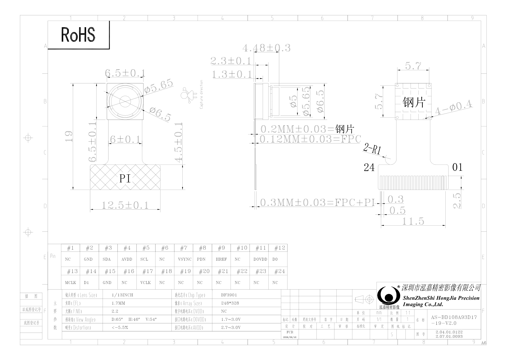

# AS-BD108A93D17-19-V2.0 摄像头模组图纸

> 来源：`AS-BD108A93D17-19-V2.0.pdf`。本文包含 BF3901 摄像头模组的参数、24 引脚定义和机械尺寸，装配方向见完整图纸。未进行实物验证。

## 模组信息
| 项目 | 原图标注 |
| --- | --- |
| 名称 | AS-BD108A93D17-19-V2.0 |
| 厂商 | 深圳市泓嘉精密影像有限公司 / ShenZhenShi HongJia Precision Imaging Co., Ltd. |
| 感光芯片 | BF3901 |
| 镜头尺寸（Lens Size） | 1/13 INCH |
| 焦距（EFL） | 1.7 mm |
| 光圈（F.NO） | 2.2 |
| 视场角 | D: 65°，H: 46°，V: 54° |
| 畸变（Distortion） | ≤ 5.5% |
| 像素（Array Size） | 248 × 328 |
| 数字电路电压（DVDD） | NC |
| 接口电路电压（DOVDD） | 1.7–3.0 V |
| 模拟电路电压（AVDD） | 2.7–3.0 V |
| 图纸单位 | mm |
| 比例 | 1:1 |

## 24 引脚定义

以下是**摄像头模组图纸**的编号，不是转接板 H1 外部排针编号。排线方向、连接器触点面及与转接板 FPC 编号的对应关系需按原图和实物确认。

| 引脚 | 标识 | 引脚 | 标识 |
| --- | --- | --- | --- |
| 1 | NC | 13 | MCLK |
| 2 | GND | 14 | D1 |
| 3 | SDA | 15 | GND |
| 4 | AVDD | 16 | NC |
| 5 | SCL | 17 | VCLK |
| 6 | NC | 18 | NC |
| 7 | VSYNC | 19 | NC |
| 8 | PDN | 20 | NC |
| 9 | HREF | 21 | NC |
| 10 | NC | 22 | NC |
| 11 | DOVDD | 23 | NC |
| 12 | D0 | 24 | NC |

原图第 17 脚印为 `VCLK`，此处照录；其与转接板 `CAM_PCLK` 的实际对应关系待确认。

## 主要机械标注

| 项目 | 原图尺寸（mm） |
| --- | --- |
| 总长 | 19 |
| 镜头区域宽度 | 6.5 ± 0.1 |
| 下部排线区域宽度 | 12.5 ± 0.1 |
| 镜头侧视总厚度标注 | 4.48 ± 0.3 |
| 钢片厚度 | 0.2 ± 0.03 |
| FPC 厚度 | 0.12 ± 0.03 |
| FPC＋PI 厚度 | 0.3 ± 0.03 |
| 排线端标注 | 接点间距 0.5，接点宽度 0.3，相关跨度 11.5 |

其他局部尺寸、圆角及触点方向见完整图纸；上述尺寸仅用于检索，不替代机械装配核对。

相关资料：[接线说明](接线说明.md) · [转接板原理图](SCH_摄像头转接板_2026-10-16.md) · [PCB 图](PCB_摄像头转接板_2026-10-16.md)。

返回：[文档索引](../../README.md)。
