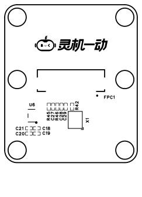
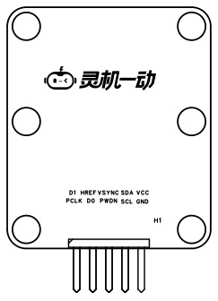

# 摄像头转接板 PCB 图

> 来源：`PCB_摄像头转接板_2026-10-16.pdf`，共 2 页。原文主要为 PCB 图形，以下按原页序收录截图并转录可提取的丝印。图形中的尺寸、焊盘位置和走线以原图为准。

## 原文第 1 页

可提取丝印：`C18`、`C19`、`C20`、`C21`、`C27`、`C28`、`C29`、`R42`、`R45`、`R46`、`U6`、`X1`、`FPC1`。

## 原文第 2 页

本页包含 H1 排针区域及相关丝印。原图两行文字分别为 `D1 HREF VSYNC SDA VCC` 与 `PCLK D0 PWDN SCL GND`。信号名称与观看方向请结合[接线说明](接线说明.md)的背面视角引脚图核对。

## 使用范围

本次仅整理图纸及配套照片，未进行 PCB 制作、通断、供电或摄像头取流验证。完整接线、供电范围和运行步骤待结合[原理图](SCH_摄像头转接板_2026-10-16.md)、[模组图纸](AS-BD108A93D17-19-V2.0.md)与实物确认。

返回：[文档索引](../../README.md)。
