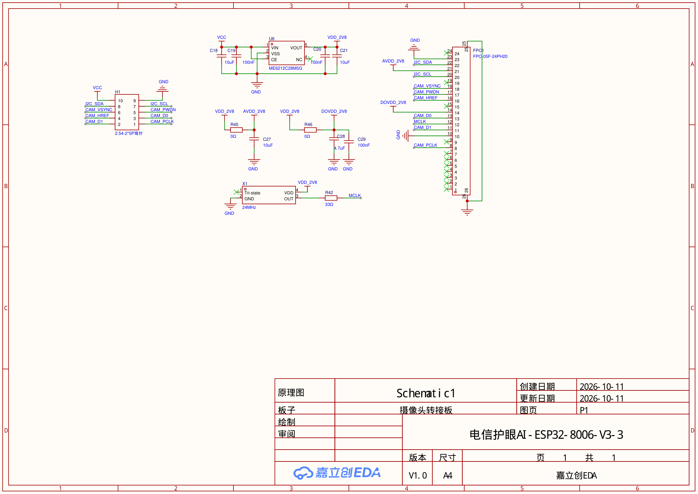

# 摄像头转接板原理图

> 来源：`SCH_摄像头转接板_2026-10-16.pdf`。本文包含电源、时钟、外部排针与排线连接器定义，完整连线见原理图。未进行接线和电气验证。

## 图纸信息
| 项目 | 原图内容 |
| --- | --- |
| 原理图 | Schematic1 |
| 板子 | 摄像头转接板 |
| 创建日期／更新日期 | 2026-10-11 / 2026-10-11 |
| 版本 | V1.0 |
| 图纸尺寸 | A4 |
| 设计工具 | 嘉立创 EDA |
| 标题栏文字 | 电信护眼AI-ESP32-8006-V3-3 |

文件名中的 `2026-10-16` 与图纸标题栏日期不同，此处分别保留。

## 电源与时钟

| 元件／网络 | 原图标注 |
| --- | --- |
| U6 | ME6212C28M5G；VIN 接 VCC，VOUT 为 VDD_2V8 |
| U6 引脚 | 1 VIN、2 VSS、3 CE、4 NC、5 VOUT |
| C18、C19 | 输入侧 10 μF、100 nF |
| C20、C21 | 输出侧 100 nF、10 μF |
| R45、C27 | 0 Ω、10 μF，VDD_2V8 到 AVDD_2V8 支路 |
| R46、C28、C29 | 0 Ω、4.7 μF、100 nF，VDD_2V8 到 DOVDD_2V8 支路 |
| X1 | 24 MHz；引脚为 1 Tri-state、2 GND、3 OUT、4 VDD |
| R42 | 33 Ω，X1 输出到 MCLK 的串联电阻 |

原图外部输入仅标 `VCC`，没有给出完整允许输入电压范围，实际外部供电电压待确认。

## H1 外部排针

H1 标注为 `2.54-2*5P弯针`。下表按**原理图引脚编号**整理，不可直接当作任意观看方向下的左右排列。

| H1 引脚 | 网络 |
| --- | --- |
| 1 | CAM_PCLK |
| 2 | CAM_D1 |
| 3 | CAM_D0 |
| 4 | CAM_HREF |
| 5 | CAM_PWDN |
| 6 | CAM_VSYNC |
| 7 | I2C_SCL |
| 8 | I2C_SDA |
| 9 | GND |
| 10 | VCC |

接线时参照[接线说明](接线说明.md)中的背面视角引脚图，核对排针方向。

## FPC1 排线连接器

FPC1 型号标注为 `FPC-05F-24PH20`。

| FPC1 引脚 | 原理图网络 |
| --- | --- |
| 1–8 | 图中未连接 |
| 9 | CAM_PCLK |
| 10 | 图中未连接 |
| 11 | GND |
| 12 | CAM_D1 |
| 13 | MCLK |
| 14 | CAM_D0 |
| 15 | DOVDD_2V8 |
| 16 | 图中未连接 |
| 17 | CAM_HREF |
| 18 | CAM_PWDN |
| 19 | CAM_VSYNC |
| 20 | 图中未连接 |
| 21 | I2C_SCL |
| 22 | AVDD_2V8 |
| 23 | I2C_SDA |
| 24 | GND |
| 25、26 | GND，连接器固定焊盘 |

摄像头模组图纸与此转接板原理图使用各自的连接器编号；排线触点面和编号映射待按实物核对，不把两份图纸的同号引脚直接等同。

## 项目接入状态

尚未确定开发板到 H1 的完整 GPIO 映射、外部供电及运行步骤。赛题使用“SPI 摄像头”的名称，本图同时列出 I²C 控制与图像数据／同步网络；具体取流模式以 SDK 和实物验证为准。

相关资料：[接线说明](接线说明.md) · [模组尺寸图](AS-BD108A93D17-19-V2.0.md) · [PCB 图](PCB_摄像头转接板_2026-10-16.md)。

返回：[文档索引](../../README.md)。
