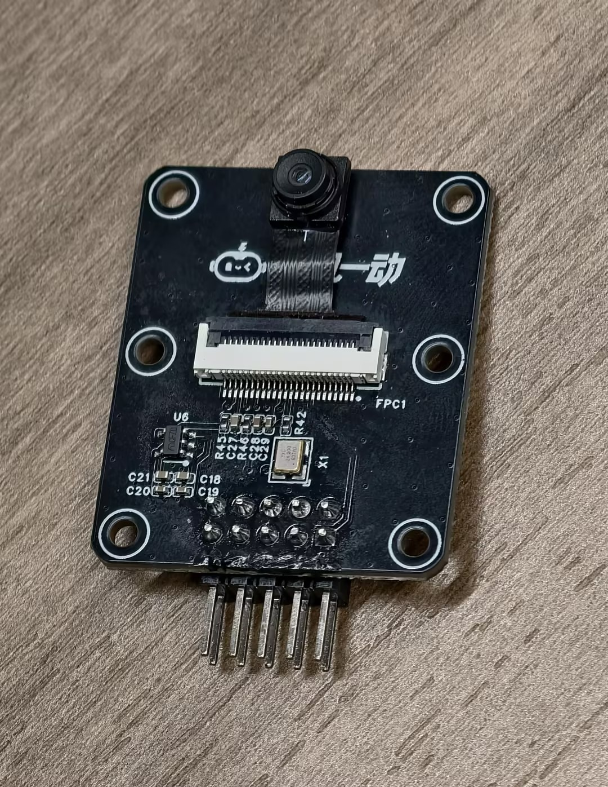
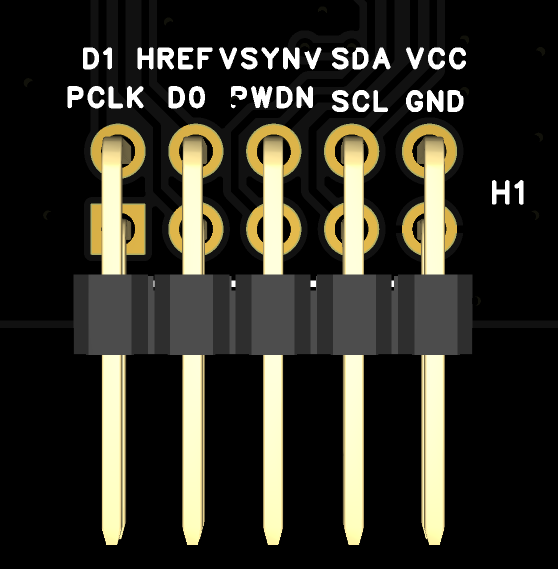
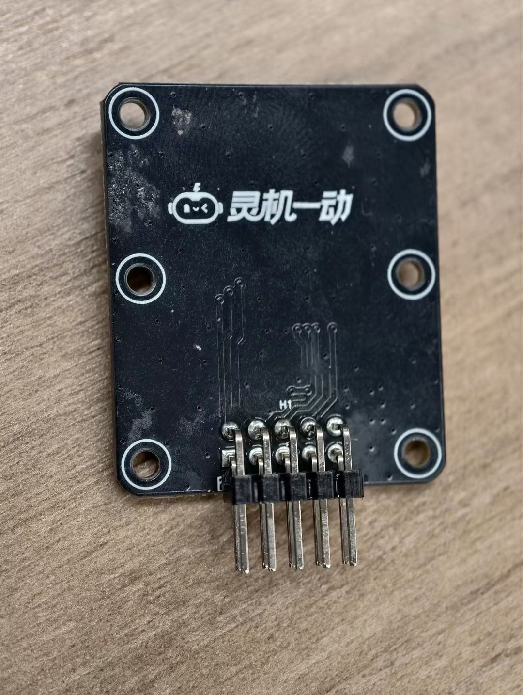
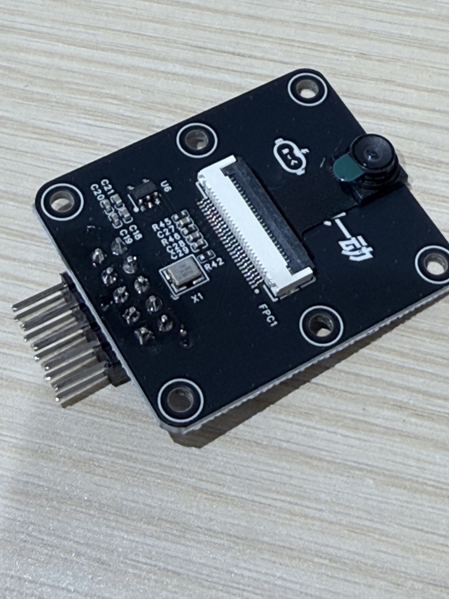
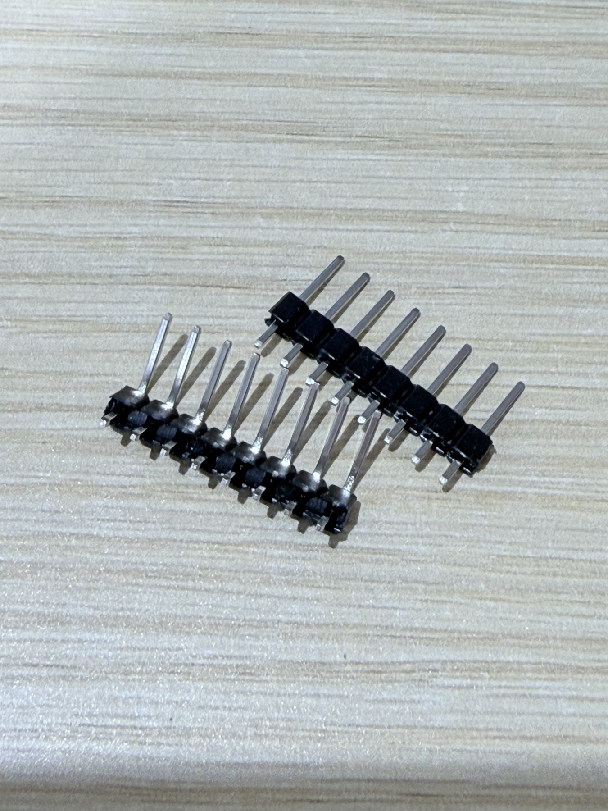
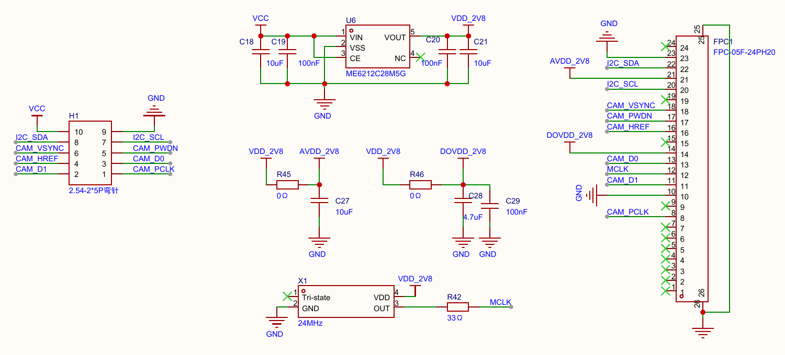
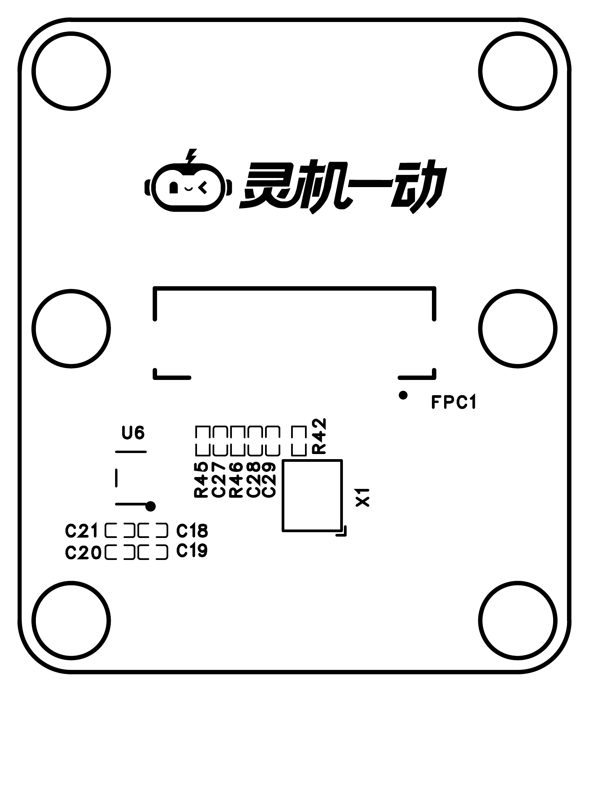
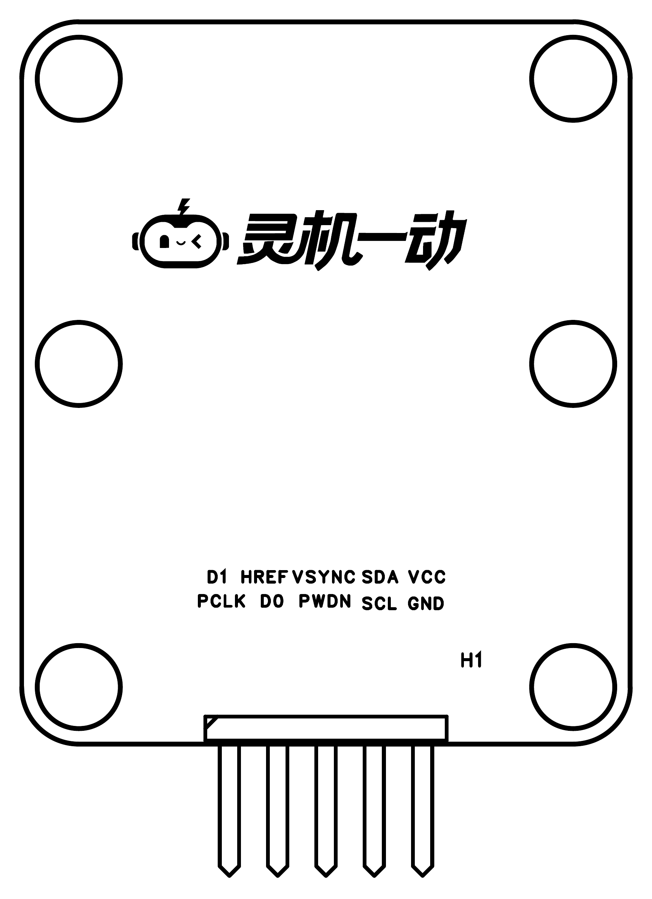

# 摄像头转接板接线与图纸

> 来源：飞书[赛道配件页](https://hcn5szavbjrh.feishu.cn/wiki/BCLzwjxfTi8hSLktJGJcZJ3Ynxf)中的 `接线说明.md` 及三张图片附件；补图日期：2026-10-29。原说明明确引脚图为背面视角；SDK 接线配置见下表，实物取流结果见运行核对记录。

本文合并接线照片、转接板原理图与 PCB 图。摄像头模组本身的尺寸与触点定义仍见[模组图纸](AS-BD108A93D17-19-V2.0.md)。

## 导航

- [摄像头接入](#1-摄像头接入)
- [背面视角与引脚方向](#2-注意方向不要接反)
- [转接板原理图](#schematic)：电源、时钟、H1 排针与 FPC1 网络
- [PCB 布局](#pcb)：元件面与排针面

## 1. 摄像头接入

将摄像头插入转接板排线，注意正反面方向。排线触点面与连接器方向待按实物核对。原说明给出的正面参考如下：

## 2. 注意方向，不要接反

原资料的引脚编号以转接板背面视角为准，接线时请注意不要接反。实际接线应核对实物丝印与[转接板原理图的 H1 引脚表](#h1-外部排针)，不可将编号直接当作任意观看方向下的左右排列；具体引脚位置待实物确认。

引脚图中的信号排列可转录为文字（仅对应上图的背面视角）：

| 图中行 | 从左到右的丝印 |
| --- | --- |
| 上行 | D1、HREF、VSYNC、SDA、VCC |
| 下行 | PCLK、D0、PWDN、SCL、GND |

此表不替代原理图的 H1 编号；翻到正面时不能照抄同一左右次序。

### 当前 SDK 接线配置

依据 `src/firmware/apps/main/peripheral/bsp_camera.h` 与 `bsp_camera.c`，当前驱动按 1-bit SPI 接收 BF3901 图像。以下是代码要求的接线，不能作为已取得有效图像的证明。用户于 2026-10-29 确认已按此接线，尚未逐线实测通断。

| 转接板信号 | 开发板丝印／GPIO | 说明 |
| --- | --- | --- |
| VCC | 3V3 | 当前 SDK 注释要求 3.3V，不接 5V；原理图未给出完整输入范围 |
| GND | GND | 共地 |
| SDA | P21／GPIO21 | SCCB／I²C 配置数据 |
| SCL | P47／GPIO47 | SCCB／I²C 配置时钟 |
| VSYNC | P4／GPIO4 | 驱动中的 CS；不要误接 HREF |
| PCLK | P13／GPIO13 | 驱动中的 SCLK |
| D0 | P8／GPIO8 | 驱动中的 DATA0 |
| PWDN | P41／GPIO41 | 启动时程序脉冲后保持低电平 |
| HREF、D1 | 不接 | 当前 1-bit 模式不用 |

板上自带 24 MHz 时钟，当前配置不外接 XCLK。GPIO4 与默认舵机、GPIO8 与默认 MPU6050 配置冲突；当前应用中这两个外设的初始化调用均被注释。

断电后接线。本次工作区配置 `CONFIG_APP_CAMERA_TEST=1`、`CONFIG_QM_POSE_SUPPORT=1`，开机准备模型和接收缓冲，正常应用初始化结束后自动开始本地采集，不依赖连云。完整帧按限频复制给独立姿态任务，结果从串口查看；构建、烧录、方向配置和日志解释统一见[实时坐姿检测运行说明](../../开发/摄像头实时坐姿检测运行说明.md)。`early init ok` 只表示初始化完成；`got ... frames good=...` 只验证帧长度；真人检测需核对 `camera pose frame=` 结果和现场姿势。

验证边界：此前灯圈联调观察到取流后异常重启，并通过关闭摄像头隔离。2026-10-30 用户重插 USB 后已成功烧录；修正摄像头专用 S3 DMA／PSRAM 缓存处理及日志格式后，45 秒实测接收 1230 帧、1226 帧完整，12 次推理输出，未见异常重启。检测输出为无人或无法判定，真人准确率和长期稳定性仍待验收。历史证据见[运行记录](../../开发/开发板首次运行核对记录.md#2026-10-30-ws2812-灯圈上电测试)。

## 3. 配件页补充实物

弯针照片用于辨认配件形态，不提供焊接朝向；焊接、排线锁扣与最终装配方向待按 PCB、原理图和实物共同确认。

## 4. 转接板原理图

来源：`SCH_摄像头转接板_2026-10-16.pdf`；原件核对／补图日期：2026-10-29。以下保留原图的电源、时钟、外部排针与排线连接器定义，未进行接线和电气验证。

### 图纸信息

| 项目 | 原图内容 |
| --- | --- |
| 原理图 | Schematic1 |
| 板子 | 摄像头转接板 |
| 创建日期／更新日期 | 2026-10-11 / 2026-10-11 |
| 版本 | V1.0 |
| 图纸尺寸 | A4 |
| 设计工具 | 嘉立创 EDA |
| 标题栏文字 | 电信护眼AI-ESP32-8006-V3-3 |

文件名中的 `2026-10-16` 与图纸标题栏日期不同，此处分别保留。

### 完整电路

原 PDF 第 1 页图形区域。

### 电源与时钟

| 元件／网络 | 原图标注 |
| --- | --- |
| U6 | ME6212C28M5G；VIN 接 VCC，VOUT 为 VDD_2V8 |
| U6 引脚 | 1 VIN、2 VSS、3 CE、4 NC、5 VOUT |
| C18、C19 | 输入侧 10 μF、100 nF |
| C20、C21 | 输出侧 100 nF、10 μF |
| R45、C27 | 0 Ω、10 μF，VDD_2V8 到 AVDD_2V8 支路 |
| R46、C28、C29 | 0 Ω、4.7 μF、100 nF，VDD_2V8 到 DOVDD_2V8 支路 |
| X1 | 24 MHz；引脚为 1 Tri-state、2 GND、3 OUT、4 VDD |
| R42 | 33 Ω，X1 输出到 MCLK 的串联电阻 |

原图外部输入仅标 `VCC`，没有给出完整允许输入电压范围，实际外部供电电压待确认。

### H1 外部排针

H1 标注为 `2.54-2*5P弯针`。下表按**原理图引脚编号**整理，不可直接当作任意观看方向下的左右排列。

| H1 引脚 | 网络 |
| --- | --- |
| 1 | CAM_PCLK |
| 2 | CAM_D1 |
| 3 | CAM_D0 |
| 4 | CAM_HREF |
| 5 | CAM_PWDN |
| 6 | CAM_VSYNC |
| 7 | I2C_SCL |
| 8 | I2C_SDA |
| 9 | GND |
| 10 | VCC |

接线时结合[接线说明](#2-注意方向不要接反)、上表与实物丝印核对排针方向。

### FPC1 排线连接器

FPC1 型号标注为 `FPC-05F-24PH20`。

| FPC1 引脚 | 原理图网络 |
| --- | --- |
| 1–8 | 图中未连接 |
| 9 | CAM_PCLK |
| 10 | 图中未连接 |
| 11 | GND |
| 12 | CAM_D1 |
| 13 | MCLK |
| 14 | CAM_D0 |
| 15 | DOVDD_2V8 |
| 16 | 图中未连接 |
| 17 | CAM_HREF |
| 18 | CAM_PWDN |
| 19 | CAM_VSYNC |
| 20 | 图中未连接 |
| 21 | I2C_SCL |
| 22 | AVDD_2V8 |
| 23 | I2C_SDA |
| 24 | GND |
| 25、26 | GND，连接器固定焊盘 |

摄像头模组图纸与此转接板原理图使用各自的连接器编号；排线触点面和编号映射待按实物核对，不把两份图纸的同号引脚直接等同。

### 项目接入状态

当前 SDK 接线与运行步骤见上方“当前 SDK 接线配置”。赛题使用“SPI 摄像头”的名称，本图同时列出 I²C 控制与图像数据／同步网络；当前代码采用 1-bit SPI，实物验证范围以运行核对记录为准。

## 5. PCB 布局

来源：`PCB_摄像头转接板_2026-10-16.pdf`；原件核对／补图日期：2026-10-29。尺寸、焊盘与走线需按原设计和实物核对。

### 元件与 FPC 连接器布局

原 PDF 第 1 页图形区域。

丝印标识：`C18`、`C19`、`C20`、`C21`、`C27`、`C28`、`C29`、`R42`、`R45`、`R46`、`U6`、`X1`、`FPC1`。

### H1 排针布局与丝印

原 PDF 第 2 页图形区域。

H1 排针区域的两行丝印分别为 `D1 HREF VSYNC SDA VCC` 与 `PCLK D0 PWDN SCL GND`。信号名称与观看方向请结合[接线说明](#2-注意方向不要接反)和实物丝印核对。

以上 PCB 资料整理不包含制作、通断或供电测试；完整允许供电范围仍待确认。项目采用的 SDK 接线配置见上文，实物取流状态见[首次运行核对记录](../../开发/开发板首次运行核对记录.md)。

返回：[配件清单](../赛道配件清单与实物图.md) · [文档索引](../../README.md)。
