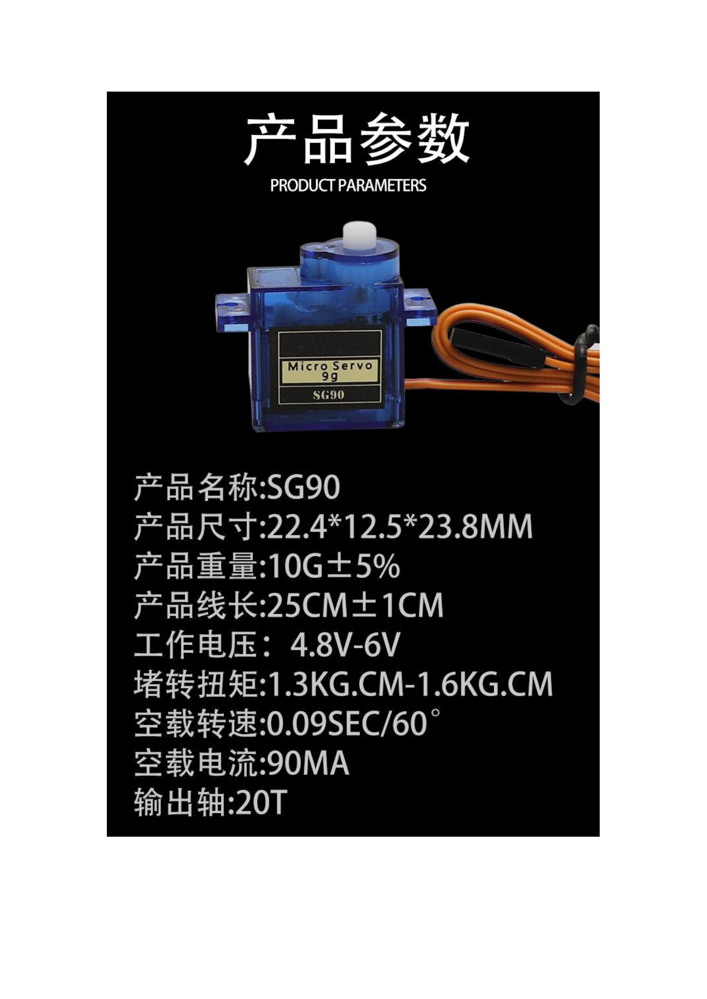
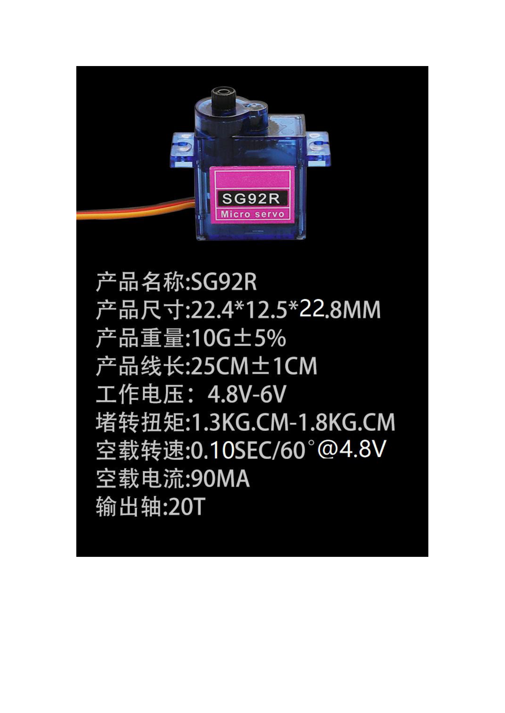
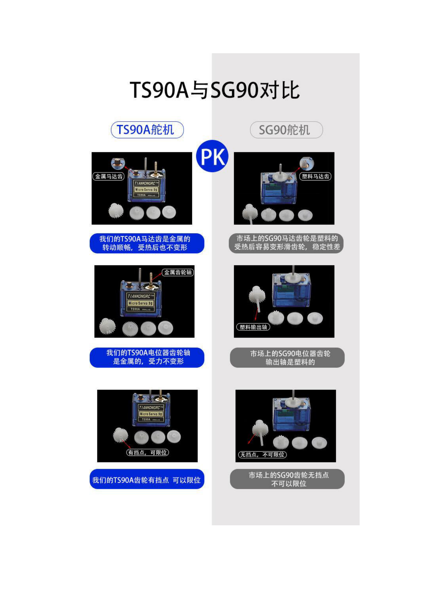
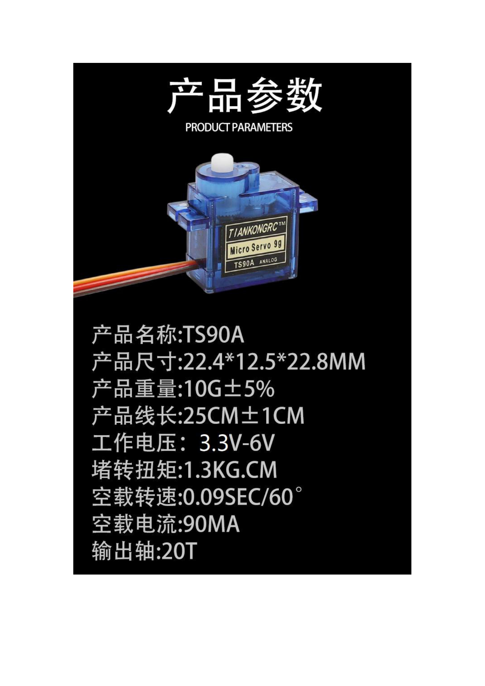
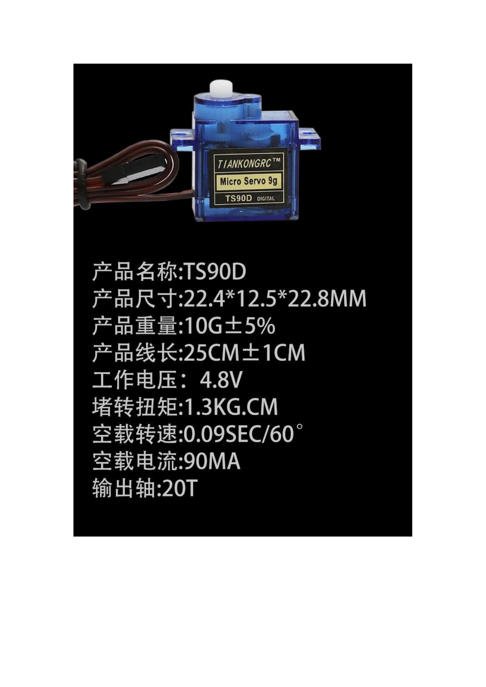
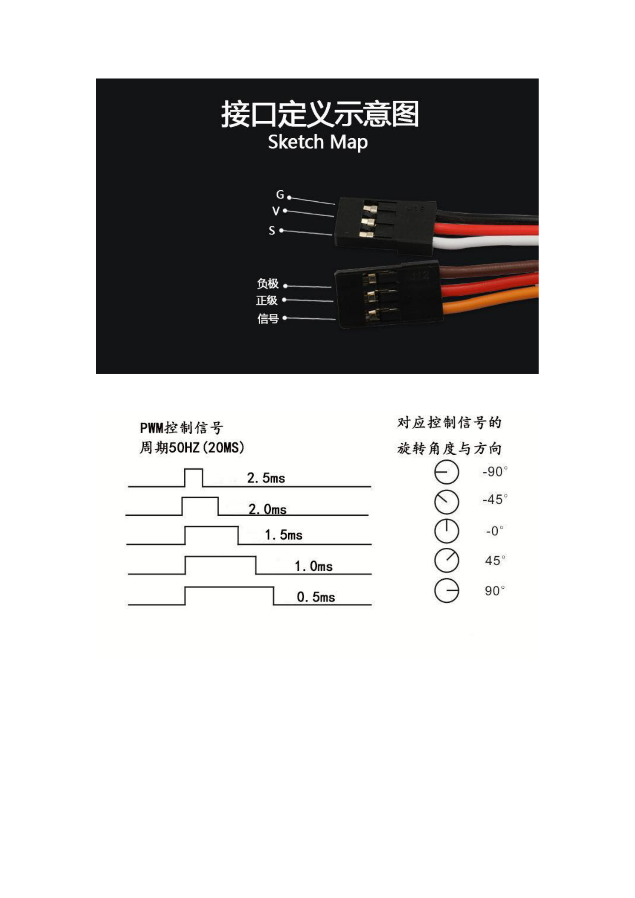
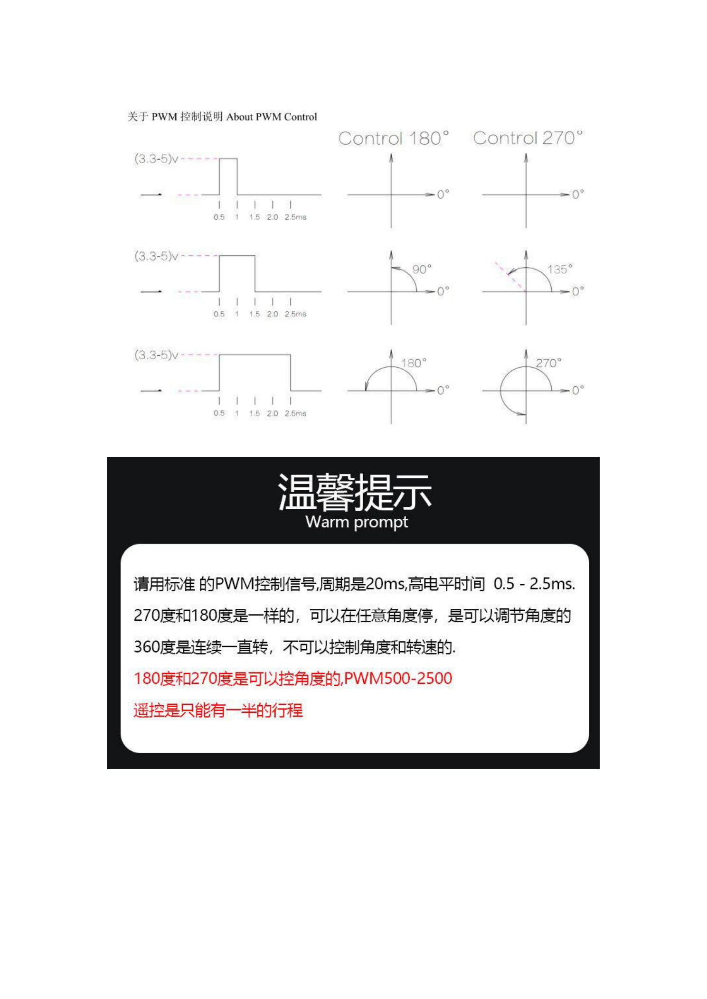

# 舵机参数与 PWM 控制说明

> 来源：`舵机.pdf`，共 9 页。原文以图片为主，以下逐页转录可辨认文字和参数表，仅在含实物、接口或 PWM 波形图时引用图片。参数和对比结论为原资料标注，未进行实物验证；参赛套件实际舵机型号、角度版本和供电能力待确认。

## 原文第 1 页：SG90

| 项目 | 原资料参数 |
| --- | --- |
| 产品名称 | SG90 |
| 产品尺寸 | 22.4 × 12.5 × 23.8 mm |
| 产品重量 | 10 g ± 5% |
| 产品线长 | 25 cm ± 1 cm |
| 工作电压 | 4.8–6 V |
| 堵转扭矩 | 1.3–1.6 kg·cm |
| 空载转速 | 0.09 s / 60° |
| 空载电流 | 90 mA |
| 输出轴 | 20T |

## 原文第 2 页：SG92R

| 项目 | 原资料参数 |
| --- | --- |
| 产品名称 | SG92R |
| 产品尺寸 | 22.4 × 12.5 × 22.8 mm |
| 产品重量 | 10 g ± 5% |
| 产品线长 | 25 cm ± 1 cm |
| 工作电压 | 4.8–6 V |
| 堵转扭矩 | 1.3–1.8 kg·cm |
| 空载转速 | 0.10 s / 60°，@ 4.8 V |
| 空载电流 | 90 mA |
| 输出轴 | 20T |

## 原文第 3 页：TS90A 与 SG90 对比

下表仅转录原资料的产品对比描述，不代表对所有同名产品的独立验证。

| 对比项 | 原资料所示 TS90A | 原资料所示 SG90 |
| --- | --- | --- |
| 马达齿 | 金属；原文称转动顺畅、受热后不变形 | 塑料；原文称受热后容易变形、滑齿 |
| 电位器齿轮轴／输出轴 | 金属，原文称受力不变形 | 塑料 |
| 齿轮挡点 | 有挡点，可以限位 | 无挡点，不可以限位 |

## 原文第 4 页：TS90A

| 项目 | 原资料参数 |
| --- | --- |
| 产品名称 | TS90A |
| 产品尺寸 | 22.4 × 12.5 × 22.8 mm |
| 产品重量 | 10 g ± 5% |
| 产品线长 | 25 cm ± 1 cm |
| 工作电压 | 3.3–6 V |
| 堵转扭矩 | 1.3 kg·cm |
| 空载转速 | 0.09 s / 60° |
| 空载电流 | 90 mA |
| 输出轴 | 20T |

## 原文第 5 页：TS90D

| 项目 | 原资料参数 |
| --- | --- |
| 产品名称 | TS90D |
| 产品尺寸 | 22.4 × 12.5 × 22.8 mm |
| 产品重量 | 10 g ± 5% |
| 产品线长 | 25 cm ± 1 cm |
| 工作电压 | 4.8 V |
| 堵转扭矩 | 1.3 kg·cm |
| 空载转速 | 0.09 s / 60° |
| 空载电流 | 90 mA |
| 输出轴 | 20T |

## 原文第 6 页：MG90

| 分类 | 项目 | 原资料参数 |
| --- | --- | --- |
| 机械规格 | 外观尺寸 | 22.4 × 12.1 × 22.8 mm |
| 机械规格 | 机构极限角度 | 200° ± 5° |
| 机械规格 | 出力轴 | 20T，直径 4.9 mm |
| 电气特性 | 工作电压 | 4.8–6 V |
| 电气特性 | 空载速度 | 0.09 s / 60°，@ 6 V |
| 电气特性 | 空载电流 | 90 mA，@ 6 V |
| 电气特性 | 堵转扭矩 | 2.0 kg·cm，@ 6 V |
| 电气特性 | 堵转电流 | 860 mA ± 10% |
| 控制特性 | 控制信号 | 原文为 “Pulse width modification” |
| 控制特性 | 控制系统类型 | Analog controller |
| 控制特性 | 中点位置 | 1500 μs |
| 控制特性 | 脉宽范围 | 500–2500 μs |

## 原文第 7 页：TS90

| 分类 | 项目 | 原资料参数 |
| --- | --- | --- |
| 机械规格 | 外观尺寸 | 22.4 × 12.5 × 22.8 mm |
| 机械规格 | 机构极限角度 | 200° ± 5° |
| 机械规格 | 出力轴 | 20T，直径 4.9 mm |
| 电气特性 | 工作电压 | 4.8–6 V |
| 电气特性 | 空载速度 | 0.11 s / 60° |
| 电气特性 | 空载电流 | 220 mA，@ 6 V |
| 电气特性 | 堵转扭矩 | 2.2 kg·cm，@ 6 V |
| 电气特性 | 堵转电流 | 800 mA ± 10% |
| 电气特性 | 静态电流 | 5–6 mA |
| 控制特性 | 控制信号 | 原文为 “Pulse width modification” |
| 控制特性 | 控制系统类型 | Analog controller |
| 控制特性 | 中点位置 | 1500 μs |
| 控制特性 | 脉宽范围 | 500–2500 μs |

## 原文第 8 页：接口定义与 PWM

| 接口标识 | 含义 | 原图线色 |
| --- | --- | --- |
| G / 负极 | 电源负极 | 棕色 |
| V / 正极 | 电源正极 | 红色 |
| S / 信号 | PWM 控制信号 | 橙色 |

原图标注控制信号周期为 50 Hz（20 ms），脉宽与相对旋转方向示意如下。表中角度是该图的相对角度标注，实际机械角度需按具体型号确认。

| 高电平脉宽 | 图示角度 |
| --- | --- |
| 2.5 ms | −90° |
| 2.0 ms | −45° |
| 1.5 ms | 0° |
| 1.0 ms | 45° |
| 0.5 ms | 90° |

## 原文第 9 页：PWM 控制说明

原图标注信号高电平为 3.3–5 V，比较 180° 与 270° 版本在不同脉宽下的位置：

| 高电平脉宽 | 180° 版本图示 | 270° 版本图示 |
| --- | --- | --- |
| 0.5 ms | 0° | 0° |
| 1.5 ms | 90° | 135° |
| 2.5 ms | 180° | 270° |

原资料提示：

- 使用标准 PWM 控制信号，周期为 20 ms，高电平时间为 0.5–2.5 ms。
- 180° 和 270° 版本可调整角度并在任意角度停止，原文标注 “PWM500-2500”。
- 360° 版本连续旋转，原文称“不可控制角度和转速”；该表述仅作为原资料转录，具体连续旋转型号的控制能力待确认。
- 原文另注“遥控是只能有一半的行程”，适用遥控器及条件未说明，待确认。

## 项目接入状态

本次仅整理资料，未进行舵机接线、烧录或动作验证。开发板手册列出舵机 PWM 使用 GPIO4，并提示其与摄像头 CS 复用；最终接线、供电方案、可用引脚和运行步骤待实现时确认，参见[开发板手册](../开发板/灵机XJWB03标准开发板使用文档.md)。

返回：[文档索引](../../README.md)。
