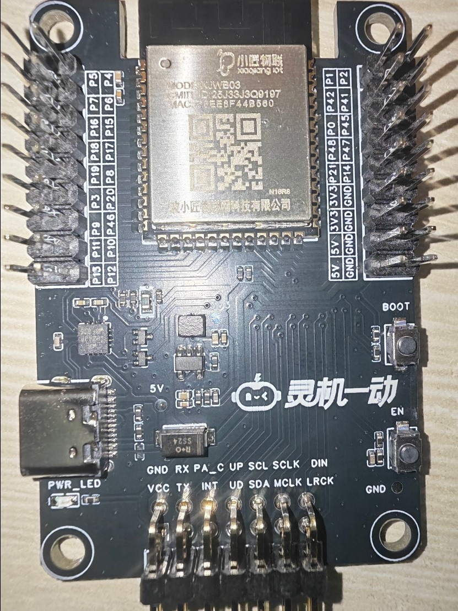
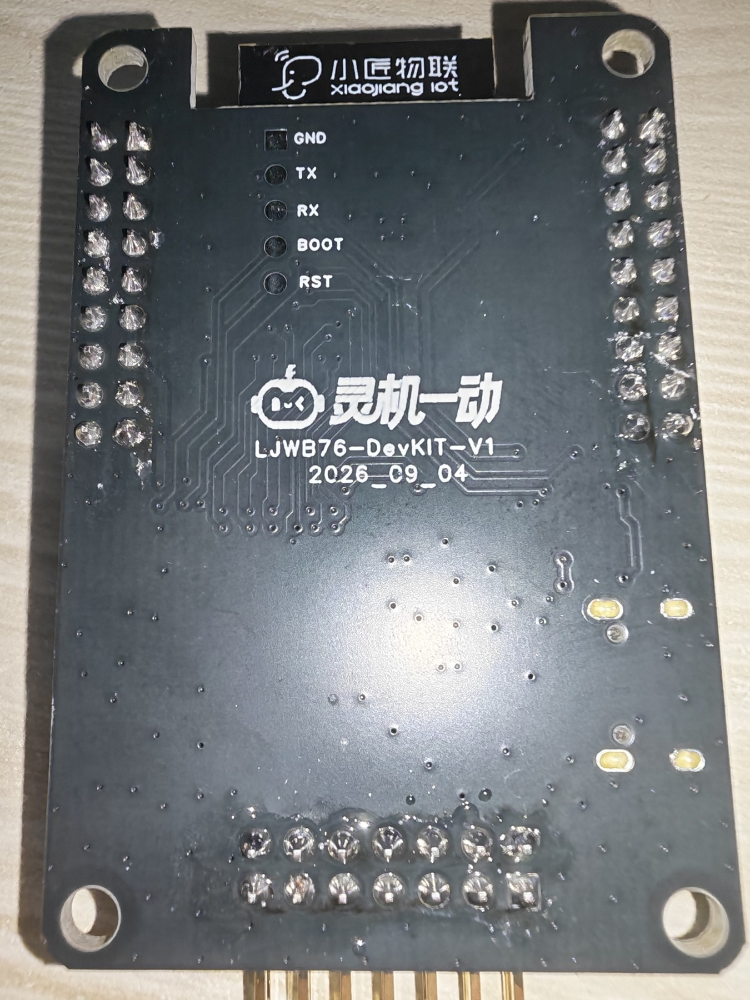
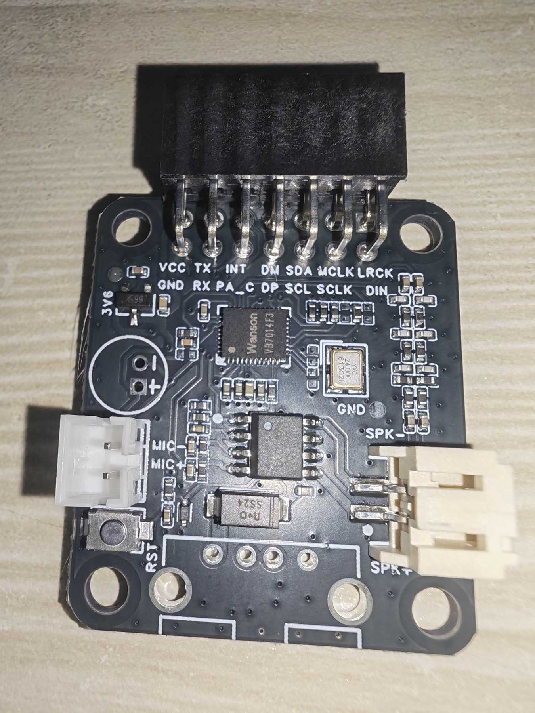
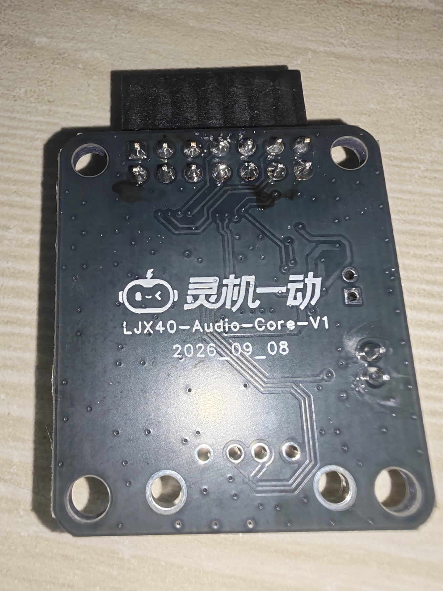
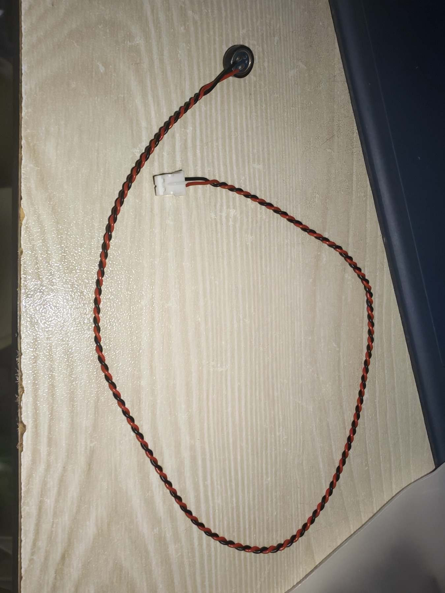
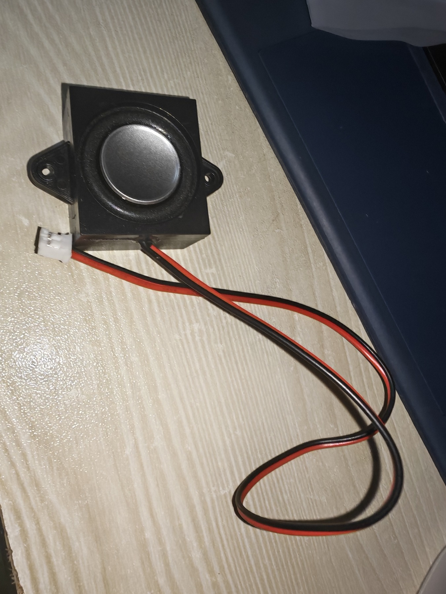
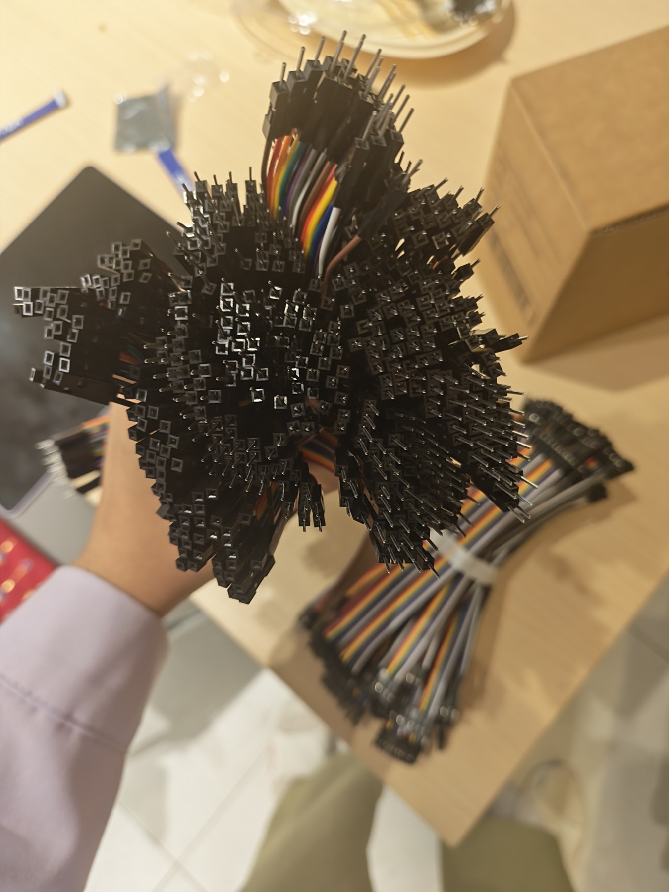

# 灵机一动 AI＋硬件赛道配件清单与实物图

> 来源：[灵机一动AI+硬件赛道配件图](https://hcn5szavbjrh.feishu.cn/wiki/BCLzwjxfTi8hSLktJGJcZJ3Ynxf)；核对日期：2026-10-29。
> 本文记录该页可见配件、实物照片及附件与本地文档的对应关系。“已发 30”等是主办方页面的发放备注，不表示本团队已收到或清点了对应数量。照片属于来源资料，不能代替本团队实物验收；接线、供电及运行验证以各模块文档与调试记录为准。

## 导航

- [配件清单](#配件清单)
- [主控板与语音板实物](#主控板与语音板实物)
- [麦克风扬声器与杜邦线](#麦克风扬声器与杜邦线)
- [附件与本地文档对应](#附件与本地文档对应)
- [本次补充与核对范围](#本次补充与核对范围)
- [官方入口](#官方入口)

## 配件清单

原页面编号存在重复且排列不连续，下表保留原编号，不重新推断数量。

| 原编号／条目 | 配件 | 页面发放备注 | 本地资料与实物图 |
| --- | --- | --- | --- |
| 1 | 主控板 | 已发 30 | [本页主控板照片](#主控板与语音板实物)；[开发板手册](开发板/灵机XJWB03标准开发板使用文档.md) |
| 2 | 语音板 | 已发 30 | [本页语音板照片](#主控板与语音板实物) |
| 3 | 麦克风 | 已发 30 | [本页音频配件照片](#麦克风扬声器与杜邦线) |
| 4 | 扬声器 | 已发 30 | [本页音频配件照片](#麦克风扬声器与杜邦线) |
| 5＆6 | 摄像头＆摄像头板 | 已发 30 | [摄像头接线说明与正反面照片](摄像头/接线说明.md) |
| 转接板引脚 | 摄像头转接板弯针 | 未单独标注数量 | [弯针实物与背面视角引脚图](摄像头/接线说明.md) |
| 7 | 杜邦线：双公线、双母线、一公一母线 | 未标注数量 | [本页杜邦线照片](#麦克风扬声器与杜邦线) |
| 8 | 六轴传感器 | 已发 30 | [模块原理图与实物](MPU6050/MPU6050-V1-SCH.md) |
| 9 | 舵机 | 一份两个，已发 30 份 | [舵机参数与实物](舵机/舵机.md) |
| 9（原文重复编号） | 舵机配套白色塑料舵机臂 | 未单独标注数量 | [舵机臂照片](舵机/舵机.md#套件实物与装配配件) |
| 10 | 灯板（照片为环形灯板） | 未标注数量 | [WS2812 数据手册与灯圈实物](WS2812灯圈/WS2812_Datasheet.md) |
| 11 | 震动马达 | 已发 30 | [模块接口与实物](震动马达/震动马达.md) |
| 无标题配图 | 螺丝照片 | 未命名、未说明用途和数量 | [舵机文档中的原图记录](舵机/舵机.md#套件实物与装配配件)；所属配件待确认 |

## 主控板与语音板实物

### 主控板

背面丝印可见 `LJWB76-DevKIT-V1`、`2026_09_04`，并有 `GND`、`TX`、`RX`、`BOOT`、`RST` 标识。照片正面可见 `BOOT` 与 `EN` 按钮。手册名称为 `XJWB03-DevKIT-V1`，赛题使用 `LJWB03`：这些名称的对应关系、照片是否与本团队板卡同一硬件版本，均待确认。不能据照片将某按钮认定为 GPIO14 配网键。

### 语音板

背面丝印为 `LJX40-Audio-Core-V1`、`2026_09_08`；手册写作 `LJX40-Audio-KIT-V1`，对应关系待确认。正面可见麦克风及扬声器插座，实际插接应结合[首次运行核对记录](../开发/开发板首次运行核对记录.md)中的接线纠正，不能只按插座外观判断。

## 麦克风扬声器与杜邦线

### 麦克风

页面未给出麦克风型号、电气参数或接头针序；与语音板的对应接口应按丝印和实物核对。

### 扬声器

页面未给出扬声器阻抗、额定功率或型号，不能据照片补写。

### 杜邦线

原文列出公对公、母对母、公对母三种接头组合，没有标注长度、线规及每种根数。使用前按实际排针方向和接头类型选择。

## 附件与本地文档对应

配件页共有 **13 个非图片附件**及 **18 张图片**（含 3 个作为附件提供的图片）。PDF 均整理为 Markdown，原件仅用于本次核对与截取，不放入 `docs/`；已有 ZIP 和例程继续保留。

| 原页面附件名 | 本地文档 | 本次处理 |
| --- | --- | --- |
| 舵机.pdf | [舵机参数与 PWM 控制说明](舵机/舵机.md) | 参数表保留文字；补外观、齿轮、三线接口、角度与 PWM 图 |
| WS2812_Datasheet.pdf | [WS2812 数据手册](WS2812灯圈/WS2812_Datasheet.md) | 保留文字和表格，补尺寸、引脚、级联、应用电路及包装方向图 |
| WS2812灯圈.zip | [参考例程说明](WS2812灯圈/参考例程说明.md) | 已有 ZIP 和解压例程；核对来源，不执行例程 |
| 震动马达.pdf | [震动马达模块说明](震动马达/震动马达.md) | 参数保留文字，补接口面与背面图片 |
| MPU6050-V1-SCH.pdf | [模块原理图](MPU6050/MPU6050-V1-SCH.md) | 补完整电路区域截图 |
| PS-MPU-6000A-EN.pdf | [产品规格书](MPU6050/PS-MPU-6000A-EN.md) | 补电路、方向、时序、封装与装配图；参数表保留文字 |
| RM-MPU-6000A-EN.pdf | [寄存器手册](MPU6050/RM-MPU-6000A-EN.md) | 核对为寄存器、位字段、说明文字，沿用文字整理 |
| 关于MPU6050模块新版本兼容问题的解决方案2.pdf | [版本兼容说明](MPU6050/关于MPU6050模块新版本兼容问题的解决方案2.md) | 表格与代码保留文字，原图红框位置的矛盾继续显式说明 |
| AS-BD108A93D17-19-V2.0.pdf | [摄像头模组图纸](摄像头/AS-BD108A93D17-19-V2.0.md) | 裁出机械与触点方向图；下方参数和引脚表保留文字 |
| PCB_摄像头转接板_2026-10-16.pdf | [PCB 图](摄像头/接线说明.md#pcb) | 补两页 PCB 图形，保留元件面与排针面布局 |
| SCH_摄像头转接板_2026-10-16.pdf | [转接板原理图](摄像头/接线说明.md#schematic) | 裁出电路区域，接口表继续保留文字 |
| 接线说明.md | [接线说明](摄像头/接线说明.md) | 恢复原文三张相对路径图片引用，增加配件页转接板及弯针照片 |
| 灵机XJWB03标准开发板使用文档.pdf | [开发板手册](开发板/灵机XJWB03标准开发板使用文档.md) | 补手册末页开发板／语音板照片；保留本地调试补充 |
| 转接板正面实拍图.jpg | [摄像头接线说明](摄像头/接线说明.md) | 保存至该目录 img/ |
| 转接板背面实拍图.jpg | [摄像头接线说明](摄像头/接线说明.md) | 保存至该目录 img/ |
| 转接板引脚图.png | [摄像头接线说明](摄像头/接线说明.md) | 保存至该目录 img/，明确背面视角 |

上表包含 13 个非图片附件和 3 个图片附件；另外 15 张页面内嵌图片分别在本页与对应模块文档引用，避免重复保存。

## 本次补充与核对范围

- 新增原页面的配件条目、发放备注、主控／语音／音频配件／杜邦线实物资料，以及已存在文档的在线来源。
- 对照配件页全部附件；文字、参数表、引脚表、代码及寄存器说明继续使用 Markdown，仅为实物、电路、布局、封装、波形等图形保存图片。
- 飞书照片以可读分辨率保存，PDF 图形使用 Poppler 渲染后按图形区域裁切；图片均放在引用文档所在目录的 `img/`。PCB 极小页面保留其完整图形区域。
- 赛题正文的 AI＋硬件部分已对照在线可读文本，现有技术要求与交付物无需重复新增。设备附页为嵌入表格，本次未获取其单元格内容；上面的配件清单来自独立配件页，不能替代附页或本团队实收清单。
- 选手手册只补充从在线可读部分确认的来源和链接；后续分页的评分、Q&A 与嵌入 PoC 内容沿用既有截图整理，其缺失及矛盾没有据此消除。
- 未进行硬件接线、供电、编译、烧录或外设功能验证；本地实测结论仍以[首次运行核对记录](../开发/开发板首次运行核对记录.md)为准。

## 官方入口

| 用途 | 来源链接 | 对应本地资料 |
| --- | --- | --- |
| 配件图与附件 | [飞书配件页](https://hcn5szavbjrh.feishu.cn/wiki/BCLzwjxfTi8hSLktJGJcZJ3Ynxf) | 本文及各模块文档 |
| 平台首页 | [灵机一动](https://www.ljyd.cn/) | [开发板手册链接汇总](开发板/灵机XJWB03标准开发板使用文档.md#links) |
| 赛题 | [黑客松赛题](https://hcn5szavbjrh.feishu.cn/wiki/H4XzwHiFBih2cskSPK6ckkPrnjb) | [AI＋硬件赛题说明](../赛题/AI硬件赛题说明.md) |
| 选手手册 | [INTERCITY HACK宁波站 · 选手手册](https://hcn5szavbjrh.feishu.cn/wiki/D0ZuwMQNTiLeG4ks8CSccCWAnoh) | [AI＋硬件参赛版](../赛事/选手手册.md) |

返回：[项目文档索引](../README.md)。
