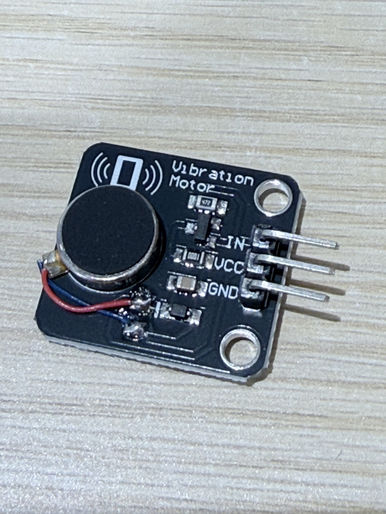
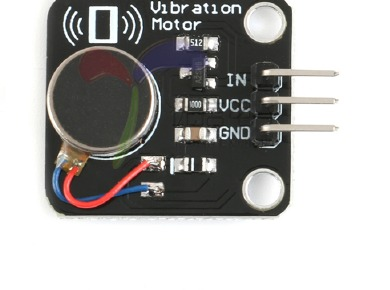
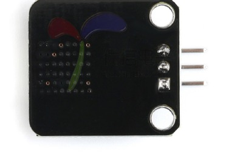

# 震动马达模块说明

> 在线来源与配件对应：[赛道配件清单与实物图](../赛道配件清单与实物图.md)；原件核对／补图日期：2026-10-29。

> 来源：`震动马达.pdf`。本文包含模块参数、MOS 驱动特性与控制接口。具体模块型号未标明，实物型号、供电和触发兼容性待确认，未进行实物验证。

## 产品概述

原文名称：“震动马达模块／直流电机手机震动器”，英文为 “Vibration Motor”。

这是适合作为非可听指示器的小型振动马达。当输入为高电平时，电动机会震动，类似处于静音模式的手机。

## 产品参数

| 项目 | 原资料标注 |
| --- | --- |
| 额定电压 | 5.0 V DC |
| 工作电压 | 3.0–5.3 V DC |
| 额定转速 | 最小 9000 转／分钟 |
| 额定电流 | 最大 60 mA |
| 起动电流 | 最大 90 mA |
| 启动电压 | DC 3.7 V |
| 绝缘电阻 | 10 MΩ |
| 兼容性 | UNO R3 / Mega2560；适用于 DIY 项目 |

原资料的技术规格表还列出：

| 项目 | 原资料标注 |
| --- | --- |
| 模块尺寸 | 21 × 30 mm |
| 固定孔 | 3 mm |
| 孔距 | 15 mm |
| 电压 | 5 V |
| 端口 | 数字量 |
| 马达 | 直径 10 mm，厚度 2.7 mm，扁平马达 |
| 驱动 | MOS 管，高电平触发、低电平截止 |
| 平台 | Arduino、单片机 |

## 产品特性

- 采用手机震动马达，原文称震动效果明显。
- 使用 MOS 放大驱动，可通过 Arduino 数字端口控制。
- 可通过 PWM 控制马达的震动强度。
- 将电信号转换为机械震动感。
- 适用于震动感互动产品、可穿戴智能设备震动提醒等。

## 接口与接入状态

原资料的接口标识为 `IN`、`VCC`、`GND`，接线应以实物丝印为准。

| 标识 | 含义 |
| --- | --- |
| IN | 控制输入；原资料标注高电平触发 |
| VCC | 模块电源 |
| GND | 电源与信号地 |

本次未接线、未运行 PWM 或震动验证。开发板手册列出 GPIO5 用于振动马达，经三极管／MOS 驱动、马达电源独立提供。实际供电电压、控制电平、是否使用此自带 MOS 模块及运行步骤待确认，参见[开发板手册](../开发板/灵机XJWB03标准开发板使用文档.md)。

## 实物与接口面

原 PDF 第 1 页图形区域。

原 PDF 第 1 页图形区域。

原图接口顺序须在同一观察方向下使用；实际接线仍以板上 `IN / VCC / GND` 丝印为准。

返回：[文档索引](../../README.md)。
